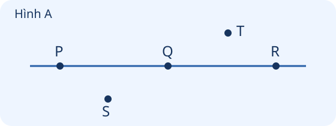
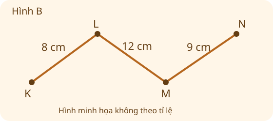

# Ôn tập hình học và đo lường

Nguồn tham khảo: Toán 3 KNTT, tập 1, trang 21-23.

Trạng thái: AI biên soạn và rà soát; chưa có xác nhận của giáo viên.

## Mục tiêu

- Nhận biết khối cầu, khối trụ, khối lập phương, khối hộp chữ nhật và các điểm thẳng hàng.
- Tính độ dài đường gấp khúc; vận dụng đơn vị cm, m, kg, lít.
- Đọc giờ, xác định ngày liền trước, liền sau và các thứ trong tuần.

## Khám phá

Hình học giúp mô tả đồ vật; đo lường giúp trả lời dài bao nhiêu, nặng bao nhiêu, chứa bao nhiêu và lúc nào. Mỗi tình huống cần đúng loại đơn vị.

- Quả bóng gần giống khối cầu; lon nước gần giống khối trụ; hộp giày gần giống khối hộp chữ nhật; khối ru-bích thông thường gần giống khối lập phương.
- Hình tam giác có 3 cạnh, hình tứ giác có 4 cạnh. Các điểm cùng nằm trên một đường thẳng là các điểm thẳng hàng.
- Độ dài đường gấp khúc bằng tổng độ dài tất cả các đoạn. Đổi cùng đơn vị trước khi tính; 1 m = 100 cm.
- Dùng kg cho khối lượng, lít cho lượng chất lỏng, cm hoặc m cho độ dài. Không cộng các đại lượng khác loại.
- Kim phút chỉ số 3: 15 phút; số 6: 30 phút; số 12: đúng giờ. Xem cả kim giờ để xác định giờ.
- Một tuần có 7 ngày. Sau 7 ngày, cùng thứ trong tuần lặp lại.

## Hướng dẫn

1. Quan sát đặc điểm đồ vật hoặc hình vẽ; nêu tên hình, khối.
2. Với đường gấp khúc, đánh dấu từng đoạn để không bỏ sót.
3. Đọc đơn vị của mỗi số; đổi về cùng đơn vị trước khi cộng, trừ.
4. Với thời gian, đọc cả giờ và phút; với lịch, đếm từng ngày theo thứ.

## Lỗi thường gặp

- Gọi quả bóng là hình tròn trong bài hỏi về khối trong không gian.
- Chỉ cộng hai đoạn trong đường gấp khúc có ba đoạn.
- Tính 1 m - 35 cm thành 34 cm mà chưa đổi 1 m = 100 cm.
- Kim phút chỉ số 3 nhưng đọc thành 3 phút.

## Ví dụ

Một đường gấp khúc có các đoạn 16 cm, 11 cm, 13 cm. Dài bao nhiêu?

1. Có ba đoạn cùng đơn vị cm.
2. 16 + 11 = 27; 27 + 13 = 40.
3. Đường gấp khúc dài 40 cm.

Dây dài 1 m, cắt 45 cm. Còn bao nhiêu?

1. Đổi 1 m = 100 cm.
2. 100 - 45 = 55. Còn 55 cm.

Ngày 5 là thứ Hai. Ngày 7 cùng tháng là thứ mấy?

1. Ngày 6 là thứ Ba.
2. Ngày 7 là thứ Tư.

## Hình minh họa

## Ngân hàng câu hỏi

### Câu 1 - nhan_biet

Hình tam giác có bao nhiêu cạnh?

A. 3; B. 2; C. 4; D. 5

Đáp án: 3. Lời giải: Hình tam giác có 3 cạnh và 3 đỉnh.

### Câu 2 - nhan_biet

Hình tứ giác có bao nhiêu cạnh?

Đáp án: 4. Lời giải: Hình tứ giác có 4 cạnh.

### Câu 3 - nhan_biet

Đồ vật gần giống khối cầu là vật nào?

A. quả bóng; B. hộp sữa chữ nhật; C. lon nước; D. viên gạch

Đáp án: quả bóng. Lời giải: Quả bóng tròn đều trong không gian, gần giống khối cầu.

### Câu 4 - nhan_biet

Đồ vật gần giống khối trụ là vật nào?

Đáp án: lon nước. Lời giải: Lon nước có hai đáy tròn và phần thân cong, gần giống khối trụ.

### Câu 5 - nhan_biet

Đồ vật gần giống khối lập phương là vật nào?

A. khối ru-bích; B. quả địa cầu; C. ống nước; D. hộp giày dài

Đáp án: khối ru-bích. Lời giải: Khối ru-bích thông thường có dạng khối lập phương.

### Câu 6 - nhan_biet

Đồ vật gần giống khối hộp chữ nhật là vật nào?

Đáp án: hộp giày. Lời giải: Hộp giày thông thường có dạng khối hộp chữ nhật.

### Câu 7 - nhan_biet

1 m bằng bao nhiêu xăng-ti-mét?

A. 100; B. 10; C. 1; D. 1000

Đáp án: 100. Lời giải: Theo quan hệ đơn vị đã học, 1 m = 100 cm.

### Câu 8 - nhan_biet

Một tuần có bao nhiêu ngày?

Đáp án: 7. Lời giải: Một tuần gồm bảy ngày, từ thứ Hai đến Chủ nhật.

### Câu 9 - nhan_biet

Đơn vị phù hợp để ghi khối lượng một bao gạo là gì?

A. kg; B. m; C. cm; D. lít

Đáp án: kg. Lời giải: Bao gạo được cân theo ki-lô-gam, viết tắt kg.

### Câu 10 - nhan_biet

Đơn vị phù hợp để ghi lượng nước chứa trong một can là gì?

Đáp án: lít. Lời giải: Dung tích can nước thường ghi bằng lít.

### Câu 11 - thong_hieu

Đường gấp khúc gồm hai đoạn 14 cm và 23 cm. Dài bao nhiêu xăng-ti-mét?

A. 37; B. 9; C. 27; D. 47

Đáp án: 37. Lời giải: Cộng độ dài các đoạn: 14 + 23 = 37 cm.

### Câu 12 - thong_hieu

Đường gấp khúc gồm ba đoạn 10 cm, 15 cm, 20 cm. Dài bao nhiêu xăng-ti-mét?

Đáp án: 45. Lời giải: 10 + 15 = 25; 25 + 20 = 45 cm.

### Câu 13 - thong_hieu

Điền số: 1 m 20 cm = ... cm.

A. 120; B. 21; C. 102; D. 100

Đáp án: 120. Lời giải: 1 m = 100 cm; 100 + 20 = 120 cm.

### Câu 14 - thong_hieu

Điền số: 2 m = ... cm.

Đáp án: 200. Lời giải: Mỗi mét có 100 cm; 100 + 100 = 200 cm.

### Câu 15 - thong_hieu

Hai can có 8 lít và 6 lít. Có tất cả bao nhiêu lít?

A. 14; B. 2; C. 12; D. 16

Đáp án: 14. Lời giải: 8 + 6 = 14 lít.

### Câu 16 - thong_hieu

Một túi nặng 9 kg, túi kia nặng 5 kg. Chênh lệch là bao nhiêu ki-lô-gam?

Đáp án: 4. Lời giải: 9 - 5 = 4 kg.

### Câu 17 - thong_hieu

Đồng hồ có kim phút chỉ số 6, kim giờ nằm giữa 8 và 9. Đó là mấy giờ?

A. 8 giờ 30 phút; B. 6 giờ 40 phút; C. 9 giờ 30 phút; D. 8 giờ 6 phút

Đáp án: 8 giờ 30 phút. Lời giải: Kim phút ở số 6 là 30 phút; kim giờ đã qua 8 nhưng chưa đến 9.

### Câu 18 - thong_hieu

Đồng hồ có kim phút chỉ số 3, kim giờ vừa qua số 10. Đó là mấy giờ?

Đáp án: 10 giờ 15 phút. Lời giải: Kim phút chỉ số 3 là 15 phút; giờ là 10.

### Câu 19 - thong_hieu

Hôm nay là thứ Tư. Ngày mai là thứ mấy?

A. thứ Năm; B. thứ Ba; C. thứ Sáu; D. thứ Bảy

Đáp án: thứ Năm. Lời giải: Sau thứ Tư là thứ Năm.

### Câu 20 - thong_hieu

Ba điểm A, B, C cùng nằm trên một đường thẳng. Chúng có thẳng hàng không?

Đáp án: có. Lời giải: Các điểm cùng nằm trên một đường thẳng là các điểm thẳng hàng.

### Câu 21 - van_dung

Lan đi 125 m từ nhà đến cầu, rồi 210 m đến trường. Đi tất cả bao nhiêu mét?

A. 335; B. 85; C. 325; D. 345

Đáp án: 335. Lời giải: 125 + 210 = 335 m.

### Câu 22 - van_dung

Ruy băng dài 1 m, cắt 35 cm. Còn bao nhiêu xăng-ti-mét?

Đáp án: 65. Lời giải: Đổi 1 m = 100 cm; 100 - 35 = 65 cm.

### Câu 23 - van_dung

Sợi dây dài 2 m, dùng 80 cm. Còn bao nhiêu xăng-ti-mét?

A. 120; B. 72; C. 180; D. 280

Đáp án: 120. Lời giải: 2 m = 200 cm; 200 - 80 = 120 cm.

### Câu 24 - van_dung

Túi gạo 12 kg và túi đậu 7 kg. Cả hai nặng bao nhiêu ki-lô-gam?

Đáp án: 19. Lời giải: 12 + 7 = 19 kg.

### Câu 25 - van_dung

Hai kiện hàng nặng 25 kg và 18 kg. Kiện thứ nhất nặng hơn mấy ki-lô-gam?

A. 7; B. 43; C. 8; D. 13

Đáp án: 7. Lời giải: 25 - 18 = 7 kg.

### Câu 26 - van_dung

Can có 15 lít nước, dùng 6 lít. Còn bao nhiêu lít?

Đáp án: 9. Lời giải: 15 - 6 = 9 lít.

### Câu 27 - van_dung

Bình có 4 lít nước, rót thêm 3 lít. Lúc này có bao nhiêu lít?

A. 7; B. 1; C. 6; D. 8

Đáp án: 7. Lời giải: 4 + 3 = 7 lít.

### Câu 28 - van_dung

Mỗi túi có 5 kg gạo. 4 túi có tất cả mấy ki-lô-gam?

Đáp án: 20. Lời giải: 5 × 4 = 20 kg.

### Câu 29 - van_dung

Có 18 lít nước chia đều vào 3 can. Mỗi can có mấy lít?

A. 6; B. 3; C. 9; D. 15

Đáp án: 6. Lời giải: 18 : 3 = 6 lít mỗi can.

### Câu 30 - van_dung

Thứ Hai tuần này Mai mượn sách. Đúng một tuần sau Mai trả sách. Đó là thứ mấy?

Đáp án: thứ Hai. Lời giải: Sau 7 ngày, thứ trong tuần lặp lại.

### Câu 31 - van_dung

Ngày 8 là thứ Sáu. Ngày 9 cùng tháng là thứ mấy?

A. thứ Bảy; B. thứ Năm; C. Chủ nhật; D. thứ Hai

Đáp án: thứ Bảy. Lời giải: Ngày 9 là ngày kế tiếp ngày 8; sau thứ Sáu là thứ Bảy.

### Câu 32 - van_dung

Ngày 12 là thứ Ba. Ngày 14 cùng tháng là thứ mấy?

Đáp án: thứ Năm. Lời giải: Ngày 13 là thứ Tư, ngày 14 là thứ Năm.

### Câu 33 - van_dung

Lan bắt đầu đọc lúc 7 giờ và dừng lúc 7 giờ 30 phút cùng buổi sáng. Lan đọc bao nhiêu phút?

A. 30; B. 15; C. 7; D. 60

Đáp án: 30. Lời giải: Từ 7 giờ đến 7 giờ 30 phút là 30 phút.

### Câu 34 - van_dung

Giờ điện tử là 16:00 vào buổi chiều. Đọc theo cách nói 12 giờ là mấy giờ chiều? Nhập số giờ.

Đáp án: 4. Lời giải: 16 giờ là 4 giờ chiều.

### Câu 35 - van_dung

Đường đi gồm ba đoạn dài 120 m, 80 m và 150 m. Cả đường dài mấy mét?

A. 350; B. 270; C. 330; D. 370

Đáp án: 350. Lời giải: 120 + 80 = 200; 200 + 150 = 350 m.

### Câu 36 - van_dung

Khung tranh có viền gồm bốn đoạn: 20 cm, 15 cm, 20 cm, 15 cm. Tổng độ dài viền là mấy xăng-ti-mét?

Đáp án: 70. Lời giải: 20 + 15 + 20 + 15 = 70 cm.

### Câu 37 - van_dung

Muốn nặn mô hình viên bi tròn đều, nên nặn theo khối nào?

A. khối cầu; B. khối trụ; C. khối hộp chữ nhật; D. khối lập phương

Đáp án: khối cầu. Lời giải: Viên bi tròn đều có dạng khối cầu.

### Câu 38 - van_dung

Quan sát hình A trong phần hình minh họa của bài: điểm nào nằm trên cùng đường thẳng với P và R?

Đáp án: Q. Lời giải: Hình A đặt P, Q, R trên cùng một đường thẳng.

### Câu 39 - van_dung

Quan sát hình B: đường gấp khúc KLMN có các đoạn 8 cm, 12 cm, 9 cm. Dài bao nhiêu xăng-ti-mét?

A. 29; B. 20; C. 21; D. 28

Đáp án: 29. Lời giải: Cộng đủ ba đoạn: 8 + 12 + 9 = 29 cm.

### Câu 40 - van_dung

Can đang có 5 lít nước. Rót đi 2 lít rồi thêm 4 lít. Cuối cùng có mấy lít?

Đáp án: 7. Lời giải: 5 - 2 = 3 lít; 3 + 4 = 7 lít.

## Trò chơi

Rương đo lường: Giải câu đố về hình khối, độ dài, khối lượng, dung tích và thời gian.

- Mỗi lượt lấy 10 câu từ bài học.
- Chọn đáp án, đọc lời giải rồi sang câu tiếp theo.
- Mỗi câu đúng được 10 điểm; tối đa 100 điểm.

## Đánh giá

Đúng lần đầu: 1 điểm; đúng sau một gợi ý: 0,5 điểm. Từ 90%: 3 sao; từ 60%: 2 sao; còn lại: 1 sao.

Xem lời giải các câu sai, đọc lại quy tắc, rồi làm một lượt mới.
