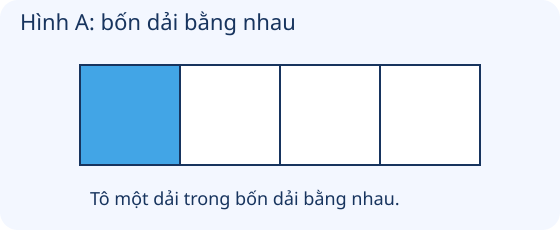
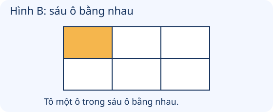

# Một phần mấy

Nguồn tham khảo: Toán 3 KNTT, tập 1, trang 42-45.

Trạng thái: AI biên soạn và rà soát; chưa có xác nhận của giáo viên.

## Mục tiêu

- Nhận biết, đọc và viết một phần hai đến một phần chín trong các hình chia đều.
- Nhận biết một phần mấy của một nhóm đồ vật và dùng phép chia để tìm số đồ vật trong một phần.

## Khám phá

Một chiếc bánh được chia cho các bạn. Muốn mỗi bạn nhận phần bằng nhau, những miếng bánh phải bằng nhau. Lấy đúng một phần trong các phần bằng nhau giúp ta hiểu một phần mấy.

- Chia một hình thành n phần bằng nhau, lấy 1 phần thì phần đó là một phần n, viết 1/n (với n từ 2 đến 9 đang học).
- 1/2 đọc là một phần hai; 1/3 là một phần ba; 1/4 là một phần tư; tương tự với 1/5 đến 1/9.
- Không gọi một miếng là một phần ba chỉ vì có 3 miếng: ba phần phải bằng nhau.
- Chia một nhóm đồ vật thành n phần bằng nhau; số đồ vật của một phần bằng tổng số chia cho n.

## Hướng dẫn

1. Đếm tổng số phần và kiểm tra các phần có bằng nhau không.
2. Xác định đã lấy hay tô đúng một phần chưa.
3. Đọc, viết một phần mấy theo tổng số phần bằng nhau.
4. Với nhóm đồ vật, chia tổng số cho số phần; đếm lại để kiểm tra.

## Lỗi thường gặp

- Chỉ đếm số phần mà không kiểm tra bằng nhau.
- Đảo 1/5 thành 5/1.
- Nhầm số phần với số đồ vật trong một phần.
- Lấy số đồ vật trừ số phần thay vì chia.

## Ví dụ

Chia tờ giấy thành 3 dải bằng nhau, tô 1 dải.

1. Có 3 phần bằng nhau, tô đúng 1 phần.
2. Phần tô là một phần ba tờ giấy, viết 1/3.

Có 20 viên bi, chia thành 5 phần bằng nhau. Một phần có mấy viên?

1. Cần tìm một phần năm của nhóm 20 viên.
2. 20 : 5 = 4.
3. Một phần năm số bi là 4 viên.

Một hình có 4 phần không bằng nhau, tô 1 phần. Có thể khẳng định đã tô 1/4 không?

1. Bốn phần chưa bằng nhau.
2. Chưa đủ điều kiện để khẳng định phần tô là một phần tư.

## Hình minh họa

## Ngân hàng câu hỏi

### Câu 1 - nhan_biet

Một hình chia thành 2 phần bằng nhau. Một phần được gọi là gì?

A. một phần hai; B. một phần ba; C. một phần tư; D. một phần năm

Đáp án: một phần hai. Lời giải: Một trong hai phần bằng nhau là một phần hai.

### Câu 2 - nhan_biet

Một hình chia thành 3 phần bằng nhau. Lấy 1 phần, viết theo dạng 1/n là gì?

Đáp án: 1/3. Lời giải: Có 3 phần bằng nhau nên viết 1/3.

### Câu 3 - nhan_biet

Một hình chia thành 4 phần bằng nhau. Lấy 1 phần, viết theo dạng 1/n là gì?

A. 1/4; B. 1/2; C. 1/3; D. 4/1

Đáp án: 1/4. Lời giải: Lấy một trong bốn phần bằng nhau, viết 1/4.

### Câu 4 - nhan_biet

Đọc cách viết 1/5.

Đáp án: một phần năm. Lời giải: Số 5 cho biết cả hình được chia thành 5 phần bằng nhau.

### Câu 5 - nhan_biet

Đọc cách viết 1/6.

A. một phần sáu; B. sáu phần một; C. một phần năm; D. một phần bảy

Đáp án: một phần sáu. Lời giải: Một trong sáu phần bằng nhau gọi là một phần sáu.

### Câu 6 - nhan_biet

Đọc cách viết 1/7.

Đáp án: một phần bảy. Lời giải: Một trong bảy phần bằng nhau gọi là một phần bảy.

### Câu 7 - nhan_biet

Đọc cách viết 1/8.

A. một phần tám; B. tám phần một; C. một phần bảy; D. một phần chín

Đáp án: một phần tám. Lời giải: Một trong tám phần bằng nhau gọi là một phần tám.

### Câu 8 - nhan_biet

Đọc cách viết 1/9.

Đáp án: một phần chín. Lời giải: Một trong chín phần bằng nhau gọi là một phần chín.

### Câu 9 - nhan_biet

Muốn gọi một miếng là một phần tư chiếc bánh, cả bánh phải chia thành mấy phần bằng nhau?

A. 4; B. 2; C. 3; D. 5

Đáp án: 4. Lời giải: Một phần tư là một trong 4 phần bằng nhau.

### Câu 10 - nhan_biet

Điều kiện quan trọng khi chia hình thành các phần để nói một phần mấy là các phần phải thế nào?

Đáp án: bằng nhau. Lời giải: Không chỉ đếm số miếng; các phần phải bằng nhau.

### Câu 11 - thong_hieu

Hình A có 4 dải bằng nhau, tô 1 dải. Phần tô viết theo dạng 1/n là gì?

A. 1/4; B. 1/2; C. 1/3; D. 1/5

Đáp án: 1/4. Lời giải: Một dải trong 4 dải bằng nhau là 1/4 hình.

### Câu 12 - thong_hieu

Hình B có 6 ô bằng nhau, tô 1 ô. Phần tô viết theo dạng 1/n là gì?

Đáp án: 1/6. Lời giải: Một ô trong 6 ô bằng nhau là 1/6 hình.

### Câu 13 - thong_hieu

Chia 8 viên bi thành 2 phần bằng nhau. Một phần có mấy viên?

A. 4; B. 2; C. 6; D. 16

Đáp án: 4. Lời giải: 8 : 2 = 4 viên, đó là một phần hai số viên bi.

### Câu 14 - thong_hieu

Chia 15 nhãn vở thành 3 phần bằng nhau. Một phần có mấy nhãn?

Đáp án: 5. Lời giải: 15 : 3 = 5 nhãn, đó là một phần ba số nhãn.

### Câu 15 - thong_hieu

Chia 20 bông hoa thành 4 phần bằng nhau. Một phần có mấy bông?

A. 5; B. 4; C. 16; D. 24

Đáp án: 5. Lời giải: 20 : 4 = 5 bông, đó là một phần tư số hoa.

### Câu 16 - thong_hieu

Một chiếc bánh bị cắt thành 3 miếng không bằng nhau. Có thể khẳng định mỗi miếng là 1/3 bánh không?

Đáp án: không. Lời giải: Muốn gọi mỗi miếng là 1/3, ba miếng phải bằng nhau.

### Câu 17 - thong_hieu

Để tìm một phần năm của 30 đồ vật, lấy 30 chia cho mấy?

A. 5; B. 1; C. 6; D. 30

Đáp án: 5. Lời giải: Chia thành 5 phần bằng nhau, nên lấy 30 : 5.

### Câu 18 - thong_hieu

Một phần tám của 16 hạt là mấy hạt?

Đáp án: 2. Lời giải: 16 : 8 = 2 hạt.

### Câu 19 - thong_hieu

Một phần chín của 27 thẻ là mấy thẻ?

A. 3; B. 9; C. 18; D. 36

Đáp án: 3. Lời giải: 27 : 9 = 3 thẻ.

### Câu 20 - thong_hieu

Một phần sáu của 24 que tính là mấy que?

Đáp án: 4. Lời giải: 24 : 6 = 4 que.

### Câu 21 - van_dung

Lan chia đều 12 quả dâu cho 2 đĩa. Một đĩa là một phần hai số dâu. Có mấy quả?

A. 6; B. 2; C. 10; D. 24

Đáp án: 6. Lời giải: 12 : 2 = 6 quả mỗi đĩa.

### Câu 22 - van_dung

Hộp có 18 bút chia đều cho 3 tổ. Mỗi tổ nhận một phần ba số bút. Là mấy bút?

Đáp án: 6. Lời giải: 18 : 3 = 6 bút mỗi tổ.

### Câu 23 - van_dung

Có 28 học sinh xếp 4 hàng bằng nhau. Một hàng là một phần tư số học sinh. Có mấy bạn?

A. 7; B. 4; C. 24; D. 8

Đáp án: 7. Lời giải: 28 : 4 = 7 bạn mỗi hàng.

### Câu 24 - van_dung

Giỏ có 25 quả, lấy một phần năm số quả. Lấy mấy quả?

Đáp án: 5. Lời giải: 25 : 5 = 5 quả.

### Câu 25 - van_dung

Có 42 thẻ, dùng một phần sáu số thẻ. Dùng mấy thẻ?

A. 7; B. 6; C. 36; D. 8

Đáp án: 7. Lời giải: 42 : 6 = 7 thẻ.

### Câu 26 - van_dung

Có 35 lá cờ, lấy một phần bảy số cờ. Lấy mấy lá?

Đáp án: 5. Lời giải: 35 : 7 = 5 lá.

### Câu 27 - van_dung

Có 32 nhãn vở, tặng một phần tám số nhãn. Tặng mấy nhãn?

A. 4; B. 8; C. 24; D. 5

Đáp án: 4. Lời giải: 32 : 8 = 4 nhãn.

### Câu 28 - van_dung

Có 45 chiếc bánh, lấy một phần chín số bánh. Lấy mấy chiếc?

Đáp án: 5. Lời giải: 45 : 9 = 5 chiếc.

### Câu 29 - van_dung

Băng giấy chia thành 5 dải bằng nhau, cắt lấy đúng 1 dải. Phần cắt viết theo dạng 1/n là gì?

A. 1/5; B. 1/4; C. 1/6; D. 5/1

Đáp án: 1/5. Lời giải: Một dải trong 5 dải bằng nhau là 1/5 băng giấy.

### Câu 30 - van_dung

Bảng có 8 ô bằng nhau, dán nhãn lên đúng 1 ô. Ô có nhãn chiếm phần nào của bảng? Viết dạng 1/n.

Đáp án: 1/8. Lời giải: Một trong 8 ô bằng nhau là 1/8 bảng.

### Câu 31 - van_dung

Chiếc bánh chia 9 miếng bằng nhau, Mai nhận 1 miếng. Mai nhận phần nào của bánh? Viết dạng 1/n.

A. 1/9; B. 1/8; C. 1/3; D. 9/1

Đáp án: 1/9. Lời giải: Một trong 9 phần bằng nhau là 1/9 bánh.

### Câu 32 - van_dung

Một tờ giấy gấp đôi sao cho hai phần chồng khít. Mỗi phần là phần nào của tờ giấy? Viết dạng 1/n.

Đáp án: 1/2. Lời giải: Gấp đôi chồng khít tạo hai phần bằng nhau, mỗi phần là 1/2.

### Câu 33 - van_dung

Có 24 chai xếp 3 hàng bằng nhau. Khoanh một hàng. Đã khoanh mấy chai?

A. 8; B. 3; C. 6; D. 21

Đáp án: 8. Lời giải: Một hàng là 1/3 số chai; 24 : 3 = 8 chai.

### Câu 34 - van_dung

Một thanh sô-cô-la có 6 ô bằng nhau. Ăn 1 ô. Phần đã ăn viết dạng 1/n là gì?

Đáp án: 1/6. Lời giải: Ăn một trong 6 ô bằng nhau, tức 1/6 thanh.

### Câu 35 - van_dung

Mảnh vải chia thành 7 dải bằng nhau. Một dải gọi là gì?

A. một phần bảy; B. một phần sáu; C. bảy phần một; D. một phần tám

Đáp án: một phần bảy. Lời giải: Có 7 phần bằng nhau, lấy 1 phần là một phần bảy.

### Câu 36 - van_dung

Chia 40 thẻ thành 5 phần bằng nhau. Một phần có mấy thẻ?

Đáp án: 8. Lời giải: 40 : 5 = 8 thẻ.

### Câu 37 - van_dung

Trong 16 chiếc lá, Lan khoanh 4 chiếc. Nếu chia đều thành 4 nhóm thì số khoanh ứng với một phần mấy? Viết dạng 1/n.

A. 1/4; B. 1/2; C. 1/3; D. 1/8

Đáp án: 1/4. Lời giải: 16 : 4 = 4 lá mỗi nhóm; 4 lá là một trong 4 phần bằng nhau.

### Câu 38 - van_dung

Trong 18 viên bi, Nam lấy 3 viên. Chia đều 18 viên thành 6 nhóm thì 3 viên ứng với một phần mấy? Viết dạng 1/n.

Đáp án: 1/6. Lời giải: 18 : 6 = 3 viên mỗi nhóm, nên 3 viên là 1/6 số bi.

### Câu 39 - van_dung

Có 36 bông hoa, một phần chín số hoa là mấy bông?

A. 4; B. 9; C. 27; D. 5

Đáp án: 4. Lời giải: 36 : 9 = 4 bông.

### Câu 40 - van_dung

Có 56 hạt giống, lấy một phần bảy để gieo. Đã lấy mấy hạt?

Đáp án: 8. Lời giải: 56 : 7 = 8 hạt.

## Trò chơi

Kiểm chứng phần tô: Đọc nhận định và kiểm tra bằng cách đếm các phần bằng nhau hoặc chia nhóm đồ vật.

- Mỗi lượt lấy 10 câu trong bài và đưa ra một kết quả để kiểm chứng.
- Chọn Đúng nếu kết quả phù hợp, chọn Sai nếu không phù hợp; đọc lời giải trước khi sang câu.
- Mỗi câu đúng được 10 điểm; tối đa 100 điểm.

## Đánh giá

Đúng lần đầu: 1 điểm; đúng sau một gợi ý: 0,5 điểm. Từ 90%: 3 sao; từ 60%: 2 sao; còn lại: 1 sao.

Xem lời giải các câu sai, đọc lại quy tắc, rồi làm một lượt mới.
