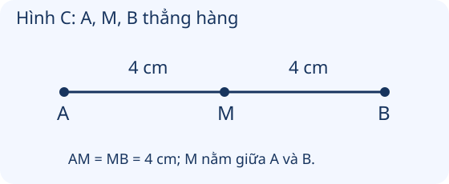
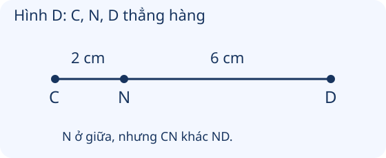
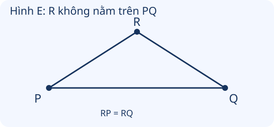

# Điểm ở giữa, trung điểm của đoạn thẳng

Nguồn tham khảo: Toán 3 KNTT, tập 1, trang 49-51.

Trạng thái: AI biên soạn và rà soát; chưa có xác nhận của giáo viên.

## Mục tiêu

- Nhận biết điểm ở giữa và phân biệt với trung điểm của đoạn thẳng.
- Xác định trung điểm khi biết thứ tự điểm và độ dài; dùng thước hoặc gấp giấy để tìm trung điểm.

## Khám phá

Một điểm có thể ở giữa hai đầu đoạn thẳng mà chưa chia đoạn thành hai phần bằng nhau. Trung điểm phải vừa ở giữa, vừa cách đều hai đầu. Hai điều kiện này luôn đi cùng nhau.

- A, M, B thẳng hàng theo thứ tự A, M, B thì M là điểm ở giữa A và B.
- M là trung điểm AB khi M ở giữa A và B, đồng thời AM = MB.
- Chỉ có AM = MB chưa đủ: M còn phải nằm trên đoạn AB.
- Khi M ở giữa A, B: AB = AM + MB. Khi M là trung điểm: mỗi nửa bằng độ dài AB chia 2.
- Có thể gấp giấy hoặc dây để hai đầu trùng nhau; vị trí chia đôi trên đoạn là trung điểm.

## Hướng dẫn

1. Kiểm tra các điểm có cùng nằm trên một đường thẳng không.
2. Xác định điểm đang xét có nằm giữa hai đầu không.
3. So sánh độ dài hai đoạn đến hai đầu.
4. Nếu cần vẽ trung điểm, đo cả đoạn, lấy nửa độ dài và đánh dấu trên đoạn; kiểm tra lại.

## Lỗi thường gặp

- Cho rằng cứ ở giữa là trung điểm dù hai đoạn không bằng nhau.
- Chỉ thấy hai khoảng cách bằng nhau mà bỏ qua điều kiện nằm trên đoạn.
- Đọc hình không theo tỉ lệ rồi đoán bằng mắt thay vì dựa vào số đo.
- Tính nửa đoạn nhưng quên đổi đúng đơn vị câu trả lời.

## Ví dụ

A, M, B thẳng hàng, M ở giữa; AM = 3 cm, MB = 5 cm. M có là trung điểm không?

1. M đáp ứng điều kiện ở giữa.
2. Nhưng 3 cm khác 5 cm, nên M không là trung điểm.

Đoạn CD dài 12 cm. Tìm độ dài từ C đến trung điểm I.

1. Trung điểm chia CD thành hai phần bằng nhau.
2. 12 : 2 = 6. CI = ID = 6 cm.

Tìm trung điểm đoạn thẳng trên giấy bằng cách gấp.

1. Gấp sao cho hai đầu đoạn trùng khít.
2. Nếp gấp cắt đoạn tại điểm chia đôi; đánh dấu điểm này.
3. Mở giấy và kiểm tra hai phần bằng nhau.

## Hình minh họa

## Ngân hàng câu hỏi

### Câu 1 - nhan_biet

Ba điểm A, M, B cùng nằm trên một đường thẳng theo thứ tự đó. Điểm nào ở giữa A và B?

A. M; B. A; C. B; D. không có điểm nào

Đáp án: M. Lời giải: Theo thứ tự A, M, B, điểm M ở giữa hai đầu A và B.

### Câu 2 - nhan_biet

M là trung điểm AB. Hai đoạn AM và MB có bằng nhau không?

Đáp án: có. Lời giải: Trung điểm nằm giữa hai đầu và cách đều hai đầu.

### Câu 3 - nhan_biet

Ba điểm A, M, B không thẳng hàng. M có thể là trung điểm AB không?

A. không; B. có; C. chỉ khi AM = MB; D. chỉ khi M ở phía trên

Đáp án: không. Lời giải: Muốn là trung điểm AB, M phải nằm trên đoạn AB, nên A, M, B phải thẳng hàng.

### Câu 4 - nhan_biet

M ở giữa A và B, AM = 4 cm, MB = 4 cm. M có là trung điểm AB không?

Đáp án: có. Lời giải: M ở giữa và AM = MB, đủ cả hai điều kiện.

### Câu 5 - nhan_biet

N ở giữa C và D, CN = 3 cm, ND = 5 cm. N có là trung điểm CD không?

A. không; B. có; C. chỉ khi CD nằm ngang; D. luôn là trung điểm

Đáp án: không. Lời giải: N ở giữa nhưng hai đoạn 3 cm và 5 cm không bằng nhau.

### Câu 6 - nhan_biet

M là trung điểm AB, AM = 5 cm. MB dài mấy xăng-ti-mét?

Đáp án: 5. Lời giải: Vì AM = MB nên MB cũng dài 5 cm.

### Câu 7 - nhan_biet

M là trung điểm AB, AM = 6 cm. AB dài mấy xăng-ti-mét?

A. 12; B. 6; C. 3; D. 18

Đáp án: 12. Lời giải: AB = AM + MB; 6 + 6 = 12 cm.

### Câu 8 - nhan_biet

Đoạn CD dài 10 cm, N là trung điểm CD. CN dài mấy xăng-ti-mét?

Đáp án: 5. Lời giải: Chia 10 cm thành hai đoạn bằng nhau: 10 : 2 = 5 cm.

### Câu 9 - nhan_biet

Đoạn PQ dài 8 cm, I là trung điểm PQ. IQ dài mấy xăng-ti-mét?

A. 4; B. 8; C. 2; D. 6

Đáp án: 4. Lời giải: 8 : 2 = 4 cm.

### Câu 10 - nhan_biet

Một điểm ở giữa hai đầu đoạn thẳng có nhất thiết là trung điểm không?

Đáp án: không. Lời giải: Còn phải kiểm tra hai khoảng cách đến hai đầu có bằng nhau không.

### Câu 11 - thong_hieu

Hình C: A, M, B thẳng hàng, AM = MB = 4 cm. Trung điểm AB là điểm nào?

A. M; B. A; C. B; D. không có trung điểm

Đáp án: M. Lời giải: M nằm giữa A, B và hai đoạn AM, MB đều 4 cm.

### Câu 12 - thong_hieu

Hình D: C, N, D thẳng hàng, CN = 2 cm, ND = 6 cm. CD dài mấy xăng-ti-mét?

Đáp án: 8. Lời giải: Cộng hai đoạn: 2 + 6 = 8 cm.

### Câu 13 - thong_hieu

Hình D: N có là trung điểm CD không?

A. không; B. có; C. chỉ khi đổi tên N; D. luôn đúng

Đáp án: không. Lời giải: CN = 2 cm khác ND = 6 cm, nên N không là trung điểm.

### Câu 14 - thong_hieu

Hình E: P và Q thẳng hàng nằm dưới R; RP = RQ. R có là trung điểm PQ không?

Đáp án: không. Lời giải: RP = RQ chưa đủ; R không nằm trên đoạn PQ.

### Câu 15 - thong_hieu

Đoạn AB dài 14 cm. Trung điểm cách A mấy xăng-ti-mét?

A. 7; B. 14; C. 2; D. 6

Đáp án: 7. Lời giải: 14 : 2 = 7 cm.

### Câu 16 - thong_hieu

M ở giữa A và B. AM = 3 cm, MB = 7 cm. AB dài mấy xăng-ti-mét?

Đáp án: 10. Lời giải: AB = AM + MB; 3 + 7 = 10 cm.

### Câu 17 - thong_hieu

M là trung điểm AB, MB = 8 cm. AB dài mấy xăng-ti-mét?

A. 16; B. 8; C. 4; D. 24

Đáp án: 16. Lời giải: AM = MB = 8 cm; 8 + 8 = 16 cm.

### Câu 18 - thong_hieu

Trên thước, A tại 0 cm, M tại 3 cm, B tại 6 cm. Điểm M là gì của AB?

Đáp án: trung điểm. Lời giải: M nằm giữa; AM = 3 cm, MB = 3 cm nên M là trung điểm.

### Câu 19 - thong_hieu

Trên thước, A tại 0 cm, N tại 2 cm, B tại 6 cm. N có là trung điểm AB không?

A. không; B. có; C. chỉ vì N nằm giữa; D. luôn đúng

Đáp án: không. Lời giải: AN = 2 cm, NB = 4 cm không bằng nhau.

### Câu 20 - thong_hieu

Để xác định trung điểm đoạn thẳng trên giấy bằng cách gấp, phải làm gì với hai đầu đoạn?

Đáp án: cho hai đầu trùng nhau. Lời giải: Gấp cho hai đầu trùng nhau thì nếp gấp cắt đoạn tại điểm chia đoạn thành hai phần bằng nhau.

### Câu 21 - van_dung

Dây dài 18 cm. Đánh dấu trung điểm, mỗi nửa dài mấy xăng-ti-mét?

A. 9; B. 18; C. 2; D. 8

Đáp án: 9. Lời giải: 18 : 2 = 9 cm.

### Câu 22 - van_dung

Thanh gỗ dài 16 cm. Cắt tại trung điểm được hai thanh, mỗi thanh dài mấy xăng-ti-mét?

Đáp án: 8. Lời giải: 16 : 2 = 8 cm.

### Câu 23 - van_dung

Đường thẳng từ cổng A đến cổng B dài 20 m. Đèn M đặt đúng trung điểm. M cách A mấy mét?

A. 10; B. 20; C. 2; D. 18

Đáp án: 10. Lời giải: 20 : 2 = 10 m.

### Câu 24 - van_dung

An và Bình đứng hai đầu một đoạn thẳng dài 12 m. Lan đứng đúng giữa, cách đều hai bạn. Lan cách mỗi bạn mấy mét?

Đáp án: 6. Lời giải: Lan là trung điểm; 12 : 2 = 6 m.

### Câu 25 - van_dung

Tấm bìa có đoạn AB dài 14 cm, đánh dấu M cách A 7 cm trên đoạn. MB dài mấy xăng-ti-mét?

A. 7; B. 14; C. 21; D. 6

Đáp án: 7. Lời giải: 14 - 7 = 7 cm; AM = MB nên M là trung điểm.

### Câu 26 - van_dung

Đoạn PQ dài 18 cm. Điểm I ở trên đoạn, PI = 8 cm. I có là trung điểm không?

Đáp án: không. Lời giải: IQ = 18 - 8 = 10 cm, khác 8 cm nên I không là trung điểm.

### Câu 27 - van_dung

Một chiếc cầu thẳng dài 18 m. Trạm nghỉ tại trung điểm. Từ đầu cầu đến trạm dài mấy mét?

A. 9; B. 18; C. 2; D. 8

Đáp án: 9. Lời giải: 18 : 2 = 9 m.

### Câu 28 - van_dung

Đường thẳng A đến B dài 16 m. Cột M ở trung điểm. Từ M đến B dài mấy mét?

Đáp án: 8. Lời giải: 16 : 2 = 8 m.

### Câu 29 - van_dung

Băng giấy dài 10 cm. Gấp cho hai đầu trùng nhau, nếp gấp chia mỗi phần dài mấy xăng-ti-mét?

A. 5; B. 10; C. 2; D. 8

Đáp án: 5. Lời giải: Gấp đôi chia thành hai phần bằng nhau; 10 : 2 = 5 cm.

### Câu 30 - van_dung

Hàng cây trên một đường thẳng có A, M, B theo thứ tự. AM = 6 m, MB = 9 m. M có ở giữa A và B không?

Đáp án: có. Lời giải: Thứ tự A, M, B trên cùng đường thẳng cho thấy M ở giữa, dù chưa là trung điểm.

### Câu 31 - van_dung

Đoạn AB dài 8 cm. M nằm giữa và AM = 4 cm. M có là trung điểm không?

A. có; B. không; C. chỉ khi đổi chiều đoạn; D. chưa biết độ dài

Đáp án: có. Lời giải: MB = 8 - 4 = 4 cm; M ở giữa và AM = MB.

### Câu 32 - van_dung

Đoạn CD dài 6 cm. I là trung điểm. CI dài mấy xăng-ti-mét?

Đáp án: 3. Lời giải: 6 : 2 = 3 cm.

### Câu 33 - van_dung

Đoạn GH dài 12 cm. M nằm ngoài đoạn nhưng MG = MH. Chỉ riêng điều kiện bằng nhau có đủ để gọi M là trung điểm không?

A. không; B. có; C. chỉ khi có thước; D. luôn đủ

Đáp án: không. Lời giải: Trung điểm phải nằm trên đoạn và ở giữa hai đầu; khoảng cách bằng nhau chưa đủ.

### Câu 34 - van_dung

Một lối đi thẳng dài 20 m, đặt bồn hoa ở trung điểm. Bồn hoa cách đầu lối mấy mét?

Đáp án: 10. Lời giải: 20 : 2 = 10 m.

### Câu 35 - van_dung

Thanh dây có M là trung điểm AB, AM dài 7 cm. Nếu đo cả dây AB thì được mấy xăng-ti-mét?

A. 14; B. 7; C. 21; D. 10

Đáp án: 14. Lời giải: AM = MB = 7 cm; 7 + 7 = 14 cm.

### Câu 36 - van_dung

Đoạn AB dài 16 cm. I và J nằm trên đoạn, AI = 7 cm, AJ = 8 cm. Điểm nào là trung điểm?

Đáp án: J. Lời giải: Trung điểm cách A 16 : 2 = 8 cm; J đúng vị trí đó.

### Câu 37 - van_dung

Trên đoạn CD dài 14 cm, N cách C 5 cm. ND dài mấy xăng-ti-mét?

A. 9; B. 5; C. 7; D. 19

Đáp án: 9. Lời giải: 14 - 5 = 9 cm; N chưa là trung điểm vì 5 khác 9.

### Câu 38 - van_dung

Dây dài 16 cm được gấp đôi cho hai đầu trùng nhau. Mỗi nửa dài bao nhiêu xăng-ti-mét?

Đáp án: 8. Lời giải: 16 : 2 = 8 cm.

### Câu 39 - van_dung

Hình C có AM = MB = 4 cm. Một con kiến đi từ A đến M rồi đến B. Đi tất cả mấy xăng-ti-mét?

A. 8; B. 4; C. 2; D. 12

Đáp án: 8. Lời giải: Đi hai đoạn liên tiếp: 4 + 4 = 8 cm.

### Câu 40 - van_dung

Đoạn thẳng dài 20 cm. Điểm M cách hai đầu lần lượt 8 cm và 12 cm, nằm giữa hai đầu. M còn cách trung điểm mấy xăng-ti-mét?

Đáp án: 2. Lời giải: Trung điểm cách đầu thứ nhất 20 : 2 = 10 cm; 10 - 8 = 2 cm.

## Trò chơi

Tăng tốc tìm điểm giữa: Kiểm tra điểm ở giữa, trung điểm và độ dài các đoạn trong 60 giây.

- Trả lời các câu thuộc bài trong 60 giây.
- Mỗi câu đúng được 10 điểm, sai không được điểm; chuyển ngay sang câu tiếp.
- Hết giờ thì kết thúc. Điểm riêng của lượt chơi, không thay kết quả luyện tập.

## Đánh giá

Đúng lần đầu: 1 điểm; đúng sau một gợi ý: 0,5 điểm. Từ 90%: 3 sao; từ 60%: 2 sao; còn lại: 1 sao.

Xem lời giải các câu sai, đọc lại quy tắc, rồi làm một lượt mới.
