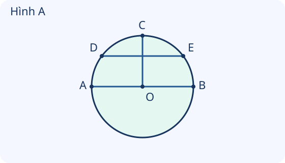

# Hình tròn. Tâm, bán kính, đường kính của hình tròn

Nguồn tham khảo: Toán 3 KNTT, tập 1, trang 52-53.

Trạng thái: AI biên soạn và rà soát; chưa có xác nhận của giáo viên.

## Mục tiêu

- Nhận biết tâm, bán kính và đường kính của hình tròn.
- Vận dụng quan hệ đường kính gấp hai lần bán kính; bước đầu dùng com pa để vẽ đường tròn.

## Khám phá

Hãy đặt đầu nhọn com pa tại một điểm cố định và giữ nguyên độ mở khi quay đầu bút. Điểm cố định là tâm; khoảng cách từ đó tới đường vẽ là bán kính. Một đoạn thẳng đi qua tâm và nối hai điểm trên đường tròn là đường kính.

- Bán kính nối tâm với một điểm trên đường tròn. Các bán kính của cùng một hình tròn dài bằng nhau.
- Đường kính có hai đầu trên đường tròn và đi qua tâm. Tâm là trung điểm của đường kính.
- Đường kính dài bằng hai lần bán kính; bán kính bằng đường kính chia 2.
- Khi vẽ bằng com pa, đầu nhọn giữ tại tâm, độ mở không đổi. Một đoạn nối hai điểm trên đường tròn mà không qua tâm không phải đường kính.

## Hướng dẫn

1. Tìm và gọi tên tâm trước.
2. Xét hai đầu đoạn thẳng: đoạn có nối tâm ra đường tròn không, hoặc có hai đầu trên đường tròn và qua tâm không?
3. Tính độ dài bằng quan hệ gấp đôi hoặc chia đôi.
4. Vẽ đường tròn: xác định tâm, đo độ mở com pa rồi quay đầu bút, giữ đầu nhọn tại tâm.

## Lỗi thường gặp

- Gọi mọi đoạn nối hai điểm trên đường tròn là đường kính.
- Nhầm độ mở com pa với đường kính.
- Cho rằng bán kính nằm ngang dài khác bán kính nằm nghiêng.
- Đổi độ mở hoặc để trượt tâm khi đang quay com pa.

## Ví dụ

Hình tròn tâm O có bán kính 4 cm. Tính đường kính.

1. Đường kính gồm hai bán kính.
2. 4 × 2 = 8. Đường kính dài 8 cm.

Đường kính AB dài 14 cm, O là tâm. Tính OA.

1. O là trung điểm của AB, nên OA là nửa AB.
2. 14 : 2 = 7. OA dài 7 cm.

Một đoạn nối hai điểm trên đường tròn nhưng không đi qua tâm. Có là đường kính không?

1. Kiểm tra điều kiện đi qua tâm.
2. Đoạn không qua tâm, nên không phải đường kính.

## Hình minh họa

## Ngân hàng câu hỏi

### Câu 1 - nhan_biet

Đoạn thẳng nối tâm với một điểm trên đường tròn gọi là gì?

A. bán kính; B. đường kính; C. cạnh hình vuông; D. tâm

Đáp án: bán kính. Lời giải: Bán kính có một đầu là tâm, đầu kia nằm trên đường tròn.

### Câu 2 - nhan_biet

Đoạn thẳng qua tâm, có hai đầu trên đường tròn gọi là gì?

Đáp án: đường kính. Lời giải: Đường kính đi qua tâm và nối hai điểm trên đường tròn.

### Câu 3 - nhan_biet

Điểm nằm chính giữa một đường kính của hình tròn là gì?

A. tâm; B. đỉnh; C. điểm bất kì; D. bán kính

Đáp án: tâm. Lời giải: Tâm là trung điểm của đường kính.

### Câu 4 - nhan_biet

Trong một hình tròn, đường kính dài bằng mấy lần bán kính?

Đáp án: 2. Lời giải: Đường kính gồm hai bán kính nối tiếp nhau.

### Câu 5 - nhan_biet

Bán kính hình tròn dài 3 cm. Đường kính dài mấy xăng-ti-mét?

A. 6; B. 3; C. 5; D. 9

Đáp án: 6. Lời giải: 3 × 2 = 6 cm.

### Câu 6 - nhan_biet

Đường kính dài 8 cm. Bán kính dài mấy xăng-ti-mét?

Đáp án: 4. Lời giải: 8 : 2 = 4 cm.

### Câu 7 - nhan_biet

Hai bán kính của cùng một hình tròn có bằng nhau không?

A. có; B. không; C. chỉ khi nằm ngang; D. chỉ khi tô cùng màu

Đáp án: có. Lời giải: Mọi bán kính của cùng một hình tròn có độ dài bằng nhau.

### Câu 8 - nhan_biet

Dụng cụ thường dùng để vẽ đường tròn là gì?

Đáp án: com pa. Lời giải: Com pa giữ một đầu ở tâm, đầu bút quay để vẽ đường tròn.

### Câu 9 - nhan_biet

Khi vẽ đường tròn bằng com pa, đầu nhọn giữ ở đâu?

A. tâm; B. bất kì ngoài giấy; C. đầu bán kính trên đường tròn; D. một góc tờ giấy

Đáp án: tâm. Lời giải: Đầu nhọn cố định tại tâm; đầu bút quay quanh tâm.

### Câu 10 - nhan_biet

Độ mở com pa khi vẽ đường tròn cho biết độ dài nào?

Đáp án: bán kính. Lời giải: Khoảng cách từ đầu nhọn đến đầu bút là khoảng cách từ tâm đến đường tròn.

### Câu 11 - thong_hieu

Hình A có đường kính AB và tâm O. Điểm nào là trung điểm AB?

A. O; B. A; C. B; D. C

Đáp án: O. Lời giải: Đường kính AB đi qua tâm O; OA = OB nên O là trung điểm.

### Câu 12 - thong_hieu

Hình A: đoạn OC nối tâm O với điểm C trên đường tròn. OC là gì?

Đáp án: bán kính. Lời giải: OC có một đầu tại tâm và đầu kia trên đường tròn.

### Câu 13 - thong_hieu

Hình A: đoạn DE có hai đầu trên đường tròn nhưng không qua O. DE có là đường kính không?

A. không; B. có; C. chỉ cần hai đầu nằm trên đường tròn; D. chỉ cần DE nằm ngang

Đáp án: không. Lời giải: Đường kính còn phải đi qua tâm; DE không qua O.

### Câu 14 - thong_hieu

Hình A có OA = 4 cm. OB dài mấy xăng-ti-mét?

Đáp án: 4. Lời giải: OA và OB là hai bán kính cùng hình tròn nên bằng nhau.

### Câu 15 - thong_hieu

Hình A có OC = 5 cm. AB dài mấy xăng-ti-mét?

A. 10; B. 5; C. 7; D. 15

Đáp án: 10. Lời giải: OC là bán kính, AB là đường kính; 5 × 2 = 10 cm.

### Câu 16 - thong_hieu

Một đoạn qua tâm nhưng chỉ có một đầu trên đường tròn có chắc là đường kính không?

Đáp án: không. Lời giải: Đường kính cần cả hai đầu trên đường tròn và đi qua tâm.

### Câu 17 - thong_hieu

Đường kính 12 cm có bán kính mấy xăng-ti-mét?

A. 6; B. 12; C. 2; D. 10

Đáp án: 6. Lời giải: 12 : 2 = 6 cm.

### Câu 18 - thong_hieu

Một bạn nói hai đường kính của cùng hình tròn dài khác nhau. Nhận định đó đúng không?

Đáp án: không. Lời giải: Mỗi đường kính đều dài gấp hai lần cùng bán kính nên các đường kính bằng nhau.

### Câu 19 - thong_hieu

Giữ nguyên tâm và độ mở com pa, vẽ lại một vòng. Đường vẽ có trùng đường tròn trước không?

A. có; B. không; C. luôn to hơn; D. luôn nhỏ hơn

Đáp án: có. Lời giải: Tâm và khoảng cách từ tâm đến đường tròn không đổi nên đường vẽ trùng nhau.

### Câu 20 - thong_hieu

Giữ tâm, tăng độ mở com pa. Đường tròn mới có bán kính như thế nào?

Đáp án: lớn hơn. Lời giải: Độ mở com pa chính là bán kính; tăng độ mở thì bán kính tăng.

### Câu 21 - van_dung

Huy vẽ vòng tròn bán kính 4 cm làm mặt huy hiệu. Đường kính mặt huy hiệu mấy xăng-ti-mét?

A. 8; B. 4; C. 6; D. 12

Đáp án: 8. Lời giải: 4 × 2 = 8 cm.

### Câu 22 - van_dung

Mặt đồng hồ đồ chơi có đường kính 14 cm. Từ tâm tới viền dài mấy xăng-ti-mét?

Đáp án: 7. Lời giải: Khoảng từ tâm tới viền là bán kính; 14 : 2 = 7 cm.

### Câu 23 - van_dung

Một vòng tròn có bán kính 6 cm. Hai đường kính vẽ ngang và dọc có cùng độ dài mấy xăng-ti-mét?

A. 12; B. 6; C. 8; D. 18

Đáp án: 12. Lời giải: Mỗi đường kính dài 6 × 2 = 12 cm.

### Câu 24 - van_dung

Lan cần vẽ đường tròn bán kính 2 cm. Com pa phải mở mấy xăng-ti-mét?

Đáp án: 2. Lời giải: Độ mở phải bằng bán kính đã yêu cầu, là 2 cm.

### Câu 25 - van_dung

Mai muốn vẽ đường tròn đường kính 10 cm. Com pa cần mở mấy xăng-ti-mét?

A. 5; B. 10; C. 2; D. 8

Đáp án: 5. Lời giải: Tìm bán kính: 10 : 2 = 5 cm; mở com pa 5 cm.

### Câu 26 - van_dung

Vòng giấy tròn có bán kính 7 cm, kẻ một đường kính. Đoạn kẻ dài mấy xăng-ti-mét?

Đáp án: 14. Lời giải: 7 × 2 = 14 cm.

### Câu 27 - van_dung

Trên huy hiệu tròn, đoạn từ tâm O đến chấm A trên viền dài 3 cm. Đến chấm B khác trên cùng viền dài mấy xăng-ti-mét?

A. 3; B. 6; C. 1; D. 9

Đáp án: 3. Lời giải: OA và OB là các bán kính của cùng hình tròn nên bằng nhau.

### Câu 28 - van_dung

Một biển tròn đồ chơi có đường kính 18 cm. Bán kính là mấy xăng-ti-mét?

Đáp án: 9. Lời giải: 18 : 2 = 9 cm.

### Câu 29 - van_dung

An mở com pa 4 cm rồi vẽ. Bạn gọi 4 cm là đường kính. Đường kính thực sự là bao nhiêu?

A. 8; B. 4; C. 2; D. 6

Đáp án: 8. Lời giải: 4 cm là bán kính; đường kính 4 × 2 = 8 cm.

### Câu 30 - van_dung

Một đường tròn có hai đường kính AB và CD cùng qua tâm O. AB = 16 cm. CD dài mấy xăng-ti-mét?

Đáp án: 16. Lời giải: Hai đường kính của cùng hình tròn bằng nhau.

### Câu 31 - van_dung

Hai hình tròn có bán kính 3 cm và 5 cm. Đường kính hình thứ hai hơn hình thứ nhất mấy xăng-ti-mét?

A. 4; B. 2; C. 8; D. 16

Đáp án: 4. Lời giải: Đường kính lần lượt 3 × 2 = 6 và 5 × 2 = 10; 10 - 6 = 4 cm.

### Câu 32 - van_dung

Một con kiến đi thẳng từ A qua tâm O đến B theo đường kính. OA = 6 cm. Quãng đi mấy xăng-ti-mét?

Đáp án: 12. Lời giải: OA = OB = 6 cm; 6 + 6 = 12 cm.

### Câu 33 - van_dung

Hai bán kính OM và ON cùng hình tròn. OM = 8 cm. ON dài mấy xăng-ti-mét?

A. 8; B. 16; C. 4; D. 10

Đáp án: 8. Lời giải: Các bán kính cùng hình tròn bằng nhau.

### Câu 34 - van_dung

Một vòng tròn đường kính 6 cm. Muốn vẽ vòng khác cùng kích thước, com pa mở mấy xăng-ti-mét?

Đáp án: 3. Lời giải: 6 : 2 = 3 cm là bán kính cần dùng.

### Câu 35 - van_dung

Có một dây thẳng căng ngang hình tròn qua tâm, hai đầu trên viền, dài 20 cm. Bán kính hình tròn là mấy xăng-ti-mét?

A. 10; B. 20; C. 2; D. 18

Đáp án: 10. Lời giải: Dây theo đường kính; 20 : 2 = 10 cm.

### Câu 36 - van_dung

Hình tròn bán kính 5 cm. Đường đi gồm hai bán kính nối từ viền tới tâm rồi ra viền có tổng dài mấy xăng-ti-mét?

Đáp án: 10. Lời giải: Cộng hai bán kính: 5 + 5 = 10 cm.

### Câu 37 - van_dung

Hai huy hiệu tròn có cùng đường kính 12 cm. Bán kính của mỗi huy hiệu là mấy xăng-ti-mét?

A. 6; B. 12; C. 3; D. 10

Đáp án: 6. Lời giải: 12 : 2 = 6 cm cho mỗi huy hiệu.

### Câu 38 - van_dung

Một bạn mở com pa 3 cm, giữ đầu nhọn nhưng đổi độ mở giữa chừng. Đường vẽ có bảo đảm là một đường tròn không?

Đáp án: không. Lời giải: Bán kính phải không đổi trong khi quay; thay đổi độ mở làm khoảng cách tới tâm thay đổi.

### Câu 39 - van_dung

Một hình tròn có bán kính 9 cm. Vẽ đường kính dài mấy xăng-ti-mét?

A. 18; B. 9; C. 11; D. 27

Đáp án: 18. Lời giải: 9 × 2 = 18 cm.

### Câu 40 - van_dung

Đường kính AB dài 10 cm, tâm O nằm trên AB. OA dài mấy xăng-ti-mét?

Đáp án: 5. Lời giải: O là trung điểm AB; 10 : 2 = 5 cm.

## Trò chơi

Khám phá vòng tròn: Nhận biết tâm, bán kính, đường kính và tính độ dài để mở rương.

- Mỗi lượt lấy 10 câu từ bài học.
- Chọn đáp án, đọc lời giải rồi sang câu tiếp theo.
- Mỗi câu đúng được 10 điểm; tối đa 100 điểm.

## Đánh giá

Đúng lần đầu: 1 điểm; đúng sau một gợi ý: 0,5 điểm. Từ 90%: 3 sao; từ 60%: 2 sao; còn lại: 1 sao.

Xem lời giải các câu sai, đọc lại quy tắc, rồi làm một lượt mới.
