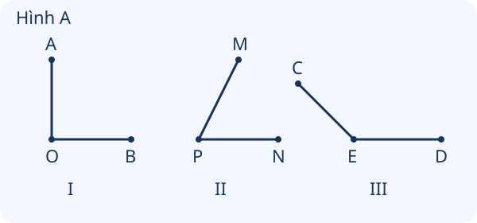
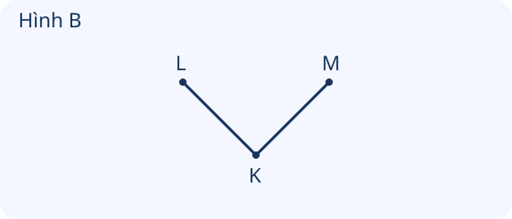

# Góc, góc vuông, góc không vuông

Nguồn tham khảo: Toán 3 KNTT, tập 1, trang 54-55.

Trạng thái: AI biên soạn và rà soát; chưa có xác nhận của giáo viên.

## Mục tiêu

- Nhận biết đỉnh và hai cạnh của góc.
- Dùng ê ke để kiểm tra góc vuông, phân biệt góc vuông với góc không vuông ở nhiều hướng.

## Khám phá

Hai cạnh cùng xuất phát từ một điểm tạo nên một góc. Điểm chung đó là đỉnh. Không phải chỉ góc có một cạnh ngang, một cạnh đứng mới vuông: góc vuông còn có thể được xoay nghiêng.

- Mỗi góc có một đỉnh và hai cạnh cùng xuất phát từ đỉnh.
- Dùng góc vuông của ê ke để kiểm tra: đỉnh trùng đỉnh, một cạnh trùng một cạnh rồi xét cạnh còn lại.
- Nếu cả hai cạnh khớp với hai cạnh góc vuông của ê ke, đó là góc vuông; nếu không, đó là góc không vuông.
- Xoay góc hoặc kéo dài các cạnh theo đúng hướng không làm đổi loại góc. Độ dài hai cạnh vẽ bằng nhau chưa đủ để gọi là góc vuông.

## Hướng dẫn

1. Xác định điểm chung của hai cạnh để tìm đỉnh.
2. Chọn đúng góc vuông của ê ke.
3. Đặt đỉnh ê ke trùng đỉnh góc, một cạnh khớp một cạnh góc.
4. Quan sát cạnh còn lại có khớp không rồi kết luận, kể cả với góc xoay nghiêng.

## Lỗi thường gặp

- Đặt đỉnh ê ke vào giữa cạnh thay vì đỉnh góc.
- Chỉ kiểm tra một cạnh đã kết luận góc vuông.
- Dựa vào cạnh dài hay ngắn để gọi góc vuông.
- Cho rằng góc vuông xoay nghiêng sẽ thành góc không vuông.

## Ví dụ

Góc có hai cạnh OA và OB. Tìm đỉnh.

1. Hai cạnh đều bắt đầu tại O.
2. O là đỉnh, OA và OB là hai cạnh.

Đỉnh ê ke trùng đỉnh góc, một cạnh khớp nhưng cạnh kia không khớp. Kết luận.

1. Một cạnh khớp chưa đủ.
2. Vì cạnh còn lại không khớp nên góc đang xét không vuông.

Một góc vuông được xoay nghiêng. Kiểm tra thế nào?

1. Xoay ê ke theo hình, giữ đỉnh trùng đỉnh.
2. Kiểm tra cả hai cạnh. Góc vẫn vuông nếu hai cạnh khớp.

## Hình minh họa

## Ngân hàng câu hỏi

### Câu 1 - nhan_biet

Một góc có mấy cạnh chung một đỉnh?

A. 2; B. 1; C. 3; D. 4

Đáp án: 2. Lời giải: Hai cạnh của góc cùng bắt đầu tại đỉnh.

### Câu 2 - nhan_biet

Điểm chung của hai cạnh góc gọi là gì?

Đáp án: đỉnh. Lời giải: Hai cạnh gặp nhau tại đỉnh của góc.

### Câu 3 - nhan_biet

Dụng cụ dùng kiểm tra góc vuông là gì?

A. ê ke; B. com pa; C. tẩy; D. bút màu

Đáp án: ê ke. Lời giải: Đặt góc vuông của ê ke khớp với góc cần kiểm tra.

### Câu 4 - nhan_biet

Hình A, góc I có hai cạnh OA và OB. Đỉnh là điểm nào?

Đáp án: O. Lời giải: Hai cạnh OA và OB có điểm chung O.

### Câu 5 - nhan_biet

Hình A, góc II có hai cạnh PM và PN. Đỉnh là điểm nào?

A. P; B. M; C. N; D. O

Đáp án: P. Lời giải: Hai cạnh PM và PN cùng có đầu P.

### Câu 6 - nhan_biet

Hình A, góc III có hai cạnh EC và ED. Đỉnh là điểm nào?

Đáp án: E. Lời giải: EC và ED gặp nhau ở E.

### Câu 7 - nhan_biet

Góc ở góc một tờ giấy hình chữ nhật là góc gì?

A. góc vuông; B. góc không vuông; C. đường tròn; D. bán kính

Đáp án: góc vuông. Lời giải: Các góc của tờ giấy hình chữ nhật đều là góc vuông.

### Câu 8 - nhan_biet

Hình A, góc I khớp góc vuông của ê ke. Đây là góc gì?

Đáp án: góc vuông. Lời giải: Đỉnh và hai cạnh khớp góc vuông của ê ke nên đó là góc vuông.

### Câu 9 - nhan_biet

Muốn kiểm tra, đỉnh góc vuông của ê ke cần đặt vào đâu?

A. đỉnh góc cần kiểm tra; B. giữa một cạnh; C. bất kì trên giấy; D. ngoài góc

Đáp án: đỉnh góc cần kiểm tra. Lời giải: Hai đỉnh phải trùng nhau trước khi so các cạnh.

### Câu 10 - nhan_biet

Hình B có hai cạnh KL và KM. K là gì của góc?

Đáp án: đỉnh. Lời giải: K là điểm chung của hai cạnh KL và KM.

### Câu 11 - thong_hieu

Hình A có ba góc I, II, III. Góc nào là góc vuông?

A. I; B. II; C. III; D. cả ba

Đáp án: I. Lời giải: Chỉ góc I khớp góc vuông của ê ke; hai góc còn lại không khớp.

### Câu 12 - thong_hieu

Hình A, góc II có phải góc vuông không?

Đáp án: không. Lời giải: Hai cạnh của góc II không khớp đồng thời hai cạnh góc vuông của ê ke.

### Câu 13 - thong_hieu

Hình A, góc III có phải góc vuông không?

A. không; B. có; C. chỉ cần một cạnh nằm ngang; D. chỉ cần có đỉnh

Đáp án: không. Lời giải: Góc III không khớp góc vuông của ê ke.

### Câu 14 - thong_hieu

Hình B là một góc vuông được xoay nghiêng. Góc đó còn vuông không?

Đáp án: có. Lời giải: Xoay hình không làm thay đổi góc giữa hai cạnh.

### Câu 15 - thong_hieu

Chỉ đặt một cạnh ê ke khớp một cạnh góc, chưa kiểm tra cạnh kia. Đã kết luận được góc vuông chưa?

A. chưa; B. rồi; C. luôn vuông; D. luôn không vuông

Đáp án: chưa. Lời giải: Cần đỉnh trùng nhau và cả hai cạnh khớp với góc vuông của ê ke.

### Câu 16 - thong_hieu

Hai góc vuông có cạnh dài khác nhau. Chúng có cùng loại góc không?

Đáp án: có. Lời giải: Độ dài phần cạnh được vẽ không quyết định góc vuông; quan trọng là hướng hai cạnh.

### Câu 17 - thong_hieu

Kéo dài một cạnh mà giữ nguyên hướng, góc có đổi từ vuông sang không vuông không?

A. không; B. có; C. luôn thành hình tròn; D. không có đỉnh nữa

Đáp án: không. Lời giải: Giữ nguyên hướng hai cạnh thì góc vẫn giữ loại ban đầu.

### Câu 18 - thong_hieu

Góc ABC có hai cạnh BA và BC. Điểm nào là đỉnh?

Đáp án: B. Lời giải: Tên hai cạnh đều bắt đầu ở B nên B là đỉnh.

### Câu 19 - thong_hieu

Góc vuông có một cạnh nằm ngang. Cạnh còn lại trong hình vẽ theo giấy thường nằm thế nào?

A. thẳng đứng; B. cũng nằm ngang; C. chếch tùy ý; D. uốn cong

Đáp án: thẳng đứng. Lời giải: Một cạnh ngang và một cạnh đứng tạo góc vuông trong hình vẽ này.

### Câu 20 - thong_hieu

Nếu cả hai cạnh không thể khớp với hai cạnh góc vuông của ê ke, đó là góc gì?

Đáp án: góc không vuông. Lời giải: Không khớp góc vuông của ê ke thì góc đang xét không vuông.

### Câu 21 - van_dung

Lan kiểm tra góc bàn hình chữ nhật bằng dụng cụ nào phù hợp?

A. ê ke; B. com pa; C. cốc tròn; D. bút màu

Đáp án: ê ke. Lời giải: Ê ke có góc vuông để so khớp với góc bàn.

### Câu 22 - van_dung

Một biển hình chữ nhật có mấy góc vuông?

Đáp án: 4. Lời giải: Hình chữ nhật có bốn góc, đều là góc vuông.

### Câu 23 - van_dung

Một ô gạch hình vuông có mấy góc vuông?

A. 4; B. 1; C. 2; D. 3

Đáp án: 4. Lời giải: Cả bốn góc của hình vuông đều vuông.

### Câu 24 - van_dung

An xoay tờ giấy hình chữ nhật. Góc tờ giấy có còn vuông không?

Đáp án: có. Lời giải: Xoay tờ giấy không thay đổi hình của góc.

### Câu 25 - van_dung

Mai vẽ hai cạnh của góc cùng xuất phát ở A. Khi kiểm tra, đỉnh ê ke đặt ở điểm nào?

A. A; B. giữa một cạnh; C. ngoài tờ giấy; D. điểm tùy ý

Đáp án: A. Lời giải: Đỉnh góc cần kiểm tra là A, nên đỉnh ê ke phải trùng A.

### Câu 26 - van_dung

Kệ sách có một cạnh ngang và một cạnh đứng gặp nhau. Góc chỗ gặp có dạng gì?

Đáp án: góc vuông. Lời giải: Hai cạnh theo hướng ngang và đứng tạo góc vuông.

### Câu 27 - van_dung

Nam vẽ góc vuông, chỉ kéo dài thêm cạnh bên trái theo đúng hướng. Góc còn vuông không?

A. có; B. không; C. chỉ khi kéo hai cạnh bằng nhau; D. chỉ khi tô kín

Đáp án: có. Lời giải: Đổi độ dài cạnh vẽ, không đổi hướng, nên góc vẫn vuông.

### Câu 28 - van_dung

Hai khung vuông rời nhau có tổng cộng mấy góc vuông ở bốn góc mỗi khung?

Đáp án: 8. Lời giải: Mỗi khung có 4 góc vuông; 4 × 2 = 8 góc.

### Câu 29 - van_dung

Ba tấm thẻ hình chữ nhật rời nhau có mấy góc vuông tại các đỉnh thẻ?

A. 12; B. 3; C. 4; D. 7

Đáp án: 12. Lời giải: Mỗi thẻ có 4; 4 × 3 = 12 góc.

### Câu 30 - van_dung

Lan đặt ê ke sao cho đỉnh trùng đỉnh góc, một cạnh trùng; cạnh kia không trùng. Góc đó có vuông không?

Đáp án: không. Lời giải: Góc vuông cần cả hai cạnh cùng khớp.

### Câu 31 - van_dung

Một hình vẽ có hai góc vuông và một góc không vuông. Có mấy góc không vuông?

A. 1; B. 2; C. 3; D. 0

Đáp án: 1. Lời giải: Đề đã cho một góc không vuông; không cộng các góc vuông vào số cần tìm.

### Câu 32 - van_dung

Hình A: muốn kiểm tra góc II, đặt đỉnh ê ke tại điểm nào?

Đáp án: P. Lời giải: Góc II có hai cạnh PM, PN, nên đỉnh là P.

### Câu 33 - van_dung

Hình A: muốn kiểm tra góc III, đặt đỉnh ê ke tại điểm nào?

A. E; B. C; C. D; D. P

Đáp án: E. Lời giải: Góc III có hai cạnh EC, ED, nên đỉnh là E.

### Câu 34 - van_dung

Hình B: muốn kiểm tra góc đã xoay nghiêng, đỉnh ê ke cần trùng điểm nào?

Đáp án: K. Lời giải: Hai cạnh KL, KM chung đỉnh K.

### Câu 35 - van_dung

Một bạn cho rằng mọi góc có cạnh dài bằng nhau đều vuông. Nhận định đúng không?

A. không; B. có; C. luôn đúng; D. chỉ sai khi cạnh ngắn

Đáp án: không. Lời giải: Độ dài hai cạnh bằng nhau chưa cho biết hướng hai cạnh có tạo góc vuông hay không.

### Câu 36 - van_dung

Để vẽ góc vuông đỉnh A, phải cho đỉnh góc vuông của ê ke trùng điểm nào?

Đáp án: A. Lời giải: Đỉnh góc cần vẽ là A, phải dùng đúng đỉnh vuông của ê ke tại A.

### Câu 37 - van_dung

Góc vuông xoay sao cho hai cạnh đều nhìn chếch so với mép giấy. Có cần kiểm tra bằng ê ke thay vì chỉ nhìn cạnh ngang không?

A. có; B. không; C. chỉ cạnh ngang mới tạo góc vuông; D. chỉ cạnh đứng mới tạo góc vuông

Đáp án: có. Lời giải: Góc vuông có thể xoay nghiêng; ê ke giúp kiểm tra chính xác.

### Câu 38 - van_dung

Một tờ giấy hình chữ nhật gấp lại thành một nếp. Muốn khẳng định góc mới là góc vuông, cần làm gì?

Đáp án: kiểm tra bằng ê ke. Lời giải: Nếp gấp tùy ý chưa bảo đảm góc vuông; phải kiểm tra góc mới.

### Câu 39 - van_dung

Một hình có 4 đỉnh nhưng chỉ 2 góc vuông. Có thể gọi cả 4 góc là góc vuông không?

A. không; B. có; C. chỉ cần có 4 đỉnh; D. chỉ cần cạnh dài

Đáp án: không. Lời giải: Phải xét từng góc; chỉ 2 góc đã được xác nhận vuông.

### Câu 40 - van_dung

Một góc gồm OA và OB, nhưng O bị ghi nhầm là A. Tên đúng của đỉnh góc là gì?

Đáp án: O. Lời giải: Điểm chung của OA và OB là O, nên đỉnh phải là O.

## Trò chơi

Kiểm chứng cùng ê ke: Xét đỉnh, cạnh và cách dùng ê ke để xác định các nhận định đúng/sai.

- Mỗi lượt lấy 10 câu trong bài và đưa ra một kết quả để kiểm chứng.
- Chọn Đúng nếu kết quả phù hợp, chọn Sai nếu không phù hợp; đọc lời giải trước khi sang câu.
- Mỗi câu đúng được 10 điểm; tối đa 100 điểm.

## Đánh giá

Đúng lần đầu: 1 điểm; đúng sau một gợi ý: 0,5 điểm. Từ 90%: 3 sao; từ 60%: 2 sao; còn lại: 1 sao.

Xem lời giải các câu sai, đọc lại quy tắc, rồi làm một lượt mới.
