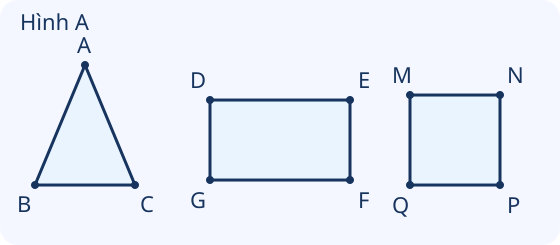
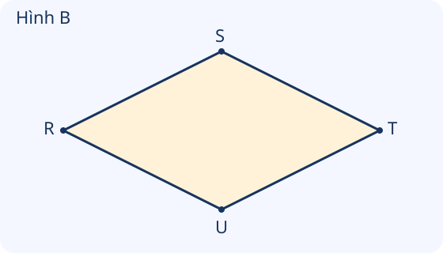

# Hình tam giác, hình tứ giác. Hình chữ nhật, hình vuông

Nguồn tham khảo: Toán 3 KNTT, tập 1, trang 56-60.

Trạng thái: AI biên soạn và rà soát; chưa có xác nhận của giáo viên.

## Mục tiêu

- Nhận biết đỉnh, cạnh, góc của tam giác và tứ giác.
- Nêu đặc điểm hình chữ nhật và hình vuông; dùng đặc điểm để tìm cạnh bằng nhau và phân loại hình.

## Khám phá

Quan sát hình khép kín, hãy đếm số đỉnh và số cạnh trước. Muốn phân biệt hình chữ nhật, hình vuông với những tứ giác khác, còn phải kiểm tra các góc và độ dài cạnh.

- Tam giác có 3 đỉnh, 3 cạnh và 3 góc. Tứ giác có 4 đỉnh, 4 cạnh và 4 góc.
- Hình chữ nhật có 4 góc vuông, 2 cạnh dài bằng nhau và 2 cạnh ngắn bằng nhau. Độ dài cạnh dài gọi là chiều dài; cạnh ngắn gọi là chiều rộng.
- Hình vuông có 4 góc vuông và 4 cạnh bằng nhau.
- Tứ giác có bốn cạnh bằng nhau nhưng góc không vuông chưa phải hình vuông. Xoay một hình không làm đổi đặc điểm của hình đó.

## Hướng dẫn

1. Đếm và gọi tên các đỉnh theo thứ tự quanh hình.
2. Gọi tên các cạnh bằng hai đầu mút, không nhầm đoạn nối hai đỉnh đối diện là cạnh.
3. Dùng ê ke kiểm tra góc, dùng thước đo hoặc đọc số đo cho sẵn để so cạnh.
4. Kết luận dựa trên đầy đủ đặc điểm; với hình chữ nhật, tìm các cặp cạnh đối diện bằng nhau.

## Lỗi thường gặp

- Gọi đoạn nối hai đỉnh đối diện là một cạnh của tứ giác.
- Thấy bốn cạnh bằng nhau là kết luận hình vuông mà chưa xét góc.
- Nhầm chiều dài với chiều rộng.
- Cho rằng xoay nghiêng hình vuông làm hình mất các góc vuông.

## Ví dụ

Hình chữ nhật ABCD có AB = 8 cm, BC = 3 cm. Tìm CD và AD.

1. AB và CD là hai cạnh dài đối diện nên CD = 8 cm.
2. BC và AD là hai cạnh ngắn đối diện nên AD = 3 cm.

Một tứ giác có bốn cạnh bằng nhau, một góc không vuông. Có là hình vuông không?

1. Hình vuông cần đủ bốn cạnh bằng nhau và bốn góc vuông.
2. Có góc không vuông nên tứ giác này không phải hình vuông.

Tam giác MNP có những cạnh nào?

1. Đi quanh hình từ M qua N, P rồi về M.
2. Ba cạnh là MN, NP và PM.

## Hình minh họa

## Ngân hàng câu hỏi

### Câu 1 - nhan_biet

Hình tam giác có mấy cạnh?

A. 3; B. 2; C. 4; D. 5

Đáp án: 3. Lời giải: Hình tam giác có 3 cạnh.

### Câu 2 - nhan_biet

Hình tam giác có mấy đỉnh?

Đáp án: 3. Lời giải: Ba cạnh khép kín của tam giác gặp nhau tại 3 đỉnh.

### Câu 3 - nhan_biet

Hình tứ giác có mấy cạnh?

A. 4; B. 3; C. 5; D. 6

Đáp án: 4. Lời giải: Hình tứ giác có 4 cạnh.

### Câu 4 - nhan_biet

Hình tứ giác có mấy góc?

Đáp án: 4. Lời giải: Hình tứ giác có 4 đỉnh, mỗi đỉnh tạo một góc.

### Câu 5 - nhan_biet

Hình chữ nhật có mấy góc vuông?

A. 4; B. 1; C. 2; D. 3

Đáp án: 4. Lời giải: Cả bốn góc của hình chữ nhật là góc vuông.

### Câu 6 - nhan_biet

Hình vuông có mấy cạnh bằng nhau?

Đáp án: 4. Lời giải: Bốn cạnh hình vuông có độ dài bằng nhau.

### Câu 7 - nhan_biet

Hai cạnh dài của cùng hình chữ nhật có bằng nhau không?

A. có; B. không; C. chỉ khi màu giống nhau; D. chỉ khi đặt ngang

Đáp án: có. Lời giải: Hai cạnh dài đối diện bằng nhau; hai cạnh ngắn đối diện cũng bằng nhau.

### Câu 8 - nhan_biet

Độ dài cạnh dài của hình chữ nhật thường gọi là gì?

Đáp án: chiều dài. Lời giải: Cạnh dài cho biết chiều dài của hình chữ nhật.

### Câu 9 - nhan_biet

Độ dài cạnh ngắn của hình chữ nhật thường gọi là gì?

A. chiều rộng; B. đường kính; C. bán kính; D. đỉnh

Đáp án: chiều rộng. Lời giải: Cạnh ngắn cho biết chiều rộng của hình chữ nhật.

### Câu 10 - nhan_biet

Một tứ giác có bốn cạnh bằng nhau và bốn góc vuông là hình gì?

Đáp án: hình vuông. Lời giải: Hai điều kiện này xác định hình vuông.

### Câu 11 - thong_hieu

Hình A: tam giác ABC có cạnh nối A với C tên là gì?

A. AC; B. AB; C. BC; D. DE

Đáp án: AC. Lời giải: Đoạn nối hai đỉnh A và C được gọi là cạnh AC.

### Câu 12 - thong_hieu

Hình A: hình chữ nhật DEFG có cạnh DE dài 7 cm. Cạnh FG dài mấy xăng-ti-mét?

Đáp án: 7. Lời giải: DE và FG là hai cạnh dài đối diện nên bằng nhau.

### Câu 13 - thong_hieu

Hình A: hình chữ nhật DEFG có EF = 4 cm. DG dài mấy xăng-ti-mét?

A. 4; B. 8; C. 7; D. 3

Đáp án: 4. Lời giải: EF và DG là hai cạnh ngắn đối diện nên bằng nhau.

### Câu 14 - thong_hieu

Hình A: hình vuông MNPQ có cạnh MN dài 3 cm. PQ dài mấy xăng-ti-mét?

Đáp án: 3. Lời giải: Các cạnh cùng hình vuông bằng nhau.

### Câu 15 - thong_hieu

Hình B có bốn cạnh bằng nhau nhưng không có góc vuông. Có là hình vuông không?

A. không; B. có; C. chỉ cần bốn cạnh bằng nhau; D. chỉ cần đặt thẳng

Đáp án: không. Lời giải: Hình vuông còn cần cả bốn góc vuông.

### Câu 16 - thong_hieu

Tam giác có ba cạnh khác nhau về độ dài vẫn là tam giác không?

Đáp án: có. Lời giải: Tên tam giác dựa vào 3 cạnh, 3 đỉnh và 3 góc, không bắt buộc ba cạnh bằng nhau.

### Câu 17 - thong_hieu

Xoay nghiêng một hình vuông, hình đó có còn là hình vuông không?

A. có; B. không; C. luôn thành tam giác; D. chỉ khi đặt ngang

Đáp án: có. Lời giải: Xoay hình không làm đổi độ dài cạnh hay loại góc.

### Câu 18 - thong_hieu

Một hình có 4 cạnh, hai cạnh dài bằng nhau, hai cạnh ngắn bằng nhau nhưng chưa kiểm tra góc. Đã chắc là hình chữ nhật chưa?

Đáp án: chưa. Lời giải: Còn cần kiểm tra bốn góc có là góc vuông không.

### Câu 19 - thong_hieu

Tam giác ABC có ba góc ở các đỉnh nào?

A. A, B, C; B. A, B, D; C. A, C, E; D. D, E, F

Đáp án: A, B, C. Lời giải: Mỗi đỉnh của tam giác là đỉnh của một góc.

### Câu 20 - thong_hieu

Hình tứ giác MNPQ có cạnh nối Q với M tên là gì?

Đáp án: QM. Lời giải: Các cạnh theo thứ tự M-N-P-Q gồm MN, NP, PQ, QM.

### Câu 21 - van_dung

Khung ảnh hình chữ nhật có cạnh trên 9 cm. Cạnh dưới dài mấy xăng-ti-mét?

A. 9; B. 18; C. 8; D. 7

Đáp án: 9. Lời giải: Hai cạnh dài đối diện của hình chữ nhật bằng nhau.

### Câu 22 - van_dung

Tấm bìa hình vuông có cạnh trái 6 cm. Cạnh phải dài mấy xăng-ti-mét?

Đáp án: 6. Lời giải: Bốn cạnh của hình vuông bằng nhau.

### Câu 23 - van_dung

Mảnh giấy hình chữ nhật có cạnh bên phải 5 cm. Cạnh bên trái dài mấy xăng-ti-mét?

A. 5; B. 10; C. 4; D. 6

Đáp án: 5. Lời giải: Hai cạnh ngắn đối diện bằng nhau.

### Câu 24 - van_dung

Một biển tam giác cần đặt dấu ở mọi đỉnh. Cần mấy dấu?

Đáp án: 3. Lời giải: Tam giác có 3 đỉnh.

### Câu 25 - van_dung

Một khung tứ giác gắn một nút ở mỗi góc. Cần mấy nút?

A. 4; B. 3; C. 5; D. 8

Đáp án: 4. Lời giải: Tứ giác có 4 góc, nên cần 4 nút.

### Câu 26 - van_dung

Hai thẻ tam giác rời nhau, mỗi thẻ có ba đỉnh. Tổng số đỉnh là mấy?

Đáp án: 6. Lời giải: 3 × 2 = 6 đỉnh.

### Câu 27 - van_dung

Ba tấm bìa hình vuông rời nhau có tổng cộng mấy góc vuông?

A. 12; B. 3; C. 4; D. 7

Đáp án: 12. Lời giải: Mỗi tấm có 4 góc vuông; 4 × 3 = 12 góc.

### Câu 28 - van_dung

An làm hai cạnh dài của khung chữ nhật bằng 8 cm và 7 cm. Khung có đúng theo đặc điểm hình chữ nhật chưa?

Đáp án: chưa. Lời giải: Hai cạnh dài đối diện phải bằng nhau; 8 cm khác 7 cm.

### Câu 29 - van_dung

Mai làm một hình có bốn cạnh 4 cm nhưng một góc không vuông. Có phải hình vuông không?

A. không; B. có; C. chỉ cần cạnh bằng nhau; D. chỉ cần có bốn đỉnh

Đáp án: không. Lời giải: Hình vuông cần bốn cạnh bằng nhau và bốn góc vuông.

### Câu 30 - van_dung

Một ô cửa hình chữ nhật có chiều dài 12 dm, chiều rộng 8 dm. Hai cạnh ngắn mỗi cạnh dài mấy đề-xi-mét?

Đáp án: 8. Lời giải: Cạnh ngắn cho biết chiều rộng, nên mỗi cạnh ngắn dài 8 dm.

### Câu 31 - van_dung

Một sân hình chữ nhật ABCD có AB = 9 m, BC = 5 m. CD dài mấy mét?

A. 9; B. 5; C. 14; D. 4

Đáp án: 9. Lời giải: AB và CD là hai cạnh đối diện bằng nhau.

### Câu 32 - van_dung

Sân hình chữ nhật ABCD có AB = 9 m, BC = 5 m. AD dài mấy mét?

Đáp án: 5. Lời giải: AD và BC là hai cạnh đối diện bằng nhau.

### Câu 33 - van_dung

Trên hình chữ nhật ABCD, kẻ đoạn AC nối hai đỉnh đối diện. Chia hình thành mấy tam giác?

A. 2; B. 1; C. 3; D. 4

Đáp án: 2. Lời giải: Đoạn AC chia hình thành tam giác ABC và tam giác ACD.

### Câu 34 - van_dung

Một tờ giấy hình vuông có bốn góc. Cắt theo đường nối hai đỉnh đối diện được mấy mảnh tam giác?

Đáp án: 2. Lời giải: Một đường nối hai đỉnh đối diện chia hình vuông thành 2 tam giác.

### Câu 35 - van_dung

Có 4 thẻ tam giác rời nhau. Mỗi thẻ có 3 cạnh. Tổng số cạnh của các thẻ là mấy?

A. 12; B. 7; C. 4; D. 16

Đáp án: 12. Lời giải: 3 × 4 = 12 cạnh; các thẻ rời nhau nên không có cạnh dùng chung.

### Câu 36 - van_dung

Có 5 khung tứ giác rời nhau, mỗi khung có 4 đỉnh. Tổng cộng mấy đỉnh?

Đáp án: 20. Lời giải: 4 × 5 = 20 đỉnh.

### Câu 37 - van_dung

Một khung vuông có một cạnh 7 cm. Muốn thay một cạnh khác đúng kích thước, thanh mới dài mấy xăng-ti-mét?

A. 7; B. 14; C. 4; D. 8

Đáp án: 7. Lời giải: Các cạnh cùng hình vuông bằng nhau.

### Câu 38 - van_dung

Một bạn chỉ nhìn cạnh của hình và chưa kiểm tra góc. Để biết có phải hình vuông, cần kiểm tra thêm điều gì?

Đáp án: bốn góc vuông. Lời giải: Ngoài bốn cạnh bằng nhau, hình vuông cần bốn góc vuông.

### Câu 39 - van_dung

Một tam giác và một tứ giác rời nhau có tổng cộng mấy đỉnh?

A. 7; B. 3; C. 4; D. 12

Đáp án: 7. Lời giải: Tam giác có 3, tứ giác có 4; 3 + 4 = 7 đỉnh.

### Câu 40 - van_dung

Tấm biển hình chữ nhật dài 8 dm, rộng 3 dm. Đi từ góc A đến góc đối diện C theo hai cạnh AB rồi BC dài mấy đề-xi-mét?

Đáp án: 11. Lời giải: Đi hai cạnh liên tiếp: 8 + 3 = 11 dm.

## Trò chơi

Ghép thẻ hình học: Ghép đặc điểm và tình huống về cạnh, đỉnh, góc với kết quả phù hợp.

- Mỗi lượt chọn 5 câu có 5 đáp án khác nhau.
- Chọn câu hỏi bên trái rồi đáp án bên phải. Sai thì thử lại.
- Mỗi cặp đúng 10 điểm; tối đa 50 điểm.

## Đánh giá

Đúng lần đầu: 1 điểm; đúng sau một gợi ý: 0,5 điểm. Từ 90%: 3 sao; từ 60%: 2 sao; còn lại: 1 sao.

Xem lời giải các câu sai, đọc lại quy tắc, rồi làm một lượt mới.
