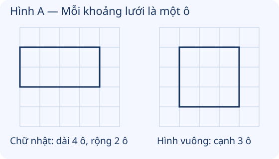

# Thực hành vẽ góc vuông, vẽ đường tròn, hình vuông, hình chữ nhật và vẽ trang trí

Nguồn tham khảo: Toán 3 KNTT, tập 1, trang 61-62.

Trạng thái: AI biên soạn và rà soát; chưa có xác nhận của giáo viên.

## Mục tiêu

- Dùng thước và ê ke vẽ góc vuông, hình chữ nhật, hình vuông.
- Dùng com pa vẽ đường tròn; phối hợp các hình thành họa tiết trang trí và tự kiểm tra sản phẩm.

## Khám phá

Đây là bài thực hành: em cần giấy, bút chì, thước, ê ke, com pa và màu. Hãy vẽ từng bước, kiểm tra hình trước khi tô màu. Bảng vẽ trên lưới chỉ mô phỏng thao tác; một ô trên màn hình không được coi là một xăng-ti-mét ngoài đời.

- Vẽ góc vuông bằng đúng góc vuông của ê ke: đỉnh trùng điểm cần vẽ, kẻ hai cạnh theo dụng cụ.
- Vẽ hình chữ nhật phải giữ bốn góc vuông và các cặp cạnh đối diện bằng nhau. Vẽ hình vuông còn phải giữ cả bốn cạnh bằng nhau.
- Com pa có đầu nhọn tại tâm, độ mở bằng bán kính. Giữ tâm và độ mở không đổi khi quay.
- Sau khi vẽ, kiểm tra độ dài bằng thước và góc bằng ê ke rồi mới tô màu hoặc ghép họa tiết.
- Trên lưới ô vuông có thể đếm hàng, cột để dựng hình. Phải đọc đúng đơn vị: số ô khác với số cm.

## Hướng dẫn

1. Chuẩn bị dụng cụ; chọn vị trí đủ rộng trên giấy.
2. Đánh dấu đỉnh hoặc tâm; dùng dụng cụ vẽ theo mẫu đã xác định.
3. Kiểm tra góc, cạnh hoặc bán kính; sửa nét sai.
4. Trang trí bằng cách lặp lại, thay vị trí hoặc xoay các hình đã vẽ, sau đó tô màu vừa phải.

## Lỗi thường gặp

- Vẽ bốn cạnh bằng nhau nhưng không kiểm tra góc vuông.
- Để đầu nhọn com pa trượt hoặc đổi độ mở khi quay.
- Đếm số điểm lưới thay vì đếm số khoảng ô.
- Coi độ dài đo trên màn hình là số cm thật.
- Tô màu che hết nét khi hình chưa được kiểm tra.

## Ví dụ

Vẽ hình vuông cạnh 3 cm trên giấy.

1. Vẽ một cạnh dài 3 cm bằng thước.
2. Dùng ê ke vẽ hai cạnh liền kề tạo góc vuông, đo mỗi cạnh 3 cm.
3. Nối hai đỉnh còn lại, kiểm tra đủ bốn cạnh 3 cm và bốn góc vuông.

Vẽ đường tròn có đường kính 8 cm.

1. Tìm bán kính: 8 : 2 = 4 cm.
2. Đánh dấu tâm O, mở com pa 4 cm bằng thước.
3. Giữ đầu nhọn ở O, quay đầu bút và giữ nguyên độ mở.

Vẽ hình chữ nhật dài 4 ô, rộng 2 ô trên lưới.

1. Chọn một đỉnh, đếm 4 khoảng ô theo hàng ngang và 2 khoảng theo cột dọc.
2. Nối bốn đỉnh theo các đường lưới để có bốn góc vuông.
3. Kiểm tra hai cạnh dài 4 ô và hai cạnh ngắn 2 ô.

## Hình minh họa

## Thực hành với dụng cụ

### Góc vuông trên giấy

Dụng cụ: Giấy, Bút chì, Ê ke.

1. Đánh dấu đỉnh A.
2. Đặt đỉnh góc vuông ê ke tại A, kẻ hai cạnh.
3. Xoay giấy và kiểm tra lại góc bằng ê ke.

Tự kiểm tra:

- Hai cạnh cùng xuất phát từ A.
- Góc khớp với góc vuông của ê ke.

### Hình vuông và hình chữ nhật

Dụng cụ: Giấy, Bút chì, Thước, Ê ke.

1. Vẽ hình vuông cạnh 3 cm.
2. Vẽ hình chữ nhật dài 5 cm, rộng 2 cm.
3. Đo lại các cạnh và kiểm tra góc.

Tự kiểm tra:

- Hình vuông có bốn cạnh 3 cm.
- Hình chữ nhật có hai cạnh 5 cm, hai cạnh 2 cm.
- Mỗi hình có bốn góc vuông.

### Họa tiết đường tròn

Dụng cụ: Giấy, Bút chì, Thước, Com pa, Bút màu.

1. Đánh dấu hai tâm khác nhau.
2. Giữ độ mở 2 cm, vẽ hai đường tròn cùng bán kính.
3. Tô màu phần em thích và kiểm tra tâm không bị trượt.

Tự kiểm tra:

- Hai đường tròn có tâm khác nhau.
- Bán kính mỗi đường tròn là 2 cm.
- Nét khép kín, không đổi độ mở trong khi vẽ.

## Ngân hàng câu hỏi

### Câu 1 - nhan_biet

Dụng cụ phù hợp nhất để vẽ một đường tròn có tâm và bán kính cho trước là gì?

A. com pa; B. ê ke; C. tẩy; D. keo dán

Đáp án: com pa. Lời giải: Com pa giữ khoảng cách từ tâm tới đầu bút không đổi.

### Câu 2 - nhan_biet

Để vẽ góc vuông, nên dùng góc nào của ê ke?

Đáp án: góc vuông. Lời giải: Ê ke có một góc vuông; dùng đúng góc này để vẽ hai cạnh.

### Câu 3 - nhan_biet

Khi vẽ đường tròn tâm O, đầu nhọn com pa đặt ở đâu?

A. O; B. điểm bất kì ngoài O; C. mép tờ giấy; D. đầu bút chì

Đáp án: O. Lời giải: Đầu nhọn cố định tại tâm O.

### Câu 4 - nhan_biet

Muốn vẽ hình vuông, bốn cạnh phải thế nào?

Đáp án: bằng nhau. Lời giải: Bốn cạnh hình vuông phải bằng nhau và bốn góc phải vuông.

### Câu 5 - nhan_biet

Muốn vẽ hình chữ nhật, bốn góc phải là góc gì?

A. góc vuông; B. góc không vuông; C. góc tùy ý; D. không có góc

Đáp án: góc vuông. Lời giải: Hình chữ nhật có bốn góc vuông.

### Câu 6 - nhan_biet

Trên lưới ô vuông, một bước theo hàng ngang và một bước theo cột dọc tạo dạng góc gì?

Đáp án: góc vuông. Lời giải: Hàng ngang và cột dọc vuông góc trong lưới.

### Câu 7 - nhan_biet

Khi quay com pa, độ mở có cần giữ nguyên không?

A. có; B. không; C. chỉ giữ nguyên nửa vòng; D. luôn tăng dần

Đáp án: có. Lời giải: Độ mở bằng bán kính; phải giữ nguyên để mọi điểm cách tâm như nhau.

### Câu 8 - nhan_biet

Đường tròn cần bán kính 3 cm. Com pa mở mấy xăng-ti-mét?

Đáp án: 3. Lời giải: Độ mở com pa bằng bán kính cần vẽ.

### Câu 9 - nhan_biet

Vẽ góc vuông đỉnh A, đỉnh góc vuông của ê ke phải trùng điểm nào?

A. A; B. điểm bất kì; C. giữa cạnh; D. mép giấy

Đáp án: A. Lời giải: Đỉnh dụng cụ phải trùng đỉnh góc cần vẽ.

### Câu 10 - nhan_biet

Sau khi vẽ hình vuông, dùng gì để kiểm tra góc?

Đáp án: ê ke. Lời giải: Ê ke dùng kiểm tra cả bốn góc có vuông không.

### Câu 11 - thong_hieu

Hình A: hình chữ nhật trên lưới dài 4 ô, rộng 2 ô. Cạnh dài đối diện cũng dài mấy ô?

A. 4; B. 2; C. 6; D. 8

Đáp án: 4. Lời giải: Hai cạnh dài đối diện của hình chữ nhật bằng nhau.

### Câu 12 - thong_hieu

Hình A: hình vuông bên phải có mỗi cạnh 3 ô. Cạnh dưới dài mấy ô?

Đáp án: 3. Lời giải: Bốn cạnh của hình vuông bằng nhau.

### Câu 13 - thong_hieu

Một bạn vẽ hình vuông nhưng chỉ đo hai cạnh. Đã đủ kiểm tra cả hình chưa?

A. chưa; B. rồi; C. chỉ nhìn màu là đủ; D. không cần đo cạnh

Đáp án: chưa. Lời giải: Cần kiểm tra bốn cạnh bằng nhau và bốn góc vuông.

### Câu 14 - thong_hieu

Một bạn vẽ hình chữ nhật dài 5 cm, rộng 3 cm nhưng một góc không vuông. Hình đã đạt yêu cầu chưa?

Đáp án: chưa. Lời giải: Hình chữ nhật cần đủ bốn góc vuông.

### Câu 15 - thong_hieu

Muốn vẽ đường tròn đường kính 8 cm, phải mở com pa mấy xăng-ti-mét?

A. 4; B. 8; C. 2; D. 6

Đáp án: 4. Lời giải: Độ mở là bán kính; 8 : 2 = 4 cm.

### Câu 16 - thong_hieu

Vẽ lại đường tròn cùng tâm, cùng bán kính trên hình cũ. Đường vẽ có trùng nhau không?

Đáp án: có. Lời giải: Tâm và bán kính giữ nguyên thì đường tròn không đổi.

### Câu 17 - thong_hieu

Hai hình vuông bằng nhau đặt xoay khác hướng có còn cùng số góc vuông không?

A. có; B. không; C. chỉ hình đặt ngang; D. chỉ hình đặt dọc

Đáp án: có. Lời giải: Mỗi hình vẫn có bốn góc vuông, dù đặt xoay hướng nào.

### Câu 18 - thong_hieu

Gấp giấy làm dụng cụ kiểm tra góc, sau đó nên so lại với dụng cụ nào?

Đáp án: ê ke. Lời giải: So với ê ke chuẩn để kiểm tra góc giấy gấp có vuông không.

### Câu 19 - thong_hieu

Trong khi vẽ com pa bị trượt khỏi tâm. Cần làm gì?

A. đặt lại đúng tâm và vẽ lại; B. tiếp tục coi là đúng; C. tăng độ mở tùy ý; D. đổi màu là đủ

Đáp án: đặt lại đúng tâm và vẽ lại. Lời giải: Đường tròn yêu cầu có tâm cố định; trượt tâm làm đường vẽ sai.

### Câu 20 - thong_hieu

Vẽ một cạnh hình vuông dài 4 cm. Cạnh liền kề phải dài mấy xăng-ti-mét?

Đáp án: 4. Lời giải: Các cạnh hình vuông bằng nhau.

### Câu 21 - van_dung

Lan vẽ hình vuông cạnh 5 cm. Cần đo mỗi cạnh còn lại dài mấy xăng-ti-mét?

A. 5; B. 10; C. 4; D. 6

Đáp án: 5. Lời giải: Mỗi cạnh phải dài bằng cạnh đã vẽ, là 5 cm.

### Câu 22 - van_dung

An vẽ hình chữ nhật dài 7 cm, rộng 4 cm. Cạnh dài thứ hai cần dài mấy xăng-ti-mét?

Đáp án: 7. Lời giải: Hai cạnh dài đối diện bằng nhau.

### Câu 23 - van_dung

Mai vẽ hình chữ nhật dài 7 cm, rộng 4 cm. Cạnh ngắn thứ hai cần dài mấy xăng-ti-mét?

A. 4; B. 7; C. 11; D. 3

Đáp án: 4. Lời giải: Hai cạnh ngắn đối diện bằng nhau.

### Câu 24 - van_dung

Một họa tiết gồm 3 hình vuông rời nhau. Cả 3 hình có mấy góc vuông tại các đỉnh?

Đáp án: 12. Lời giải: Mỗi hình có 4; 4 × 3 = 12 góc.

### Câu 25 - van_dung

Mỗi cánh quạt trang trí là một hình tam giác. Dùng 4 cánh rời nhau có tổng mấy đỉnh?

A. 12; B. 7; C. 4; D. 16

Đáp án: 12. Lời giải: Mỗi tam giác có 3 đỉnh; 3 × 4 = 12 đỉnh.

### Câu 26 - van_dung

Nam cần vẽ đường tròn đường kính 12 cm. Com pa mở mấy xăng-ti-mét?

Đáp án: 6. Lời giải: 12 : 2 = 6 cm là bán kính.

### Câu 27 - van_dung

Vẽ hai đường tròn có cùng độ mở com pa 4 cm nhưng tâm khác nhau. Hai đường tròn có cùng bán kính không?

A. có; B. không; C. chỉ khi tâm trùng; D. chỉ khi màu giống nhau

Đáp án: có. Lời giải: Độ mở giữ nguyên 4 cm nên hai bán kính bằng nhau.

### Câu 28 - van_dung

Một mẫu trang trí có 5 hình chữ nhật rời nhau. Tổng số cạnh của các hình là mấy?

Đáp án: 20. Lời giải: Mỗi hình có 4 cạnh; 4 × 5 = 20 cạnh.

### Câu 29 - van_dung

Lan dùng lưới vẽ hình vuông cạnh 4 ô. Cạnh trên đã dài 4 ô, cạnh bên phải cần dài mấy ô?

A. 4; B. 8; C. 2; D. 6

Đáp án: 4. Lời giải: Cạnh bên phải cũng phải bằng 4 ô.

### Câu 30 - van_dung

Một hình chữ nhật trên lưới có cạnh trên 6 ô, cạnh phải 2 ô. Cạnh trái cần dài mấy ô?

Đáp án: 2. Lời giải: Cạnh trái và phải bằng nhau, đều 2 ô.

### Câu 31 - van_dung

An vẽ góc vuông nghiêng so với mép giấy. Có bắt buộc quay góc cho một cạnh nằm ngang mới được không?

A. không; B. có; C. chỉ cạnh ngang mới đúng; D. chỉ cạnh đứng mới đúng

Đáp án: không. Lời giải: Góc vuông có thể ở nhiều hướng; dùng ê ke kiểm tra thay vì dựa vào mép giấy.

### Câu 32 - van_dung

Mai vẽ 4 đường tròn cùng tâm và cùng độ mở. Có mấy đường tròn khác nhau về vị trí nét vẽ?

Đáp án: 1. Lời giải: Cùng tâm, cùng bán kính thì các đường vẽ trùng nhau, chỉ một đường tròn khác biệt.

### Câu 33 - van_dung

Để tạo hai đường tròn cùng kích thước nhưng không trùng nhau, nên giữ độ mở và thay đổi điều gì?

A. tâm; B. màu giấy thay cho tâm; C. độ dài bán kính; D. góc vuông

Đáp án: tâm. Lời giải: Đổi vị trí tâm, giữ độ mở, được hai đường tròn cùng bán kính ở vị trí khác nhau.

### Câu 34 - van_dung

Một mẫu có 2 hình vuông và 1 hình chữ nhật rời nhau. Có tổng mấy góc vuông ở các đỉnh?

Đáp án: 12. Lời giải: Ba hình, mỗi hình 4 góc vuông; 4 × 3 = 12 góc.

### Câu 35 - van_dung

Tờ giấy hình vuông cạnh 6 cm. Cần vẽ một hình vuông nhỏ cạnh 3 cm. Cạnh nhỏ bằng một phần mấy cạnh lớn? Viết dạng 1/n.

A. 1/2; B. 1/3; C. 1/4; D. 2/1

Đáp án: 1/2. Lời giải: 6 : 2 = 3 cm nên cạnh nhỏ bằng một phần hai cạnh lớn.

### Câu 36 - van_dung

Em vẽ hình chữ nhật 4 ô dài, 2 ô rộng. Muốn thành hình vuông giữ nguyên chiều dài, chiều rộng phải tăng thêm mấy ô?

Đáp án: 2. Lời giải: Hình vuông cần cạnh 4 ô; 4 - 2 = 2 ô cần tăng.

### Câu 37 - van_dung

Một hình vuông vẽ trên lưới có cạnh 3 ô. Đổi màu tô có làm thay đổi số góc vuông không?

A. không; B. có; C. chỉ màu xanh mới vuông; D. chỉ màu đỏ mới vuông

Đáp án: không. Lời giải: Tô màu không thay đổi hình hay các góc.

### Câu 38 - van_dung

Họa tiết hình tròn bán kính 5 cm. Vẽ thêm một đường kính để trang trí. Đường kính dài mấy xăng-ti-mét?

Đáp án: 10. Lời giải: 5 × 2 = 10 cm.

### Câu 39 - van_dung

An vẽ hình có bốn cạnh 4 cm nhưng chưa dùng ê ke. Để xác nhận hình vuông, cần kiểm tra thêm gì?

A. bốn góc vuông; B. chỉ một góc tùy ý; C. chỉ màu hình; D. chỉ tâm hình

Đáp án: bốn góc vuông. Lời giải: Bốn cạnh bằng nhau chưa đủ; cần cả bốn góc vuông.

### Câu 40 - van_dung

Vẽ góc vuông trên giấy, hai cạnh được kéo dài thêm theo đúng hướng. Góc có còn vuông không?

Đáp án: có. Lời giải: Kéo dài theo đúng hướng không làm thay đổi góc.

## Trò chơi

Tăng tốc kiểm tra hình vẽ: Ôn thao tác vẽ, kiểm tra góc, cạnh, tâm và bán kính qua câu hỏi trong 60 giây.

- Trả lời các câu thuộc bài trong 60 giây.
- Mỗi câu đúng được 10 điểm, sai không được điểm; chuyển ngay sang câu tiếp.
- Hết giờ thì kết thúc. Điểm riêng của lượt chơi, không thay kết quả luyện tập.

## Đánh giá

Đúng lần đầu: 1 điểm; đúng sau một gợi ý: 0,5 điểm. Từ 90%: 3 sao; từ 60%: 2 sao; còn lại: 1 sao.

Xem lời giải các câu sai, đọc lại quy tắc, rồi làm một lượt mới.
