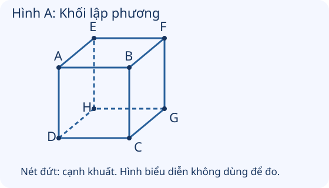
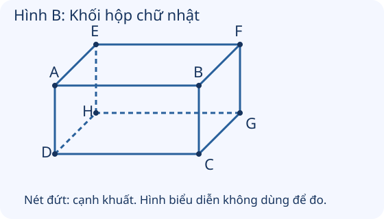

# Khối lập phương, khối hộp chữ nhật

Nguồn tham khảo: Toán 3 KNTT, tập 1, trang 63-64.

Trạng thái: AI biên soạn và rà soát; chưa có xác nhận của giáo viên.

## Mục tiêu

- Nhận biết mặt, cạnh, đỉnh của khối lập phương và khối hộp chữ nhật.
- Nhớ và vận dụng số mặt, cạnh, đỉnh; phân biệt vật thể với hình phẳng trên một mặt.

## Khám phá

Một chiếc hộp không chỉ có mặt trước. Hãy quan sát hoặc xoay hộp để thấy cả mặt trên, dưới, bên và phía sau. Khi đếm, phải tính cả những bộ phận đang bị khuất.

- Khối lập phương và khối hộp chữ nhật đều có 8 đỉnh, 6 mặt, 12 cạnh.
- Các mặt của khối lập phương là các hình vuông bằng nhau. Các mặt của khối hộp chữ nhật là hình chữ nhật.
- Mặt là phần phẳng bao quanh khối; cạnh là chỗ hai mặt kề gặp nhau; đỉnh là điểm các cạnh gặp nhau.
- Có thể đếm cạnh theo ba nhóm: 4 cạnh quanh phía trên, 4 cạnh quanh phía dưới và 4 cạnh nối. Tính cả cạnh và đỉnh khuất trong hình biểu diễn.
- Hình vuông hay hình chữ nhật là hình phẳng; cả khối lập phương hay hộp chữ nhật là vật thể có nhiều mặt.

## Hướng dẫn

1. Cầm hoặc quan sát mô hình, chỉ rõ một mặt, một cạnh, một đỉnh.
2. Đánh dấu các bộ phận đã đếm để tránh lặp.
3. Đếm cả phía sau và phía dưới, có thể xoay mô hình.
4. Khi giải bài trang trí, xác định đang gắn vào mặt, cạnh hay đỉnh rồi tính theo đúng số bộ phận.

## Lỗi thường gặp

- Chỉ đếm ba mặt đang nhìn thấy.
- Nhầm 8 đỉnh thành 8 cạnh.
- Dùng 12 cạnh để tính số giấy dán mỗi mặt.
- Nhìn mặt nghiêng trong hình biểu diễn rồi cho rằng mặt khối lập phương không phải hình vuông.

## Ví dụ

Mỗi mặt một chiếc hộp lập phương dán một nhãn. Cần bao nhiêu nhãn?

1. Nhãn được dán theo mặt, không theo cạnh.
2. Khối lập phương có 6 mặt, nên cần 6 nhãn.

Một hạt gắn vào mỗi đỉnh của hai mô hình hộp chữ nhật rời nhau. Cần mấy hạt?

1. Mỗi mô hình có 8 đỉnh.
2. 8 × 2 = 16. Cần 16 hạt.

Làm một khung lập phương, mỗi cạnh một que. Đã lắp 8 que. Còn mấy que?

1. Khối có 12 cạnh nên cần 12 que.
2. 12 - 8 = 4. Còn cần 4 que.

## Hình minh họa

## Ngân hàng câu hỏi

### Câu 1 - nhan_biet

Khối lập phương có mấy mặt?

A. 6; B. 4; C. 8; D. 12

Đáp án: 6. Lời giải: Khối lập phương có 6 mặt.

### Câu 2 - nhan_biet

Khối lập phương có mấy đỉnh?

Đáp án: 8. Lời giải: Khối lập phương có 8 đỉnh.

### Câu 3 - nhan_biet

Khối lập phương có mấy cạnh?

A. 12; B. 6; C. 8; D. 4

Đáp án: 12. Lời giải: Có 4 cạnh quanh mặt trên, 4 cạnh quanh mặt dưới và 4 cạnh nối hai mặt.

### Câu 4 - nhan_biet

Khối hộp chữ nhật có mấy mặt?

Đáp án: 6. Lời giải: Khối hộp chữ nhật có 6 mặt.

### Câu 5 - nhan_biet

Khối hộp chữ nhật có mấy đỉnh?

A. 8; B. 4; C. 6; D. 12

Đáp án: 8. Lời giải: Có 4 đỉnh ở phía trên và 4 đỉnh ở phía dưới, tất cả 8 đỉnh.

### Câu 6 - nhan_biet

Khối hộp chữ nhật có mấy cạnh?

Đáp án: 12. Lời giải: Có 4 cạnh phía trên, 4 cạnh phía dưới, 4 cạnh nối, tất cả 12 cạnh.

### Câu 7 - nhan_biet

Các mặt của khối lập phương có dạng hình gì?

A. hình vuông; B. hình tam giác; C. hình tròn; D. góc

Đáp án: hình vuông. Lời giải: Sáu mặt của khối lập phương là các hình vuông.

### Câu 8 - nhan_biet

Các mặt của khối hộp chữ nhật có dạng hình gì?

Đáp án: hình chữ nhật. Lời giải: Các mặt khối hộp chữ nhật là các hình chữ nhật.

### Câu 9 - nhan_biet

Chỗ các cạnh của khối gặp nhau tại một điểm gọi là gì?

A. đỉnh; B. mặt; C. bán kính; D. đường kính

Đáp án: đỉnh. Lời giải: Điểm gặp của các cạnh là một đỉnh của khối.

### Câu 10 - nhan_biet

Đoạn thẳng nơi hai mặt kề gặp nhau gọi là gì?

Đáp án: cạnh. Lời giải: Đường gặp giữa hai mặt kề là một cạnh của khối.

### Câu 11 - thong_hieu

Hình A biểu diễn khối lập phương. Có thể chỉ đếm các cạnh nét liền để tìm tổng số cạnh không?

A. không; B. có; C. chỉ cần đếm mặt trước; D. chỉ cần đếm mặt trên

Đáp án: không. Lời giải: Nét đứt biểu diễn cạnh bị khuất; vẫn phải tính đủ 12 cạnh.

### Câu 12 - thong_hieu

Hình B biểu diễn khối hộp chữ nhật. Cả các đỉnh ở phía sau có phải là đỉnh của khối không?

Đáp án: có. Lời giải: Khối có cả phần trước và sau; phải tính đủ 8 đỉnh.

### Câu 13 - thong_hieu

Một mặt trước của khối lập phương có mấy cạnh?

A. 4; B. 6; C. 8; D. 12

Đáp án: 4. Lời giải: Mặt trước là một hình vuông nên có 4 cạnh.

### Câu 14 - thong_hieu

Tất cả các mặt của một khối lập phương có bằng nhau không?

Đáp án: có. Lời giải: Sáu mặt là các hình vuông bằng nhau.

### Câu 15 - thong_hieu

Số mặt của khối hộp chữ nhật và khối lập phương có bằng nhau không?

A. có; B. không; C. chỉ khi cùng chiều cao; D. chỉ khi cùng màu

Đáp án: có. Lời giải: Mỗi khối đều có 6 mặt.

### Câu 16 - thong_hieu

Một hình vuông trên giấy có phải là cả khối lập phương không?

Đáp án: không. Lời giải: Hình vuông là hình phẳng; khối lập phương có 6 mặt trong không gian.

### Câu 17 - thong_hieu

Một hộp giày dạng khối hộp chữ nhật có phải mọi mặt đều là tam giác không?

A. không; B. có; C. chỉ mặt trên; D. chỉ mặt dưới

Đáp án: không. Lời giải: Các mặt của khối hộp chữ nhật là hình chữ nhật.

### Câu 18 - thong_hieu

Đếm mặt của một chiếc hộp kín chỉ theo ba mặt đang nhìn thấy có đủ không?

Đáp án: không. Lời giải: Cần tính cả các mặt phía sau, dưới và bên khuất, tổng cộng 6 mặt.

### Câu 19 - thong_hieu

Khối có 6 mặt vuông bằng nhau, 8 đỉnh, 12 cạnh là khối gì?

A. khối lập phương; B. khối cầu; C. khối trụ; D. hình tam giác

Đáp án: khối lập phương. Lời giải: Đây là đặc điểm của khối lập phương.

### Câu 20 - thong_hieu

Đóng kín một chiếc hộp chữ nhật bị thiếu đúng một mặt. Phải thêm mấy mặt?

Đáp án: 1. Lời giải: Đề cho thiếu một mặt, nên thêm đúng một mặt để kín.

### Câu 21 - van_dung

Dán một nhãn lên mỗi mặt của một khối lập phương. Cần mấy nhãn?

A. 6; B. 4; C. 8; D. 12

Đáp án: 6. Lời giải: Có 6 mặt nên cần 6 nhãn.

### Câu 22 - van_dung

Gắn một hạt ở mỗi đỉnh của mô hình khối hộp chữ nhật. Cần mấy hạt?

Đáp án: 8. Lời giải: Có 8 đỉnh nên cần 8 hạt.

### Câu 23 - van_dung

Mỗi cạnh một mô hình lập phương dùng một que thẳng. Cần mấy que?

A. 12; B. 6; C. 8; D. 4

Đáp án: 12. Lời giải: Khối lập phương có 12 cạnh.

### Câu 24 - van_dung

Hai mô hình lập phương rời nhau, mỗi mô hình gắn một hạt tại mỗi đỉnh. Cần tất cả mấy hạt?

Đáp án: 16. Lời giải: 8 × 2 = 16 hạt.

### Câu 25 - van_dung

Ba hộp lập phương kín, mỗi mặt dán một tờ màu. Cần mấy tờ?

A. 18; B. 9; C. 12; D. 24

Đáp án: 18. Lời giải: 6 × 3 = 18 tờ.

### Câu 26 - van_dung

Mỗi đỉnh của một khối lập phương gắn 2 bông hoa. Cần mấy bông?

Đáp án: 16. Lời giải: 8 đỉnh, mỗi đỉnh 2 bông; 8 × 2 = 16 bông.

### Câu 27 - van_dung

Tô màu đúng bốn mặt của một hộp chữ nhật kín. Còn mấy mặt chưa tô?

A. 2; B. 4; C. 6; D. 10

Đáp án: 2. Lời giải: 6 - 4 = 2 mặt.

### Câu 28 - van_dung

Hộp lập phương đã dán nhãn 5 mặt. Còn mấy mặt chưa dán?

Đáp án: 1. Lời giải: 6 - 5 = 1 mặt.

### Câu 29 - van_dung

Làm hai khung hộp chữ nhật rời nhau, mỗi cạnh một que. Cần tất cả mấy que?

A. 24; B. 12; C. 14; D. 20

Đáp án: 24. Lời giải: Mỗi khung cần 12 que; 12 + 12 = 24 que.

### Câu 30 - van_dung

Một mô hình lập phương có 12 cạnh, đã lắp 7 cạnh. Còn phải lắp mấy cạnh?

Đáp án: 5. Lời giải: 12 - 7 = 5 cạnh.

### Câu 31 - van_dung

Năm hộp lập phương kín, mỗi mặt dán một nhãn. Tổng số nhãn là mấy?

A. 30; B. 11; C. 24; D. 36

Đáp án: 30. Lời giải: 6 × 5 = 30 nhãn.

### Câu 32 - van_dung

Ba khối lập phương rời nhau, mỗi khối đánh dấu cả 8 đỉnh. Tổng cộng mấy dấu?

Đáp án: 24. Lời giải: 8 × 3 = 24 dấu.

### Câu 33 - van_dung

Mỗi đỉnh một khối hộp chữ nhật gắn 3 hạt. Cần bao nhiêu hạt?

A. 24; B. 11; C. 18; D. 36

Đáp án: 24. Lời giải: 8 đỉnh, mỗi đỉnh 3 hạt; 8 × 3 = 24 hạt.

### Câu 34 - van_dung

Hai hộp chữ nhật kín rời nhau, đếm riêng mặt của từng hộp. Tổng cộng mấy mặt?

Đáp án: 12. Lời giải: 6 × 2 = 12 mặt.

### Câu 35 - van_dung

Chỉ dán giấy vào 6 mặt của một hộp lập phương, không dán vào cạnh. Cần mấy miếng giấy, mỗi mặt một miếng?

A. 6; B. 12; C. 8; D. 4

Đáp án: 6. Lời giải: Giấy dán theo số mặt, không theo 12 cạnh; cần 6 miếng.

### Câu 36 - van_dung

Một bạn đếm khối hộp chữ nhật có 4 đỉnh vì chỉ nhìn mặt trước. Cần tính thêm mấy đỉnh ở mặt sau?

Đáp án: 4. Lời giải: Khối có 8 đỉnh; đã đếm 4, còn 8 - 4 = 4 đỉnh.

### Câu 37 - van_dung

Khung lập phương có 4 cạnh trên và 4 cạnh dưới đã lắp xong. Cần thêm mấy cạnh nối để hoàn chỉnh?

A. 4; B. 8; C. 12; D. 2

Đáp án: 4. Lời giải: Tổng 12 cạnh; 4 + 4 = 8 đã lắp, 12 - 8 = 4 cạnh nối.

### Câu 38 - van_dung

Một hộp lập phương kín có 6 mặt. Mở nắp nhưng không tháo rời nắp, số mặt của chiếc hộp và nắp tính chung có giảm không?

Đáp án: không. Lời giải: Nắp vẫn là một mặt của hộp; thay vị trí nắp không làm mất mặt đó.

### Câu 39 - van_dung

Sáu miếng bìa bằng nhau, mỗi miếng hình vuông, dùng làm mỗi mặt của một hộp kín lập phương. Cần dùng mấy miếng?

A. 6; B. 4; C. 8; D. 12

Đáp án: 6. Lời giải: Khối lập phương có 6 mặt, mỗi mặt dùng một miếng vuông.

### Câu 40 - van_dung

Gắn 1 hạt vào mỗi đỉnh và 1 nhãn vào mỗi mặt một mô hình lập phương. Tổng số hạt và nhãn là mấy?

Đáp án: 14. Lời giải: Có 8 hạt và 6 nhãn; 8 + 6 = 14 đồ trang trí.

## Trò chơi

Thám hiểm chiếc hộp: Tìm đúng mặt, cạnh, đỉnh và giải bài trang trí mô hình qua 10 câu hỏi.

- Mỗi lượt lấy 10 câu từ bài học.
- Chọn đáp án, đọc lời giải rồi sang câu tiếp theo.
- Mỗi câu đúng được 10 điểm; tối đa 100 điểm.

## Đánh giá

Đúng lần đầu: 1 điểm; đúng sau một gợi ý: 0,5 điểm. Từ 90%: 3 sao; từ 60%: 2 sao; còn lại: 1 sao.

Xem lời giải các câu sai, đọc lại quy tắc, rồi làm một lượt mới.
