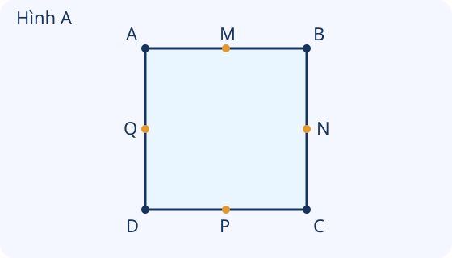
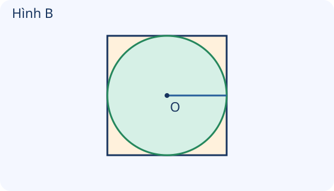

# Luyện tập chung

Nguồn tham khảo: Toán 3 KNTT, tập 1, trang 65-66.

Trạng thái: AI biên soạn và rà soát; chưa có xác nhận của giáo viên.

## Mục tiêu

- Kết hợp kiến thức trung điểm, đường tròn, góc, hình vuông, chữ nhật và hình khối.
- Dùng hình và dữ kiện rõ ràng để chọn phép tính phù hợp, tránh bỏ sót bộ phận bị khuất.

## Khám phá

Bài ôn tập yêu cầu nhìn đúng đối tượng trước khi tính. Đề hỏi bán kính khác với đường kính; hỏi mặt khác với cạnh; một điểm ở giữa còn cần cách đều hai đầu mới là trung điểm.

- Trung điểm nằm giữa hai đầu và chia đoạn thành hai phần bằng nhau.
- Đường kính dài gấp hai lần bán kính. Nếu đường tròn vừa chạm cả bốn cạnh của một hình vuông như hình cho trước, cạnh vuông bằng đường kính.
- Hình vuông có bốn cạnh bằng nhau và bốn góc vuông; chữ nhật có bốn góc vuông và các cặp cạnh đối diện bằng nhau.
- Khối lập phương và hộp chữ nhật đều có 8 đỉnh, 6 mặt, 12 cạnh; hình vẽ có thể che khuất một số bộ phận.
- Tính từng bước khi bài kết hợp nhiều hình hoặc cần tìm tổng/chênh lệch độ dài.

## Hướng dẫn

1. Đọc tên hình hoặc khối và xác định điều cần tìm.
2. Đọc đủ dữ kiện, gồm vị trí điểm và quan hệ vừa khít nếu có.
3. Nhắc lại quy tắc, chọn phép tính rồi ghi đơn vị.
4. Kiểm tra kết quả bằng hình, bằng cách chia đôi/gấp đôi hoặc đếm lại.

## Lỗi thường gặp

- Lấy bán kính làm cạnh hình vuông bao quanh đường tròn vừa khít.
- Chỉ xét điểm cách đều mà quên điều kiện nằm trên đoạn.
- Đếm số khối nhỏ thay cho số ô mặt được sơn.
- Cộng nhầm số cạnh vào bài hỏi số đỉnh.

## Ví dụ

Đường tròn bán kính 4 cm vừa chạm bốn cạnh khung vuông. Tìm cạnh khung.

1. Cạnh khung bằng đường kính đường tròn.
2. 4 × 2 = 8. Cạnh khung dài 8 cm.

Đoạn AB dài 16 cm, M là trung điểm. Tìm AM.

1. Trung điểm chia AB thành hai phần bằng nhau.
2. 16 : 2 = 8. AM dài 8 cm.

Một mặt ngoài khối lớn gồm 4 ô vuông nhỏ. Sáu mặt như vậy có mấy ô mặt?

1. Mỗi mặt có 4 ô, có 6 mặt.
2. 4 × 6 = 24 ô mặt nhỏ. Không nhầm với số khối nhỏ.

## Hình minh họa

## Ngân hàng câu hỏi

### Câu 1 - nhan_biet

Đường kính hình tròn dài bằng mấy lần bán kính?

A. 2; B. 1; C. 3; D. 4

Đáp án: 2. Lời giải: Đường kính gồm hai bán kính nối tiếp nhau.

### Câu 2 - nhan_biet

Hình vuông có mấy góc vuông?

Đáp án: 4. Lời giải: Bốn góc hình vuông đều vuông.

### Câu 3 - nhan_biet

Khối lập phương có mấy mặt?

A. 6; B. 4; C. 8; D. 12

Đáp án: 6. Lời giải: Khối lập phương có 6 mặt vuông.

### Câu 4 - nhan_biet

Khối hộp chữ nhật có mấy đỉnh?

Đáp án: 8. Lời giải: Khối hộp chữ nhật có 8 đỉnh.

### Câu 5 - nhan_biet

Đoạn AB dài 12 cm, M là trung điểm. AM dài mấy xăng-ti-mét?

A. 6; B. 12; C. 2; D. 10

Đáp án: 6. Lời giải: 12 : 2 = 6 cm.

### Câu 6 - nhan_biet

Dụng cụ kiểm tra góc vuông là gì?

Đáp án: ê ke. Lời giải: Ê ke có góc vuông để so khớp.

### Câu 7 - nhan_biet

Một tam giác có mấy đỉnh?

A. 3; B. 2; C. 4; D. 6

Đáp án: 3. Lời giải: Tam giác có 3 đỉnh.

### Câu 8 - nhan_biet

Một khối lập phương có mấy cạnh?

Đáp án: 12. Lời giải: Có 4 cạnh trên, 4 cạnh dưới và 4 cạnh nối.

### Câu 9 - nhan_biet

Bán kính dài 4 cm, đường kính dài mấy xăng-ti-mét?

A. 8; B. 4; C. 6; D. 12

Đáp án: 8. Lời giải: 4 × 2 = 8 cm.

### Câu 10 - nhan_biet

Một hình chữ nhật có mấy góc không vuông?

Đáp án: 0. Lời giải: Cả bốn góc đều là góc vuông nên không có góc không vuông.

### Câu 11 - thong_hieu

Hình A: M, N, P, Q nằm tại trung điểm bốn cạnh hình vuông. Có mấy điểm được đánh dấu làm trung điểm?

A. 4; B. 2; C. 3; D. 8

Đáp án: 4. Lời giải: Mỗi cạnh có một trung điểm đã đánh dấu, bốn cạnh có 4 điểm.

### Câu 12 - thong_hieu

Hình B: đường tròn vừa chạm cả bốn cạnh hình vuông. Bán kính 3 cm, cạnh vuông dài mấy xăng-ti-mét?

Đáp án: 6. Lời giải: Cạnh vuông bằng đường kính hình tròn; 3 × 2 = 6 cm.

### Câu 13 - thong_hieu

Hình B có bán kính 5 cm. Cạnh hình vuông bao quanh dài mấy xăng-ti-mét?

A. 10; B. 5; C. 7; D. 15

Đáp án: 10. Lời giải: Cạnh bằng đường kính; 5 × 2 = 10 cm.

### Câu 14 - thong_hieu

Hình vuông xoay nghiêng có mất các góc vuông không?

Đáp án: không. Lời giải: Xoay hình không đổi độ dài cạnh và loại góc.

### Câu 15 - thong_hieu

Một điểm cách hai đầu đoạn thẳng bằng nhau nhưng không nằm trên đoạn có phải trung điểm không?

A. không; B. có; C. chỉ cần khoảng cách bằng nhau; D. chỉ cần tên điểm

Đáp án: không. Lời giải: Còn thiếu điều kiện nằm giữa hai đầu trên đoạn thẳng.

### Câu 16 - thong_hieu

Một khối lập phương được vẽ chỉ nhìn thấy 3 mặt. Cả khối có bao nhiêu mặt?

Đáp án: 6. Lời giải: Hình biểu diễn che khuất một số mặt; cả khối vẫn có 6 mặt.

### Câu 17 - thong_hieu

Hình chữ nhật có cạnh dài 8 cm và cạnh ngắn 3 cm. Cạnh dài đối diện dài mấy xăng-ti-mét?

A. 8; B. 3; C. 11; D. 5

Đáp án: 8. Lời giải: Hai cạnh dài đối diện bằng nhau.

### Câu 18 - thong_hieu

Hình vuông có một cạnh 7 cm. Cạnh liền kề dài mấy xăng-ti-mét?

Đáp án: 7. Lời giải: Các cạnh hình vuông bằng nhau.

### Câu 19 - thong_hieu

Một góc có hai cạnh OM và ON. Đỉnh của góc là gì?

A. O; B. M; C. N; D. MN

Đáp án: O. Lời giải: Hai cạnh chung điểm O.

### Câu 20 - thong_hieu

Một đoạn nối hai điểm trên đường tròn nhưng không qua tâm có là đường kính không?

Đáp án: không. Lời giải: Đường kính phải đi qua tâm.

### Câu 21 - van_dung

Dây dài 18 cm được chia tại trung điểm. Mỗi phần dài mấy xăng-ti-mét?

A. 9; B. 18; C. 2; D. 8

Đáp án: 9. Lời giải: 18 : 2 = 9 cm.

### Câu 22 - van_dung

Vòng tròn bán kính 6 cm đặt vừa khít trong khung vuông như Hình B. Cạnh khung dài mấy xăng-ti-mét?

Đáp án: 12. Lời giải: Cạnh khung bằng đường kính; 6 × 2 = 12 cm.

### Câu 23 - van_dung

Hai biển tam giác rời nhau có tổng mấy góc?

A. 6; B. 3; C. 5; D. 8

Đáp án: 6. Lời giải: Mỗi biển có 3 góc; 3 × 2 = 6 góc.

### Câu 24 - van_dung

Ba hộp lập phương kín, mỗi mặt một nhãn. Cần mấy nhãn?

Đáp án: 18. Lời giải: 6 × 3 = 18 nhãn.

### Câu 25 - van_dung

Bốn tấm bìa hình chữ nhật rời nhau có tổng mấy góc vuông?

A. 16; B. 4; C. 8; D. 12

Đáp án: 16. Lời giải: 4 × 4 = 16 góc vuông.

### Câu 26 - van_dung

Huy hiệu tròn đường kính 16 cm. Từ tâm đến viền mấy xăng-ti-mét?

Đáp án: 8. Lời giải: 16 : 2 = 8 cm.

### Câu 27 - van_dung

Một hình chữ nhật có hai cạnh ngắn 5 cm. Đi theo cả hai cạnh ngắn được tổng mấy xăng-ti-mét?

A. 10; B. 5; C. 7; D. 15

Đáp án: 10. Lời giải: 5 + 5 = 10 cm.

### Câu 28 - van_dung

Thước đánh dấu A tại 0 cm, M tại 4 cm, B tại 8 cm. M có là trung điểm AB không?

Đáp án: có. Lời giải: M ở giữa, AM = 4 cm, MB = 4 cm, nên là trung điểm.

### Câu 29 - van_dung

Thước đánh dấu A tại 0 cm, N tại 3 cm, B tại 8 cm. NB dài mấy xăng-ti-mét?

A. 5; B. 3; C. 4; D. 11

Đáp án: 5. Lời giải: 8 - 3 = 5 cm; AN và NB không bằng nhau.

### Câu 30 - van_dung

Hai khối hộp chữ nhật rời nhau có tổng mấy đỉnh?

Đáp án: 16. Lời giải: 8 × 2 = 16 đỉnh.

### Câu 31 - van_dung

Một vòng tròn có bán kính 3 cm, vòng khác bán kính 4 cm. Hai đường kính dài tổng cộng mấy xăng-ti-mét?

A. 14; B. 7; C. 12; D. 16

Đáp án: 14. Lời giải: Đường kính 3 × 2 = 6 cm và 4 × 2 = 8 cm; 6 + 8 = 14 cm.

### Câu 32 - van_dung

Khung chữ nhật có chiều dài 9 cm, rộng 4 cm. Đi theo một cạnh dài rồi một cạnh ngắn được mấy xăng-ti-mét?

Đáp án: 13. Lời giải: 9 + 4 = 13 cm.

### Câu 33 - van_dung

Đoạn thẳng 20 cm, tâm của hình tròn nằm tại trung điểm đoạn, hai đầu đoạn trên đường tròn. Bán kính là mấy xăng-ti-mét?

A. 10; B. 20; C. 2; D. 18

Đáp án: 10. Lời giải: Đoạn là đường kính; 20 : 2 = 10 cm.

### Câu 34 - van_dung

Mỗi góc của một tấm bìa vuông dán một nhãn. Sáu tấm rời nhau cần mấy nhãn?

Đáp án: 24. Lời giải: Mỗi tấm có 4 góc; 4 × 6 = 24 nhãn.

### Câu 35 - van_dung

Đếm đủ cả mặt khuất của một hộp chữ nhật kín được 6 mặt. Nếu đã ghi 4 mặt thì còn phải ghi mấy mặt?

A. 2; B. 4; C. 6; D. 10

Đáp án: 2. Lời giải: 6 - 4 = 2 mặt.

### Câu 36 - van_dung

Một hình vuông cạnh 8 cm. Đánh dấu trung điểm của một cạnh. Mỗi nửa cạnh dài mấy xăng-ti-mét?

Đáp án: 4. Lời giải: 8 : 2 = 4 cm.

### Câu 37 - van_dung

Trên một đường tròn, OA và OB là hai bán kính tạo góc vuông đỉnh O. Đỉnh góc trùng bộ phận nào của hình tròn?

A. tâm; B. đường kính; C. đầu cạnh; D. điểm bất kì trên viền

Đáp án: tâm. Lời giải: O vừa là điểm chung của hai cạnh góc vừa là tâm hình tròn.

### Câu 38 - van_dung

Làm một khung lập phương cần 12 que. Đã có 8 que, cần thêm mấy que?

Đáp án: 4. Lời giải: 12 - 8 = 4 que.

### Câu 39 - van_dung

Mỗi mặt ngoài một khối lập phương lớn được ghép bởi 4 ô vuông nhỏ. Sơn cả 6 mặt ngoài. Có mấy ô mặt nhỏ được sơn?

A. 24; B. 6; C. 8; D. 12

Đáp án: 24. Lời giải: Mỗi mặt có 4 ô, 6 mặt có 4 × 6 = 24 ô mặt nhỏ.

### Câu 40 - van_dung

Một tấm bìa vuông và một tấm bìa tam giác rời nhau, dán nhãn tại mỗi đỉnh. Cần tất cả mấy nhãn?

Đáp án: 7. Lời giải: 4 + 3 = 7 đỉnh nên cần 7 nhãn.

## Trò chơi

Kiểm chứng hình học tổng hợp: Đọc nhận định, kiểm tra tâm, trung điểm, góc và các bộ phận của hình khối.

- Mỗi lượt lấy 10 câu trong bài và đưa ra một kết quả để kiểm chứng.
- Chọn Đúng nếu kết quả phù hợp, chọn Sai nếu không phù hợp; đọc lời giải trước khi sang câu.
- Mỗi câu đúng được 10 điểm; tối đa 100 điểm.

## Đánh giá

Đúng lần đầu: 1 điểm; đúng sau một gợi ý: 0,5 điểm. Từ 90%: 3 sao; từ 60%: 2 sao; còn lại: 1 sao.

Xem lời giải các câu sai, đọc lại quy tắc, rồi làm một lượt mới.
