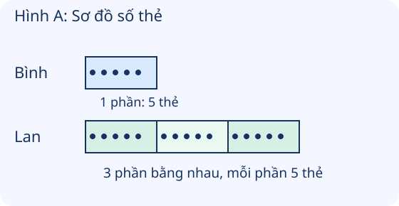

# Gấp một số lên một số lần

Nguồn tham khảo: Toán 3 KNTT, tập 1, trang 70-71.

Trạng thái: AI biên soạn và rà soát; chưa có xác nhận của giáo viên.

## Mục tiêu

- Hiểu gấp một số lên một số lần là tạo các phần bằng nhau, mỗi phần bằng số ban đầu.
- Dùng phép nhân, phân biệt với thêm đơn vị và giải các tình huống một hoặc hai bước phù hợp.

## Khám phá

Bình có 5 thẻ. Nếu Lan có gấp 3 lần số thẻ Bình, số thẻ Lan gồm 3 phần bằng nhau, mỗi phần 5 thẻ. Gấp 3 lần khác với thêm 3 thẻ.

- Muốn gấp một số lên một số lần, lấy số đó nhân với số lần.
- Sơ đồ gấp n lần gồm n phần bằng nhau; một phần bằng số ban đầu.
- Thêm n đơn vị dùng phép cộng, gấp n lần dùng phép nhân; cần đọc kĩ từ trong đề.
- Nếu hỏi tổng cả hai nhóm, phải tính nhóm gấp lên trước rồi cộng thêm nhóm ban đầu. Nếu hỏi hơn bao nhiêu, lấy số lớn trừ số bé.

## Hướng dẫn

1. Xác định số ban đầu và số lần cần gấp.
2. Có thể vẽ sơ đồ một phần và nhiều phần bằng nhau.
3. Lập phép nhân rồi tính, có nhớ đúng nếu cần.
4. Đọc lại xem câu hỏi yêu cầu số sau khi gấp, tổng hay chênh lệch; làm thêm bước nếu cần.

## Lỗi thường gặp

- Lấy số ban đầu cộng số lần.
- Nhầm số lần gấp với số đơn vị tăng thêm.
- Tính được số nhóm sau rồi cho đó là tổng cả hai nhóm.
- Không đọc rõ đề hỏi hơn bao nhiêu hay có tất cả bao nhiêu.

## Ví dụ

Gấp 8 lên 3 lần.

1. Lấy 8 nhân với 3.
2. 8 × 3 = 24.

So sánh gấp 4 lần số 6 với thêm 4 đơn vị vào 6.

1. Gấp 4 lần: 6 × 4 = 24.
2. Thêm 4 đơn vị: 6 + 4 = 10.
3. Hai yêu cầu có ý nghĩa và kết quả khác nhau.

An có 12 tem, Bình có gấp 3 lần An. Cả hai có mấy tem?

1. Bình có 12 × 3 = 36 tem.
2. Cả hai có 12 + 36 = 48 tem.

## Hình minh họa

## Ngân hàng câu hỏi

### Câu 1 - nhan_biet

Muốn gấp một số lên một số lần, dùng phép tính nào?

A. nhân; B. cộng; C. trừ; D. chia

Đáp án: nhân. Lời giải: Lấy số ban đầu nhân với số lần.

### Câu 2 - nhan_biet

Gấp 5 lên 3 lần được bao nhiêu?

Đáp án: 15. Lời giải: 5 × 3 = 15.

### Câu 3 - nhan_biet

Gấp 7 lên 4 lần được bao nhiêu?

A. 28; B. 11; C. 21; D. 35

Đáp án: 28. Lời giải: 7 × 4 = 28.

### Câu 4 - nhan_biet

Gấp 9 lên 2 lần được bao nhiêu?

Đáp án: 18. Lời giải: 9 × 2 = 18.

### Câu 5 - nhan_biet

Gấp 12 lên 3 lần được bao nhiêu?

A. 36; B. 15; C. 24; D. 39

Đáp án: 36. Lời giải: 12 × 3 = 36.

### Câu 6 - nhan_biet

Thêm 3 đơn vị vào 5 được bao nhiêu?

Đáp án: 8. Lời giải: Thêm đơn vị dùng cộng: 5 + 3 = 8.

### Câu 7 - nhan_biet

Gấp 6 lên 5 lần được bao nhiêu?

A. 30; B. 11; C. 24; D. 36

Đáp án: 30. Lời giải: 6 × 5 = 30.

### Câu 8 - nhan_biet

Gấp 8 lên 4 lần được bao nhiêu?

Đáp án: 32. Lời giải: 8 × 4 = 32.

### Câu 9 - nhan_biet

Gấp một số lên 1 lần, kết quả có bằng số ban đầu không?

A. có; B. không; C. luôn bằng 1; D. luôn bằng 0

Đáp án: có. Lời giải: Một số nhân 1 bằng chính số đó.

### Câu 10 - nhan_biet

Gấp 15 lên 2 lần được bao nhiêu?

Đáp án: 30. Lời giải: 15 × 2 = 30.

### Câu 11 - thong_hieu

Hình A: Bình có 5 thẻ, Lan có số thẻ gấp 3 lần Bình. Lan có mấy thẻ?

A. 15; B. 8; C. 10; D. 20

Đáp án: 15. Lời giải: Lan có 3 phần, mỗi phần 5 thẻ; 5 × 3 = 15 thẻ.

### Câu 12 - thong_hieu

Hình A: số thẻ Bình là một phần, số thẻ Lan tương ứng mấy phần bằng nhau như thế?

Đáp án: 3. Lời giải: Hình biểu diễn số thẻ Lan bằng 3 phần, mỗi phần bằng số thẻ Bình.

### Câu 13 - thong_hieu

Gấp 4 lên 6 lần và thêm 6 đơn vị vào 4 có cùng kết quả không?

A. không; B. có; C. đều bằng 10; D. đều bằng 24

Đáp án: không. Lời giải: 4 × 6 = 24, còn 4 + 6 = 10; hai kết quả khác nhau.

### Câu 14 - thong_hieu

Gấp 13 lên 4 lần được bao nhiêu?

Đáp án: 52. Lời giải: 13 × 4 = 52.

### Câu 15 - thong_hieu

Một bạn gấp 8 lên 3 lần bằng 8 + 3. Kết quả đúng là bao nhiêu?

A. 24; B. 11; C. 16; D. 32

Đáp án: 24. Lời giải: Gấp số lần dùng nhân: 8 × 3 = 24, không phải 11.

### Câu 16 - thong_hieu

Hai số 6 và 18. Số 18 có phải gấp 3 lần số 6 không?

Đáp án: có. Lời giải: 6 × 3 = 18.

### Câu 17 - thong_hieu

Gấp 16 lên 3 lần được bao nhiêu?

A. 48; B. 19; C. 32; D. 46

Đáp án: 48. Lời giải: 16 × 3 = 48.

### Câu 18 - thong_hieu

Gấp 11 lên 7 lần được bao nhiêu?

Đáp án: 77. Lời giải: 11 × 7 = 77.

### Câu 19 - thong_hieu

Số ban đầu 14, kết quả sau khi gấp 4 lần là bao nhiêu?

A. 56; B. 18; C. 42; D. 54

Đáp án: 56. Lời giải: 14 × 4 = 56.

### Câu 20 - thong_hieu

Thêm 4 đơn vị vào 14 được bao nhiêu?

Đáp án: 18. Lời giải: 14 + 4 = 18. Khác với gấp 4 lần là 56.

### Câu 21 - van_dung

An có 7 tem, Bình có số tem gấp 3 lần An. Bình có mấy tem?

A. 21; B. 10; C. 14; D. 28

Đáp án: 21. Lời giải: 7 × 3 = 21 tem.

### Câu 22 - van_dung

Một sợi dây xanh dài 12 cm. Dây đỏ dài gấp 4 lần. Dây đỏ dài mấy xăng-ti-mét?

Đáp án: 48. Lời giải: 12 × 4 = 48 cm.

### Câu 23 - van_dung

Một giỏ có 8 quả. Giỏ lớn có số quả gấp 5 lần. Giỏ lớn có mấy quả?

A. 40; B. 13; C. 32; D. 48

Đáp án: 40. Lời giải: 8 × 5 = 40 quả.

### Câu 24 - van_dung

Em có 6 bút, chị có số bút gấp 2 lần em. Để tìm số bút của chị, dùng phép tính nào?

Đáp án: nhân. Lời giải: Gấp số lần dùng phép nhân: 6 × 2 = 12 bút.

### Câu 25 - van_dung

Buổi sáng bán 15 bánh. Chiều bán gấp 3 lần sáng. Chiều bán mấy bánh?

A. 45; B. 18; C. 30; D. 48

Đáp án: 45. Lời giải: 15 × 3 = 45 bánh.

### Câu 26 - van_dung

Một nhóm trồng 9 cây. Nhóm khác trồng gấp 4 lần, được 36 cây. Trong tình huống này, số cây ban đầu là số nào?

Đáp án: 9. Lời giải: Số ban đầu là 9 cây; nhân với số lần 4 để được 36 cây.

### Câu 27 - van_dung

Một tấm vải dài 14 m. Cuộn vải dài gấp 5 lần. Cuộn dài mấy mét?

A. 70; B. 19; C. 56; D. 60

Đáp án: 70. Lời giải: 14 × 5 = 70 m.

### Câu 28 - van_dung

Lan đọc 11 trang, Mai đọc gấp 6 lần Lan. Mai đọc mấy trang?

Đáp án: 66. Lời giải: 11 × 6 = 66 trang.

### Câu 29 - van_dung

Hộp nhỏ có 16 thẻ, hộp lớn gấp 4 lần. Có thể tìm số thẻ hộp lớn bằng 16 + 4 không?

A. không; B. có; C. chỉ cần đổi màu hộp; D. hai phép tính luôn bằng nhau

Đáp án: không. Lời giải: Gấp 4 lần phải tính 16 × 4 = 64; 16 + 4 = 20 chỉ là thêm 4 thẻ.

### Câu 30 - van_dung

Đoạn AB dài 13 cm, CD dài gấp 3 lần AB. CD dài mấy xăng-ti-mét?

Đáp án: 39. Lời giải: 13 × 3 = 39 cm.

### Câu 31 - van_dung

Nam có 18 nhãn. Hoa có số nhãn gấp 2 lần Nam. Hoa có mấy nhãn?

A. 36; B. 20; C. 16; D. 54

Đáp án: 36. Lời giải: 18 × 2 = 36 nhãn.

### Câu 32 - van_dung

Một bao có 21 kg, số gạo trong kho gấp 3 lần số gạo của bao đó. Sơ đồ kho cần mấy phần bằng nhau, mỗi phần 21 kg?

Đáp án: 3. Lời giải: Gấp 3 lần nghĩa là 3 phần bằng nhau, mỗi phần 21 kg; 21 × 3 = 63 kg.

### Câu 33 - van_dung

Một luống có 17 cây. Luống thứ hai có số cây gấp 3 lần. Luống thứ hai có mấy cây?

A. 51; B. 20; C. 34; D. 47

Đáp án: 51. Lời giải: 17 × 3 = 51 cây.

### Câu 34 - van_dung

Ngày đầu làm 24 thiệp, ngày sau gấp 3 lần. Phép 24 × 3 đã cho biết tổng cả hai ngày chưa?

Đáp án: chưa. Lời giải: 24 × 3 = 72 là số thiệp ngày sau; cả hai ngày là 24 + 72 = 96 thiệp.

### Câu 35 - van_dung

Đường đi ngắn dài 19 m, đường dài gấp 4 lần. Có thể tính đường dài bằng 19 + 19 + 19 + 19 không?

A. có; B. không; C. chỉ cộng 19 + 4; D. chỉ cộng 19 hai lần

Đáp án: có. Lời giải: Bốn phần, mỗi phần 19 m: 19 + 19 + 19 + 19 = 76; cũng là 19 × 4 = 76 m.

### Câu 36 - van_dung

An có 8 viên bi. Bình có gấp 3 lần An, rồi cho em 4 viên. Bình còn mấy viên?

Đáp án: 20. Lời giải: Bình ban đầu có 8 × 3 = 24 viên; 24 - 4 = 20 viên.

### Câu 37 - van_dung

Một cửa hàng sáng bán 12 quyển vở, chiều bán gấp 4 lần sáng. Cả ngày bán mấy quyển?

A. 60; B. 48; C. 16; D. 36

Đáp án: 60. Lời giải: Chiều bán 12 × 4 = 48 quyển; cả ngày 12 + 48 = 60 quyển.

### Câu 38 - van_dung

Em có 5 thẻ, anh có gấp 6 lần em. Anh nhiều hơn em mấy thẻ?

Đáp án: 25. Lời giải: Anh có 5 × 6 = 30 thẻ; 30 - 5 = 25 thẻ nhiều hơn.

### Câu 39 - van_dung

Dây đỏ dài 14 cm, dây xanh dài hơn dây đỏ 3 cm. Dây xanh dài mấy xăng-ti-mét?

A. 17; B. 42; C. 11; D. 28

Đáp án: 17. Lời giải: Hơn 3 cm là thêm 3 đơn vị: 14 + 3 = 17 cm, không nhân 3.

### Câu 40 - van_dung

Lan có 9 nhãn, Mai có gấp 4 lần Lan. Cần thêm mấy nhãn để Mai có 40 nhãn?

Đáp án: 4. Lời giải: Mai có 9 × 4 = 36 nhãn; 40 - 36 = 4 nhãn cần thêm.

## Trò chơi

Ghép thẻ gấp hay thêm: Ghép bài toán với kết quả, phân biệt gấp số lần, thêm đơn vị, tổng và chênh lệch.

- Mỗi lượt chọn 5 câu có 5 đáp án khác nhau.
- Chọn câu hỏi bên trái rồi đáp án bên phải. Sai thì thử lại.
- Mỗi cặp đúng 10 điểm; tối đa 50 điểm.

## Đánh giá

Đúng lần đầu: 1 điểm; đúng sau một gợi ý: 0,5 điểm. Từ 90%: 3 sao; từ 60%: 2 sao; còn lại: 1 sao.

Xem lời giải các câu sai, đọc lại quy tắc, rồi làm một lượt mới.
