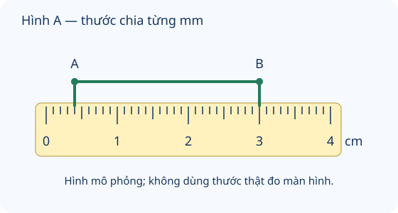

# Mi-li-mét

Nguồn tham khảo: Toán 3 KNTT, tập 1, trang 85-86.

Trạng thái: AI biên soạn và rà soát; chưa có xác nhận của giáo viên.

## Mục tiêu

- Nhận biết mm, quan hệ với cm và m.
- Đọc vạch thước, đổi cùng đơn vị và giải bài toán độ dài.

## Khám phá

Các vật rất nhỏ hoặc độ dày mỏng có thể dùng mi-li-mét. Trên thước, mỗi khoảng 1 cm thường được chia thành 10 khoảng bằng nhau; mỗi khoảng nhỏ dài 1 mm. Đếm khoảng, không đếm số vạch.

- Mi-li-mét viết tắt mm. 1 cm bằng 10 mm; 1 m bằng 1000 mm.
- Đổi cm sang mm: nhân với 10. Đổi số mm tròn chục sang cm: chia cho 10.
- Nếu một đầu không ở vạch 0, độ dài bằng số ở đầu cuối trừ số ở đầu đầu.
- Muốn cộng, trừ hoặc so sánh, phải đổi về cùng đơn vị trước.
- Hình thước trên màn hình chỉ mô phỏng vạch; kích thước hiển thị không phải độ dài vật thật.

## Hướng dẫn

1. Đặt thước sát vật; để một đầu vật ở vạch 0 khi có thể.
2. Nhìn vuông góc với vạch ở đầu kia, đọc cm và khoảng mm.
3. Nếu đầu vật lệch vạch 0, lấy hai số đo đầu cuối trừ nhau.
4. Ghi mm hoặc cm đúng yêu cầu, kiểm tra phép đổi đơn vị.

## Lỗi thường gặp

- Nhầm 1 cm bằng 100 mm.
- Đọc số cuối thay độ dài khi đầu vật không ở 0.
- Cộng cm với mm mà chưa đổi.
- Lấy thước thật đo hình trên màn hình rồi tin đó là số đo trong đề.

## Ví dụ

Một que từ vạch 6 mm đến 34 mm. Que dài bao nhiêu?

1. 34 - 6 = 28.
2. Que dài 28 mm.

Dải giấy 5 cm cắt bớt 13 mm. Còn bao nhiêu?

1. 5 cm bằng 50 mm.
2. 50 - 13 = 37. Còn 37 mm.

## Hình minh họa

## Thực hành với dụng cụ

### Tìm vạch một mi-li-mét

Dụng cụ: Thước có chia mm, Một dải giấy.

1. Tìm khoảng từ 0 đến 1 cm và đếm 10 khoảng nhỏ.
2. Đánh dấu trên giấy hai điểm cách nhau 2 cm, rồi một điểm cách điểm đầu 25 mm.
3. Đo lại, đọc 25 mm cũng là 2 cm 5 mm.

Tự kiểm tra:

- Đếm khoảng giữa các vạch, không đếm cả hai vạch đầu cuối.
- Đầu dải giấy trùng vạch 0; mắt nhìn vuông góc.

## Ngân hàng câu hỏi

### Câu 1 - nhan_biet

Mi-li-mét viết tắt là gì?

A. mm; B. cm; C. g; D. ml

Đáp án: mm. Lời giải: Kí hiệu mm dùng cho đơn vị mi-li-mét đo độ dài.

### Câu 2 - nhan_biet

Một xăng-ti-mét bằng mấy mi-li-mét?

Đáp án: 10. Lời giải: Mỗi khoảng 1 cm gồm 10 khoảng nhỏ 1 mm.

### Câu 3 - nhan_biet

Một mét bằng mấy mi-li-mét?

A. 1000; B. 100; C. 10; D. 10000

Đáp án: 1000. Lời giải: 1 m bằng 100 cm, mỗi cm bằng 10 mm nên bằng 1000 mm.

### Câu 4 - nhan_biet

30 mm bằng mấy cm?

Đáp án: 3. Lời giải: 30 : 10 = 3 cm.

### Câu 5 - nhan_biet

7 cm bằng mấy mm?

A. 70; B. 7; C. 17; D. 700

Đáp án: 70. Lời giải: 7 × 10 = 70 mm.

### Câu 6 - nhan_biet

Trong các đơn vị mm, g, ml, kg, đơn vị nào đo độ dài?

Đáp án: mm. Lời giải: mm là đơn vị độ dài; g và kg đo khối lượng, ml đo dung tích.

### Câu 7 - nhan_biet

Độ dày tấm thẻ khoảng 1 đơn vị. Chọn đơn vị hợp lí: mm, m, km hay l?

A. mm; B. m; C. km; D. l

Đáp án: mm. Lời giải: Một mi-li-mét phù hợp với độ dày rất nhỏ.

### Câu 8 - nhan_biet

Trong 1 cm trên thước có mấy khoảng 1 mm?

Đáp án: 10. Lời giải: Đếm khoảng giữa các vạch: có 10 khoảng 1 mm.

### Câu 9 - nhan_biet

Hình A: đoạn AB dài mấy mm?

A. 26; B. 30; C. 34; D. 24

Đáp án: 26. Lời giải: A ở vạch 4 mm, B ở vạch 30 mm; 30 - 4 = 26 mm.

### Câu 10 - nhan_biet

Hình A: điểm A trùng vạch mấy mm?

Đáp án: 4. Lời giải: Đọc từ vạch 0 đến A có 4 khoảng nhỏ 1 mm.

### Câu 11 - thong_hieu

Vì sao 4 cm dài hơn 35 mm? 4 cm bằng mấy mm?

A. 40; B. 4; C. 400; D. 39

Đáp án: 40. Lời giải: Đổi cùng đơn vị: 4 × 10 = 40 mm, lớn hơn 35 mm.

### Câu 12 - thong_hieu

Thước có đầu vật ở 12 mm, cuối ở 39 mm. Vật dài mấy mm?

Đáp án: 27. Lời giải: 39 - 12 = 27 mm; không lấy riêng số cuối.

### Câu 13 - thong_hieu

Bạn đổi 8 cm thành 8 mm. Kết quả đúng là mấy mm?

A. 80; B. 8; C. 18; D. 800

Đáp án: 80. Lời giải: 8 × 10 = 80 mm.

### Câu 14 - thong_hieu

Điền dấu so sánh: 50 mm ... 5 cm.

Đáp án: =. Lời giải: 5 cm đổi ra 50 mm nên hai độ dài bằng nhau.

### Câu 15 - thong_hieu

Đoạn 2 cm 7 mm bằng mấy mm?

A. 27; B. 9; C. 207; D. 72

Đáp án: 27. Lời giải: 2 cm bằng 20 mm; 20 + 7 = 27 mm.

### Câu 16 - thong_hieu

Giảm 64 mm đi 4 lần còn mấy mm?

Đáp án: 16. Lời giải: 64 : 4 = 16 mm.

### Câu 17 - thong_hieu

Tổng 3 cm và 8 mm bằng mấy mm?

A. 38; B. 11; C. 308; D. 83

Đáp án: 38. Lời giải: 3 cm bằng 30 mm; 30 + 8 = 38.

### Câu 18 - thong_hieu

Hình A: bạn đọc AB là 30 mm vì chỉ nhìn B. Bạn đã tính thừa mấy mm?

Đáp án: 4. Lời giải: AB là 26 mm; 30 - 26 = 4 mm, chính là đoạn từ 0 đến A.

### Câu 19 - thong_hieu

Một đoạn dài 90 mm, đoạn kia 8 cm. Đoạn thứ nhất dài hơn mấy mm?

A. 10; B. 82; C. 2; D. 18

Đáp án: 10. Lời giải: 8 cm bằng 80 mm; 90 - 80 = 10 mm.

### Câu 20 - thong_hieu

Đo bằng hình thước trên màn hình có cho biết kích thước vật thật nếu hình bị phóng to không? Trả lời có hoặc không.

Đáp án: không. Lời giải: Hình có thể đổi kích thước hiển thị; chỉ đọc số vạch theo dữ kiện, không đo trực tiếp màn hình.

### Câu 21 - van_dung

Một dải giấy dài 6 cm, cắt bớt 14 mm. Còn mấy mm?

A. 46; B. 54; C. 8; D. 74

Đáp án: 46. Lời giải: 6 cm bằng 60 mm; 60 - 14 = 46 mm.

### Câu 22 - van_dung

Ba đoạn dây mỗi đoạn 18 mm, không chồng lên nhau. Tổng dài mấy mm?

Đáp án: 54. Lời giải: 18 × 3 = 54 mm.

### Câu 23 - van_dung

Một con kiến đi 125 mm rồi đi thêm 240 mm. Đã đi mấy mm?

A. 365; B. 115; C. 355; D. 375

Đáp án: 365. Lời giải: 125 + 240 = 365 mm.

### Câu 24 - van_dung

Hai thanh dài 42 mm và 3 cm. Cần cắt bớt thanh dài mấy mm để bằng thanh ngắn?

Đáp án: 12. Lời giải: 3 cm bằng 30 mm; 42 - 30 = 12 mm.

### Câu 25 - van_dung

Dây dài 84 mm chia 4 đoạn bằng nhau. Mỗi đoạn mấy mm?

A. 21; B. 20; C. 24; D. 80

Đáp án: 21. Lời giải: 84 : 4 = 21 mm.

### Câu 26 - van_dung

Có 1 m dây, dùng 360 mm. Còn mấy mm?

Đáp án: 640. Lời giải: 1 m bằng 1000 mm; 1000 - 360 = 640 mm.

### Câu 27 - van_dung

Một đường gấp khúc gồm 25 mm, 4 cm và 15 mm. Tổng dài mấy mm?

A. 80; B. 44; C. 65; D. 70

Đáp án: 80. Lời giải: 4 cm bằng 40 mm; 25 + 40 + 15 = 80 mm.

### Câu 28 - van_dung

Hai tấm gỗ dày 7 mm và 9 mm chồng khít. Tổng dày mấy mm?

Đáp án: 16. Lời giải: 7 + 9 = 16 mm.

### Câu 29 - van_dung

Muốn có 5 cm từ một dải 36 mm, cần nối thêm mấy mm không chồng mép?

A. 14; B. 31; C. 41; D. 86

Đáp án: 14. Lời giải: 5 cm bằng 50 mm; 50 - 36 = 14 mm.

### Câu 30 - van_dung

Một nhãn dài 48 mm, nhãn khác bằng nó giảm 3 lần. Nhãn khác dài mấy mm?

Đáp án: 16. Lời giải: 48 : 3 = 16 mm.

### Câu 31 - van_dung

Có 95 mm ruy băng, mỗi đoạn cần 20 mm. Cắt nhiều nhất mấy đoạn đủ?

A. 4; B. 5; C. 3; D. 15

Đáp án: 4. Lời giải: 20 × 4 + 15 = 95, cắt được 4 đoạn đủ.

### Câu 32 - van_dung

Có 95 mm ruy băng, cắt bốn đoạn 20 mm. Còn mấy mm?

Đáp án: 15. Lời giải: 20 × 4 = 80; 95 - 80 = 15 mm.

### Câu 33 - van_dung

Một vật từ vạch 7 mm đến 4 cm trên thước. Dài mấy mm?

A. 33; B. 47; C. 3; D. 40

Đáp án: 33. Lời giải: 4 cm bằng 40 mm; 40 - 7 = 33 mm.

### Câu 34 - van_dung

Đường kiến đi gồm hai đoạn bằng nhau, mỗi đoạn 35 mm. Còn thiếu mấy mm để tổng đạt 1 dm?

Đáp án: 30. Lời giải: 35 × 2 = 70; 1 dm bằng 100 mm; 100 - 70 = 30 mm.

### Câu 35 - van_dung

Một chồng 8 tấm thẻ giống nhau dày tổng 24 mm. Mỗi tấm dày mấy mm?

A. 3; B. 16; C. 32; D. 4

Đáp án: 3. Lời giải: 24 : 8 = 3 mm.

### Câu 36 - van_dung

Bút dài 12 cm, sau khi gọt ngắn đi 5 mm. Bút còn dài mấy mm?

Đáp án: 115. Lời giải: 12 cm bằng 120 mm; 120 - 5 = 115 mm.

### Câu 37 - van_dung

Đoạn đỏ 56 mm, đoạn xanh 7 cm. Tổng hai đoạn dài mấy mm?

A. 126; B. 63; C. 14; D. 116

Đáp án: 126. Lời giải: 7 cm bằng 70 mm; 56 + 70 = 126 mm.

### Câu 38 - van_dung

Dây dài 9 cm chia 3 phần bằng nhau, lấy một phần rồi cắt bớt 8 mm. Còn mấy mm?

Đáp án: 22. Lời giải: 9 cm bằng 90 mm; 90 : 3 = 30; 30 - 8 = 22 mm.

### Câu 39 - van_dung

Khung cần ba que dài 24 mm, 24 mm, 32 mm. Có 1 dm dây đủ làm ba que không? Trả lời có hoặc không.

A. có; B. không; C. thiếu 20; D. thiếu 80

Đáp án: có. Lời giải: 24 + 24 + 32 = 80 mm; 1 dm bằng 100 mm, nên đủ.

### Câu 40 - van_dung

Một đoạn dài 63 mm. Muốn ngắn đi 7 mm rồi chia đều 4 phần, mỗi phần dài mấy mm?

Đáp án: 14. Lời giải: 63 - 7 = 56; 56 : 4 = 14 mm.

## Trò chơi

Ghép độ dài: Ghép câu hỏi đổi đơn vị, đọc thước và độ dài với kết quả.

- Mỗi lượt chọn 5 câu có 5 đáp án khác nhau.
- Chọn câu hỏi bên trái rồi đáp án bên phải. Sai thì thử lại.
- Mỗi cặp đúng 10 điểm; tối đa 50 điểm.

## Đánh giá

Đúng lần đầu: 1 điểm; đúng sau một gợi ý: 0,5 điểm. Từ 90%: 3 sao; từ 60%: 2 sao; còn lại: 1 sao.

Xem lời giải các câu sai, đọc lại quy tắc, rồi làm một lượt mới.
