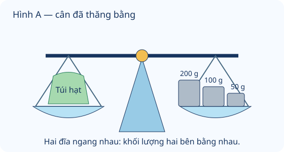

# Gam

Nguồn tham khảo: Toán 3 KNTT, tập 1, trang 87-88.

Trạng thái: AI biên soạn và rà soát; chưa có xác nhận của giáo viên.

## Mục tiêu

- Biết kí hiệu g và quan hệ 1 kg bằng 1000 g.
- Đọc cân thăng bằng, phân biệt khối lượng cả vật chứa với phần bên trong.

## Khám phá

Gam giúp ghi khối lượng của vật nhẹ. Khi cân hai đĩa thăng bằng, tổng khối lượng hai bên bằng nhau. Nếu đĩa có cả hộp hoặc lọ, số cân được bao gồm cả vật chứa ấy.

- Gam viết tắt g; 1 kg bằng 1000 g.
- Cân hai đĩa thăng bằng: tổng khối lượng bên trái bằng tổng khối lượng bên phải.
- Có nhiều quả cân trên một đĩa thì cộng khối lượng tất cả quả cân.
- Khối lượng phần bên trong bằng khối lượng cả vật chứa và phần bên trong trừ khối lượng vật chứa rỗng.
- Cộng/trừ và so sánh cần cùng đơn vị. Chọn g cho vật nhẹ, kg cho vật nặng hơn.

## Hướng dẫn

1. Đọc đơn vị và xem cân đã thăng bằng chưa.
2. Cộng đủ các quả cân hoặc đọc vạch cân theo số ghi.
3. Xác định đang hỏi cả hộp hay chỉ phần bên trong.
4. Đổi cùng đơn vị, tính và ghi g hoặc kg.

## Lỗi thường gặp

- So số 1 với 500 mà bỏ qua kg và g.
- Chỉ đọc một quả cân khi đĩa có nhiều quả.
- Quên trừ vỏ hộp hoặc lọ rỗng.
- Cân chưa thăng bằng đã kết luận hai bên bằng nhau.

## Ví dụ

Túi cân bằng ba quả cân 200 g, 50 g và 20 g. Túi nặng bao nhiêu?

1. 200 + 50 + 20 = 270.
2. Túi nặng 270 g.

Lọ và hạt nặng 380 g, lọ rỗng nặng 80 g. Hạt nặng bao nhiêu?

1. 380 - 80 = 300.
2. Riêng hạt nặng 300 g.

## Hình minh họa

## Thực hành với dụng cụ

### Đọc nhãn khối lượng

Dụng cụ: Hai gói thực phẩm có nhãn khối lượng.

1. Tìm số kèm g hoặc kg trên nhãn của từng gói.
2. Đọc thành lời; nếu có 1 kg, đổi thành 1000 g.
3. So sánh hai số sau khi cùng đơn vị.

Tự kiểm tra:

- Không nhầm g với ml.
- Ghi đúng số và đơn vị; không tự xem dung tích là khối lượng.

## Ngân hàng câu hỏi

### Câu 1 - nhan_biet

Gam viết tắt là gì?

A. g; B. kg; C. mm; D. ml

Đáp án: g. Lời giải: Kí hiệu g chỉ đơn vị khối lượng gam.

### Câu 2 - nhan_biet

1 kg bằng mấy gam?

Đáp án: 1000. Lời giải: Một ki-lô-gam bằng một nghìn gam.

### Câu 3 - nhan_biet

1000 g bằng mấy kg?

A. 1; B. 10; C. 100; D. 1000

Đáp án: 1. Lời giải: Đổi theo quan hệ 1 kg bằng 1000 g.

### Câu 4 - nhan_biet

Đơn vị nào hợp lí để ghi khối lượng một chiếc kẹp giấy nhỏ?

Đáp án: g. Lời giải: Gam thích hợp cho đồ vật nhẹ.

### Câu 5 - nhan_biet

Cân hai đĩa nằm ngang cho biết khối lượng hai bên thế nào?

A. bằng nhau; B. bên trái luôn nặng hơn; C. bên phải luôn nặng hơn; D. không liên quan

Đáp án: bằng nhau. Lời giải: Cân thăng bằng nghĩa là hai bên có khối lượng bằng nhau.

### Câu 6 - nhan_biet

Hình A: túi hạt cân bằng các quả cân tổng bao nhiêu gam?

Đáp án: 350. Lời giải: Các quả cân 200 g, 100 g, 50 g có tổng 200 + 100 + 50 = 350 g.

### Câu 7 - nhan_biet

Khối lượng 600 g so với 1 kg thế nào?

A. nhẹ hơn; B. nặng hơn; C. bằng nhau; D. gấp đôi

Đáp án: nhẹ hơn. Lời giải: 1 kg bằng 1000 g; 600 g nhỏ hơn 1000 g.

### Câu 8 - nhan_biet

Một gói ghi 125 g. Số 125 cho biết đại lượng nào?

Đáp án: khối lượng. Lời giải: Đơn vị gam biểu thị khối lượng của gói.

### Câu 9 - nhan_biet

Hai quả cân 20 g và 50 g có tổng mấy gam?

A. 70; B. 30; C. 60; D. 100

Đáp án: 70. Lời giải: 20 + 50 = 70 g.

### Câu 10 - nhan_biet

Túi 900 g còn thiếu mấy gam để đủ 1 kg?

Đáp án: 100. Lời giải: 1000 - 900 = 100 g.

### Câu 11 - thong_hieu

Bạn nói 1 kg nhẹ hơn 750 g vì 1 nhỏ hơn 750. 1 kg phải đổi thành mấy gam trước khi so sánh?

A. 1000; B. 100; C. 10; D. 1

Đáp án: 1000. Lời giải: Cần cùng đơn vị: 1 kg bằng 1000 g.

### Câu 12 - thong_hieu

Cân thăng bằng, trái là hộp và quả cân 50 g, phải là 300 g. Hộp nặng mấy gam?

Đáp án: 250. Lời giải: 300 - 50 = 250 g; không tính cả quả cân vào hộp.

### Câu 13 - thong_hieu

Hai túi cùng nặng 180 g mỗi túi. Cả hai nặng mấy gam?

A. 360; B. 182; C. 90; D. 280

Đáp án: 360. Lời giải: 180 × 2 = 360 g.

### Câu 14 - thong_hieu

Hình A: lấy quả cân 50 g bên phải ra, bên nào sẽ hạ xuống? Chọn trái hoặc phải.

Đáp án: trái. Lời giải: Túi bên trái vẫn 350 g, bên phải chỉ còn 300 g nên trái nặng hơn.

### Câu 15 - thong_hieu

Một hộp 500 g được chia 5 phần bằng nhau. Mỗi phần mấy gam?

A. 100; B. 50; C. 2500; D. 495

Đáp án: 100. Lời giải: 500 : 5 = 100 g.

### Câu 16 - thong_hieu

Số đo nào hợp lí cho một quả nho: 5 g, 5 kg, 50 kg hay 500 kg?

Đáp án: 5 g. Lời giải: Một quả nho nhỏ có khối lượng vài gam, không phải nhiều ki-lô-gam.

### Câu 17 - thong_hieu

Túi A 420 g, túi B 380 g. A nặng hơn B mấy gam?

A. 40; B. 800; C. 60; D. 20

Đáp án: 40. Lời giải: 420 - 380 = 40 g.

### Câu 18 - thong_hieu

Một cân chỉ khối lượng cả lọ và hạt là 270 g, lọ rỗng 70 g. Riêng hạt mấy gam?

Đáp án: 200. Lời giải: 270 - 70 = 200 g.

### Câu 19 - thong_hieu

Các quả cân 100 g, 50 g, 20 g cân được túi 170 g nếu đặt cùng một đĩa và túi ở đĩa kia không? Trả lời có hoặc không.

A. có; B. không; C. thiếu 20; D. thừa 50

Đáp án: có. Lời giải: 100 + 50 + 20 = 170 g, đúng khối lượng cần cân.

### Câu 20 - thong_hieu

Gói 250 g tăng khối lượng gấp 3 lần thì thành mấy gam?

Đáp án: 750. Lời giải: 250 × 3 = 750 g.

### Câu 21 - van_dung

Mua 450 g đậu và 350 g mè. Tổng mấy gam?

A. 800; B. 100; C. 700; D. 900

Đáp án: 800. Lời giải: 450 + 350 = 800 g.

### Câu 22 - van_dung

Một túi 1 kg gạo, lấy 275 g. Còn mấy gam?

Đáp án: 725. Lời giải: 1 kg bằng 1000 g; 1000 - 275 = 725 g.

### Câu 23 - van_dung

Có 4 gói mỗi gói 125 g. Cả bốn mấy gam?

A. 500; B. 129; C. 400; D. 625

Đáp án: 500. Lời giải: 125 × 4 = 500 g.

### Câu 24 - van_dung

Có 600 g bột chia đều 3 hộp. Dùng hết 80 g ở một hộp, hộp đó còn mấy gam?

Đáp án: 120. Lời giải: 600 : 3 = 200; 200 - 80 = 120 g.

### Câu 25 - van_dung

Cả hộp bánh nặng 540 g, vỏ hộp 40 g. Bánh chia đều 5 phần, mỗi phần mấy gam?

A. 100; B. 108; C. 500; D. 116

Đáp án: 100. Lời giải: 540 - 40 = 500; 500 : 5 = 100 g.

### Câu 26 - van_dung

Cần 1 kg đậu, đã có hai túi 300 g và 450 g. Thiếu mấy gam?

Đáp án: 250. Lời giải: 300 + 450 = 750; 1000 - 750 = 250 g.

### Câu 27 - van_dung

Một khay 90 g chứa ba quả bằng nhau, cả khay và quả nặng 450 g. Mỗi quả mấy gam?

A. 120; B. 150; C. 180; D. 90

Đáp án: 120. Lời giải: 450 - 90 = 360; 360 : 3 = 120 g.

### Câu 28 - van_dung

Túi lớn 640 g, túi nhỏ bằng túi lớn giảm 4 lần. Hai túi nặng tổng mấy gam?

Đáp án: 800. Lời giải: 640 : 4 = 160; 640 + 160 = 800 g.

### Câu 29 - van_dung

Có 700 g hạt, đóng gói 100 g mỗi gói. Bán 3 gói thì còn mấy gói?

A. 4; B. 7; C. 3; D. 5

Đáp án: 4. Lời giải: 700 : 100 = 7; 7 - 3 = 4 gói.

### Câu 30 - van_dung

Cân thăng bằng: túi A và 100 g bên trái, 450 g bên phải. Túi A nhẹ hơn túi 400 g bao nhiêu gam?

Đáp án: 50. Lời giải: 450 - 100 = 350; 400 - 350 = 50 g.

### Câu 31 - van_dung

Mỗi mẻ dùng 45 g đường. Làm 4 mẻ thì dùng mấy gam?

A. 180; B. 49; C. 160; D. 200

Đáp án: 180. Lời giải: 45 × 4 = 180 g.

### Câu 32 - van_dung

Có 950 g bột. Dùng 320 g rồi thêm 150 g vào số còn lại. Hiện có mấy gam?

Đáp án: 780. Lời giải: 950 - 320 = 630; 630 + 150 = 780 g.

### Câu 33 - van_dung

Có 6 gói mỗi gói 80 g. Muốn đủ 500 g thì cần thêm mấy gam?

A. 20; B. 480; C. 40; D. 420

Đáp án: 20. Lời giải: 80 × 6 = 480; 500 - 480 = 20 g.

### Câu 34 - van_dung

Một gói nặng 375 g, gói kia nhẹ hơn 125 g. Tổng hai gói mấy gam?

Đáp án: 625. Lời giải: 375 - 125 = 250; 375 + 250 = 625 g.

### Câu 35 - van_dung

Một lọ rỗng 60 g, thêm vào 240 g hạt. Lấy đi nửa số hạt thì cả lọ còn nặng mấy gam?

A. 180; B. 120; C. 150; D. 300

Đáp án: 180. Lời giải: 240 : 2 = 120 g hạt còn lại; 60 + 120 = 180 g.

### Câu 36 - van_dung

Có 1 kg nguyên liệu, cần chia hai phần 400 g và phần còn lại. Phần còn lại nặng mấy gam?

Đáp án: 600. Lời giải: 1000 - 400 = 600 g.

### Câu 37 - van_dung

Hai túi tổng 900 g, một túi 360 g. Túi kia nặng hơn túi này mấy gam?

A. 180; B. 540; C. 260; D. 360

Đáp án: 180. Lời giải: 900 - 360 = 540; 540 - 360 = 180 g.

### Câu 38 - van_dung

Có 720 g trà, đóng mỗi túi 90 g. Đóng được mấy túi?

Đáp án: 8. Lời giải: 720 : 90 = 8 túi.

### Câu 39 - van_dung

Một cân có đĩa trái 200 g và túi 150 g, đĩa phải 300 g. Thêm ít nhất mấy gam bên phải để cân bằng?

A. 50; B. 150; C. 100; D. 650

Đáp án: 50. Lời giải: 200 + 150 = 350; 350 - 300 = 50 g.

### Câu 40 - van_dung

Ba phần hạt bằng nhau có tổng 960 g. Đem một phần làm bánh, còn mấy gam?

Đáp án: 640. Lời giải: 960 : 3 = 320; 960 - 320 = 640 g.

## Trò chơi

Kiểm chứng bàn cân: Xem lượng gam, so sánh và kiểm tra cân thăng bằng.

- Mỗi lượt lấy 10 câu trong bài và đưa ra một kết quả để kiểm chứng.
- Chọn Đúng nếu kết quả phù hợp, chọn Sai nếu không phù hợp; đọc lời giải trước khi sang câu.
- Mỗi câu đúng được 10 điểm; tối đa 100 điểm.

## Đánh giá

Đúng lần đầu: 1 điểm; đúng sau một gợi ý: 0,5 điểm. Từ 90%: 3 sao; từ 60%: 2 sao; còn lại: 1 sao.

Xem lời giải các câu sai, đọc lại quy tắc, rồi làm một lượt mới.
