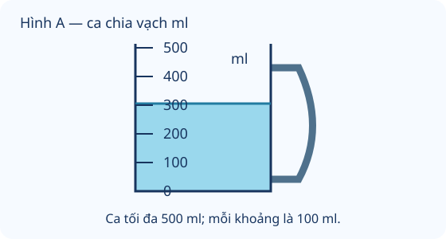

# Mi-li-lít

Nguồn tham khảo: Toán 3 KNTT, tập 1, trang 89-90.

Trạng thái: AI biên soạn và rà soát; chưa có xác nhận của giáo viên.

## Mục tiêu

- Biết kí hiệu ml, quan hệ 1 l bằng 1000 ml.
- Đọc ca chia vạch và giải bài rót nước, lượng còn lại, lượng cần thêm.

## Khám phá

Mi-li-lít thường dùng cho lượng chất lỏng ít. Ca chia vạch giúp đọc lượng nước đang có. Dung tích tối đa của bình là lượng bình chứa được khi đầy; lượng nước hiện có có thể ít hơn nhiều.

- Mi-li-lít viết tắt ml; 1 l bằng 1000 ml.
- Xem đơn vị, xác định giá trị mỗi khoảng giữa hai vạch liền nhau trước khi đọc mực nước.
- Rót thêm dùng cộng, rót ra dùng trừ; rót đều các phần dùng chia.
- Lượng rót ra khác lượng còn lại. Lượng cần thêm bằng mức muốn đạt trừ mức đang có.
- Không đồng nhất ml với g: ml đo dung tích, g đo khối lượng. Hình ca trên màn hình là mô phỏng.

## Hướng dẫn

1. Đặt ca trên mặt phẳng ngang; nhìn mực nước ngang tầm mắt.
2. Đọc số ở vạch tương ứng và đơn vị ml.
3. Đổi l sang ml trước khi tính cùng các số ml.
4. Kiểm tra tổng đã rót với dung tích tối đa để biết còn thiếu hay bị tràn.

## Lỗi thường gặp

- Đổi 1 l thành 100 ml.
- Đọc dung tích tối đa làm lượng đang có.
- Nhầm lượng đã dùng với lượng còn lại.
- Cộng ml vào số l chưa đổi đơn vị.

## Ví dụ

Bình có 1 l, rót ra 280 ml. Còn bao nhiêu?

1. 1 l bằng 1000 ml.
2. 1000 - 280 = 720. Còn 720 ml.

Ca tối đa 500 ml, đang có 320 ml. Thêm 200 ml thì tràn bao nhiêu?

1. 320 + 200 = 520 ml.
2. 520 - 500 = 20. Tràn 20 ml.

## Hình minh họa

## Thực hành với dụng cụ

### Đọc ca nước thực tế

Dụng cụ: Ca có chia vạch ml, Nước sạch, Khay hứng.

1. Đặt ca trong khay trên mặt phẳng ngang.
2. Rót chậm một ít nước, quan sát giá trị giữa các vạch.
3. Đọc và ghi lượng nước, thêm nước rồi đọc lần nữa; lấy số sau trừ số trước để tìm lượng đã thêm.

Tự kiểm tra:

- Mắt ngang mực nước, ca không nghiêng.
- Không rót quá vạch tối đa; chỉ thực hành với nước sạch.

## Ngân hàng câu hỏi

### Câu 1 - nhan_biet

Mi-li-lít viết tắt là gì?

A. ml; B. mm; C. g; D. kg

Đáp án: ml. Lời giải: Kí hiệu ml chỉ đơn vị dung tích mi-li-lít.

### Câu 2 - nhan_biet

1 lít bằng mấy mi-li-lít?

Đáp án: 1000. Lời giải: Một lít bằng một nghìn mi-li-lít.

### Câu 3 - nhan_biet

1000 ml bằng mấy lít?

A. 1; B. 10; C. 100; D. 1000

Đáp án: 1. Lời giải: Đổi theo quan hệ 1 l bằng 1000 ml.

### Câu 4 - nhan_biet

Đơn vị nào thích hợp ghi lượng nước trong một thìa nhỏ?

Đáp án: ml. Lời giải: Mi-li-lít thích hợp với lượng chất lỏng ít.

### Câu 5 - nhan_biet

Ca chia vạch có các mốc 0, 100, 200 ml cách đều. Mỗi khoảng ứng với mấy ml?

A. 100; B. 200; C. 10; D. 50

Đáp án: 100. Lời giải: Hiệu giữa hai mốc liền nhau là 100 ml.

### Câu 6 - nhan_biet

Hình A: mực nước ngang vạch mấy ml?

Đáp án: 300. Lời giải: Mực nước ngang vạch 300 ml của ca.

### Câu 7 - nhan_biet

Lượng 800 ml so với 1 l thế nào?

A. ít hơn; B. nhiều hơn; C. bằng nhau; D. gấp đôi

Đáp án: ít hơn. Lời giải: 1 l bằng 1000 ml, nên 800 ml ít hơn.

### Câu 8 - nhan_biet

Một chai ghi 250 ml. Đây là số đo gì?

Đáp án: dung tích. Lời giải: Mi-li-lít là đơn vị đo dung tích.

### Câu 9 - nhan_biet

Có 100 ml thêm 50 ml thì được mấy ml?

A. 150; B. 50; C. 100; D. 500

Đáp án: 150. Lời giải: 100 + 50 = 150 ml.

### Câu 10 - nhan_biet

Bình 1 l đã rót hết 1000 ml thì còn mấy ml?

Đáp án: 0. Lời giải: 1000 - 1000 = 0 ml.

### Câu 11 - thong_hieu

Bạn nói 1 l ít hơn 500 ml vì 1 nhỏ hơn 500. Phải đổi 1 l thành mấy ml?

A. 1000; B. 100; C. 10; D. 1

Đáp án: 1000. Lời giải: So sánh cùng đơn vị: 1 l bằng 1000 ml.

### Câu 12 - thong_hieu

Hình A: muốn nước đến vạch 500 ml cần thêm mấy ml?

Đáp án: 200. Lời giải: 500 - 300 = 200 ml.

### Câu 13 - thong_hieu

Ca có 400 ml, rót 150 ml ra thì còn mấy ml?

A. 250; B. 550; C. 150; D. 200

Đáp án: 250. Lời giải: 400 - 150 = 250 ml.

### Câu 14 - thong_hieu

Chai rỗng có dung tích tối đa 600 ml. Rót 650 ml vào có tràn không? Trả lời có hoặc không.

Đáp án: có. Lời giải: 650 ml vượt dung tích 600 ml nên tràn nếu rót toàn bộ.

### Câu 15 - thong_hieu

Một lít nước chia đều 4 cốc, mỗi cốc mấy ml?

A. 250; B. 4; C. 400; D. 200

Đáp án: 250. Lời giải: 1 l bằng 1000 ml; 1000 : 4 = 250 ml.

### Câu 16 - thong_hieu

Bình có 700 ml, rót ra 200 ml. Số 200 chỉ lượng còn lại hay lượng đã rót?

Đáp án: lượng đã rót. Lời giải: Đề nói rót ra 200 ml, còn lại là 500 ml.

### Câu 17 - thong_hieu

Một ca 150 ml và một ca 250 ml. Ca sau nhiều hơn mấy ml?

A. 100; B. 400; C. 150; D. 200

Đáp án: 100. Lời giải: 250 - 150 = 100 ml.

### Câu 18 - thong_hieu

Lượng 350 ml giảm 5 lần còn mấy ml?

Đáp án: 70. Lời giải: 350 : 5 = 70 ml.

### Câu 19 - thong_hieu

Chai A 450 ml, chai B 550 ml. Gộp lại được đúng 1 l không? Trả lời có hoặc không.

A. có; B. không; C. thiếu 100; D. thừa 100

Đáp án: có. Lời giải: 450 + 550 = 1000 ml, bằng 1 l.

### Câu 20 - thong_hieu

Mỗi lần lấy 20 ml. Lấy 3 lần được mấy ml?

Đáp án: 60. Lời giải: 20 × 3 = 60 ml.

### Câu 21 - van_dung

Bình có 900 ml, rót hai lần mỗi lần 250 ml. Còn mấy ml?

A. 400; B. 650; C. 500; D. 350

Đáp án: 400. Lời giải: 250 × 2 = 500; 900 - 500 = 400 ml.

### Câu 22 - van_dung

Có 1 l nước, rót 350 ml rồi 275 ml. Còn mấy ml?

Đáp án: 375. Lời giải: 1000 - 350 = 650; 650 - 275 = 375 ml.

### Câu 23 - van_dung

Ba cốc mỗi cốc 180 ml. Gộp được mấy ml?

A. 540; B. 183; C. 360; D. 480

Đáp án: 540. Lời giải: 180 × 3 = 540 ml.

### Câu 24 - van_dung

Chai 750 ml đã dùng 280 ml. Muốn lượng còn lại thành 600 ml cần thêm mấy ml?

Đáp án: 130. Lời giải: 750 - 280 = 470; 600 - 470 = 130 ml.

### Câu 25 - van_dung

Có 800 ml chia đều vào 4 cốc. Uống 50 ml từ một cốc, cốc đó còn mấy ml?

A. 150; B. 200; C. 750; D. 250

Đáp án: 150. Lời giải: 800 : 4 = 200; 200 - 50 = 150 ml.

### Câu 26 - van_dung

Bình 1 l đã có 650 ml. Rót thêm 400 ml thì tràn mấy ml?

Đáp án: 50. Lời giải: 650 + 400 = 1050; 1050 - 1000 = 50 ml.

### Câu 27 - van_dung

Cần pha 500 ml nước, đã có 125 ml và thêm 200 ml. Còn thiếu mấy ml?

A. 175; B. 325; C. 375; D. 300

Đáp án: 175. Lời giải: 125 + 200 = 325; 500 - 325 = 175 ml.

### Câu 28 - van_dung

Có 600 ml, mỗi cốc chứa tối đa 200 ml. Cần mấy cốc để chứa hết?

Đáp án: 3. Lời giải: 600 : 200 = 3 cốc.

### Câu 29 - van_dung

Một bình có 720 ml. Rót ra một lượng bằng ban đầu giảm 3 lần. Bình còn mấy ml?

A. 480; B. 240; C. 717; D. 960

Đáp án: 480. Lời giải: 720 : 3 = 240 ml rót ra; 720 - 240 = 480 ml.

### Câu 30 - van_dung

Có 5 chai mỗi chai 160 ml. Tổng lượng nước còn thiếu mấy ml để đủ 1 l?

Đáp án: 200. Lời giải: 160 × 5 = 800; 1000 - 800 = 200 ml.

### Câu 31 - van_dung

Bình đầu 350 ml, bình sau nhiều hơn 120 ml. Cả hai có mấy ml?

A. 820; B. 470; C. 700; D. 940

Đáp án: 820. Lời giải: 350 + 120 = 470; 350 + 470 = 820 ml.

### Câu 32 - van_dung

Có 950 ml nước, dùng 300 ml rồi chia số còn lại đều vào 5 cốc. Mỗi cốc mấy ml?

Đáp án: 130. Lời giải: 950 - 300 = 650; 650 : 5 = 130 ml.

### Câu 33 - van_dung

Một ca có 240 ml, ca khác gấp 3 lần. Ca khác nhiều hơn ca đầu mấy ml?

A. 480; B. 720; C. 960; D. 243

Đáp án: 480. Lời giải: 240 × 3 = 720; 720 - 240 = 480 ml.

### Câu 34 - van_dung

Có 1 l dầu chia vào hai chai, chai đầu 425 ml. Chai sau mấy ml?

Đáp án: 575. Lời giải: 1000 - 425 = 575 ml.

### Câu 35 - van_dung

Mỗi cốc dùng 80 ml, chuẩn bị 7 cốc. Đã có 500 ml, cần thêm mấy ml?

A. 60; B. 560; C. 420; D. 20

Đáp án: 60. Lời giải: 80 × 7 = 560; 560 - 500 = 60 ml.

### Câu 36 - van_dung

Một bình 840 ml, sau khi rót số còn lại bằng ban đầu giảm 4 lần. Đã rót mấy ml?

Đáp án: 630. Lời giải: 840 : 4 = 210 ml còn lại; 840 - 210 = 630 ml.

### Câu 37 - van_dung

Hai ca bằng nhau chứa tổng 500 ml. Đổ thêm 75 ml vào một ca. Ca đó có mấy ml?

A. 325; B. 250; C. 575; D. 175

Đáp án: 325. Lời giải: 500 : 2 = 250; 250 + 75 = 325 ml.

### Câu 38 - van_dung

Một bình có 680 ml, thêm 120 ml rồi rót 350 ml. Còn mấy ml?

Đáp án: 450. Lời giải: 680 + 120 = 800; 800 - 350 = 450 ml.

### Câu 39 - van_dung

Có 975 ml nước. Cốc tối đa 250 ml. Cần ít nhất mấy cốc để chứa hết?

A. 4; B. 3; C. 5; D. 2

Đáp án: 4. Lời giải: Ba cốc chứa 750 ml, còn 225 ml cần cốc thứ 4.

### Câu 40 - van_dung

Ba lần rót lần lượt 150 ml, 200 ml, 250 ml từ bình 1 l. Bình còn mấy ml?

Đáp án: 400. Lời giải: 150 + 200 + 250 = 600; 1000 - 600 = 400 ml.

## Trò chơi

Kho báu ca chia vạch: Đọc số đo và tìm lượng nước còn lại, cần thêm hoặc bị tràn.

- Mỗi lượt lấy 10 câu từ bài học.
- Chọn đáp án, đọc lời giải rồi sang câu tiếp theo.
- Mỗi câu đúng được 10 điểm; tối đa 100 điểm.

## Đánh giá

Đúng lần đầu: 1 điểm; đúng sau một gợi ý: 0,5 điểm. Từ 90%: 3 sao; từ 60%: 2 sao; còn lại: 1 sao.

Xem lời giải các câu sai, đọc lại quy tắc, rồi làm một lượt mới.
