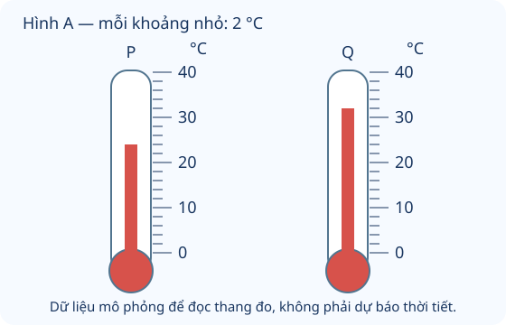

# Nhiệt độ. Đơn vị đo nhiệt độ

Nguồn tham khảo: Toán 3 KNTT, tập 1, trang 91-92.

Trạng thái: AI biên soạn và rà soát; chưa có xác nhận của giáo viên.

## Mục tiêu

- Biết nhiệt kế dùng đo nhiệt độ và kí hiệu °C.
- Đọc thang chia, so sánh số đo và tìm mức tăng/giảm bằng số nguyên trong phạm vi đã học.

## Khám phá

Nhiệt độ cho biết mức nóng hay lạnh. Dùng nhiệt kế để có số đo, thay vì chỉ đoán bằng cảm giác. Trong bài này, các số đo thời tiết là dữ liệu mô phỏng để luyện toán, không phải dự báo hiện tại.

- Độ C viết là °C, đọc là độ xê. Nhiệt kế là dụng cụ đo nhiệt độ.
- Đọc số theo vạch ở đầu cột chất lỏng hoặc theo số hiển thị của nhiệt kế điện tử.
- Cần xem mỗi khoảng chia ứng với mấy độ C, không mặc định mọi vạch là 1 độ.
- Trong cùng thang °C, số lớn hơn biểu thị nhiệt độ cao hơn. Muốn biết chênh lệch, lấy số lớn trừ số bé.
- Nhiệt độ tăng dùng cộng, giảm dùng trừ theo số độ đề cho. Không suy luận nhiệt độ bằng cách cộng các mức của hai nơi.

## Hướng dẫn

1. Xem đơn vị và các số mốc trên thang.
2. Tính giá trị một khoảng nhỏ nếu cần.
3. Đọc vạch đúng đầu cột chỉ nhiệt độ.
4. Ghi số và °C; so sánh hoặc tìm chênh lệch đúng câu hỏi.

## Lỗi thường gặp

- Đếm vạch thay vì khoảng.
- Nhìn chiều dài hình nhiệt kế thay vì số trên thang.
- Bỏ kí hiệu °C khiến không rõ đang đo gì.
- Gọi 0 °C là không có nhiệt độ.

## Ví dụ

Một nhiệt kế có mỗi khoảng 2 °C, đầu cột đỏ ở hai khoảng trên 20 °C. Đọc số đo.

1. 2 × 2 = 4 độ C.
2. 20 + 4 = 24. Nhiệt kế chỉ 24 °C.

Bản ghi mô phỏng có sáng 18 °C, trưa 26 °C. Trưa tăng mấy độ?

1. 26 - 18 = 8.
2. Trưa cao hơn sáng 8 độ C.

## Hình minh họa

## Thực hành với dụng cụ

### Ghi nhiệt độ không khí

Dụng cụ: Nhiệt kế đo không khí, Giấy bút.

1. Nhờ người lớn đặt nhiệt kế theo hướng dẫn của dụng cụ, tránh vị trí bị nắng chiếu trực tiếp.
2. Quan sát số chỉ sau khi ổn định theo hướng dẫn.
3. Ghi vị trí, thời điểm, số và °C; lặp lại ở một thời điểm khác để so sánh.

Tự kiểm tra:

- Ghi đúng đơn vị và thời điểm, không chỉ ghi một số rời.
- Không tự dùng nước nóng để thử nhiệt kế; nhờ người lớn hỗ trợ dụng cụ.

## Ngân hàng câu hỏi

### Câu 1 - nhan_biet

Đơn vị độ C dùng đo đại lượng nào?

A. nhiệt độ; B. độ dài; C. khối lượng; D. dung tích

Đáp án: nhiệt độ. Lời giải: Độ C biểu thị mức nóng lạnh, không đo độ dài hay khối lượng.

### Câu 2 - nhan_biet

Kí hiệu độ C là gì?

Đáp án: °C. Lời giải: Dấu độ đi cùng chữ C để ghi độ C.

### Câu 3 - nhan_biet

Dụng cụ dùng đo nhiệt độ là gì?

A. nhiệt kế; B. thước; C. cân; D. ca đong

Đáp án: nhiệt kế. Lời giải: Nhiệt kế có thang đo nhiệt độ.

### Câu 4 - nhan_biet

Số 28 °C đọc là bao nhiêu độ C? Điền số.

Đáp án: 28. Lời giải: Đọc là hai mươi tám độ C.

### Câu 5 - nhan_biet

Hai nơi 18 °C và 26 °C, nơi có nhiệt độ cao hơn là bao nhiêu °C?

A. 26; B. 18; C. 8; D. 44

Đáp án: 26. Lời giải: 26 lớn hơn 18 nên mức 26 °C cao hơn.

### Câu 6 - nhan_biet

Trong 12 °C, 20 °C, 29 °C, mức thấp nhất là bao nhiêu °C?

Đáp án: 12. Lời giải: 12 là số nhỏ nhất trong ba số.

### Câu 7 - nhan_biet

Hình A: nhiệt kế P chỉ mấy °C?

A. 24; B. 22; C. 26; D. 20

Đáp án: 24. Lời giải: Từ 20 lên 24 có hai khoảng, mỗi khoảng 2 °C.

### Câu 8 - nhan_biet

Hình A: nhiệt kế Q chỉ mấy °C?

Đáp án: 32. Lời giải: Mức đỏ của Q tại vạch 32, trên 30 một khoảng 2 °C.

### Câu 9 - nhan_biet

Nhiệt độ 0 °C có nghĩa là nhiệt kế không có nhiệt độ không? Trả lời có hoặc không.

A. không; B. có; C. không có thang; D. không có đơn vị

Đáp án: không. Lời giải: 0 °C là một giá trị trên thang đo, không phải thiếu số đo.

### Câu 10 - nhan_biet

Nhiệt độ tăng từ 21 °C lên 25 °C thì tăng mấy độ C?

Đáp án: 4. Lời giải: 25 - 21 = 4 độ C.

### Câu 11 - thong_hieu

Hình A: Q cao hơn P mấy độ C?

A. 8; B. 56; C. 6; D. 10

Đáp án: 8. Lời giải: 32 - 24 = 8 độ C.

### Câu 12 - thong_hieu

Thang nhiệt kế ghi 10, 20, 30; từ 10 đến 20 có 5 khoảng bằng nhau. Mỗi khoảng mấy độ C?

Đáp án: 2. Lời giải: 20 - 10 = 10; 10 : 5 = 2 độ C.

### Câu 13 - thong_hieu

Một bản ghi 23 °C nhưng thiếu kí hiệu, chỉ viết 23. Cần bổ sung đơn vị nào?

A. °C; B. mm; C. kg; D. ml

Đáp án: °C. Lời giải: Thêm °C để biết 23 là nhiệt độ.

### Câu 14 - thong_hieu

Buổi sáng 19 °C, buổi trưa 27 °C. Nhiệt độ trưa tăng mấy độ C so với sáng?

Đáp án: 8. Lời giải: 27 - 19 = 8 độ C.

### Câu 15 - thong_hieu

Nhiệt độ giảm từ 31 °C xuống 24 °C. Đã giảm mấy độ C?

A. 7; B. 55; C. 6; D. 8

Đáp án: 7. Lời giải: 31 - 24 = 7 độ C.

### Câu 16 - thong_hieu

Hai nhiệt kế chỉ cùng 22 °C dù một hình được phóng to. Số đo có bằng nhau không? Trả lời có hoặc không.

Đáp án: có. Lời giải: Số đo theo vạch và đơn vị, không theo chiều dài hình hiển thị.

### Câu 17 - thong_hieu

Hình A: P tăng 6 độ C thì chỉ mấy °C?

A. 30; B. 18; C. 26; D. 32

Đáp án: 30. Lời giải: 24 + 6 = 30 °C.

### Câu 18 - thong_hieu

Trong các mức 17, 25, 22 °C, xếp tăng dần thì mức ở giữa là mấy °C?

Đáp án: 22. Lời giải: Thứ tự là 17, 22, 25; mức ở giữa là 22 °C.

### Câu 19 - thong_hieu

Ba ngày cùng giờ lần lượt 26, 26, 24 °C. Có mấy ngày bằng 26 °C?

A. 2; B. 1; C. 3; D. 0

Đáp án: 2. Lời giải: Ngày thứ nhất và thứ hai cùng 26 °C.

### Câu 20 - thong_hieu

Một thang chia mỗi khoảng 1 °C. Từ vạch 25 đi lên 3 khoảng đến mấy °C?

Đáp án: 28. Lời giải: 25 + 3 = 28 °C.

### Câu 21 - van_dung

Dữ liệu mô phỏng: sáng 22 °C, trưa 31 °C, tối 25 °C. Trong ngày mức cao nhất mấy °C?

A. 31; B. 22; C. 25; D. 78

Đáp án: 31. Lời giải: 31 lớn hơn 22 và 25 nên cao nhất.

### Câu 22 - van_dung

Dữ liệu mô phỏng: sáng 22 °C, trưa 31 °C, tối 25 °C. Trưa hơn sáng mấy độ C?

Đáp án: 9. Lời giải: 31 - 22 = 9 độ C.

### Câu 23 - van_dung

Dữ liệu mô phỏng: sáng 22 °C, trưa 31 °C, tối 25 °C. Từ trưa đến tối giảm mấy độ C?

A. 6; B. 3; C. 9; D. 56

Đáp án: 6. Lời giải: 31 - 25 = 6 độ C.

### Câu 24 - van_dung

Một phòng 24 °C tăng 3 độ rồi giảm 2 độ. Sau cùng mấy °C?

Đáp án: 25. Lời giải: 24 + 3 = 27; 27 - 2 = 25 °C.

### Câu 25 - van_dung

Kho A 16 °C, kho B 23 °C, kho C 19 °C. A thấp hơn B mấy độ C?

A. 7; B. 3; C. 4; D. 39

Đáp án: 7. Lời giải: 23 - 16 = 7 độ C.

### Câu 26 - van_dung

Hai lần đo cùng phòng là 20 °C và 28 °C. Lần sau cao hơn lần trước mấy độ C?

Đáp án: 8. Lời giải: 28 - 20 = 8 độ C.

### Câu 27 - van_dung

Mỗi khoảng thang nhiệt kế là 2 °C. Mực đỏ ở hai khoảng trên vạch 16 °C. Đọc được mấy °C?

A. 20; B. 18; C. 24; D. 12

Đáp án: 20. Lời giải: 2 × 2 = 4; 16 + 4 = 20 °C.

### Câu 28 - van_dung

Một buồng thử nghiệm 30 °C, giảm 4 độ rồi tăng 1 độ. Sau cùng mấy °C?

Đáp án: 27. Lời giải: 30 - 4 = 26; 26 + 1 = 27 °C.

### Câu 29 - van_dung

Đầu giờ 18 °C, cuối giờ 24 °C. Muốn cuối giờ đạt 26 °C thì cần tăng thêm mấy độ C?

A. 2; B. 8; C. 6; D. 4

Đáp án: 2. Lời giải: 26 - 24 = 2 độ C.

### Câu 30 - van_dung

Bốn số đo 21, 25, 21, 28 °C. Có mấy số đo cao hơn 22 °C?

Đáp án: 2. Lời giải: Chỉ 25 và 28 lớn hơn 22.

### Câu 31 - van_dung

Nơi A 14 °C, B cao hơn A 8 độ. Nơi B mấy °C?

A. 22; B. 6; C. 24; D. 20

Đáp án: 22. Lời giải: 14 + 8 = 22 °C.

### Câu 32 - van_dung

Nơi B 29 °C, nơi C thấp hơn B 11 độ. C mấy °C?

Đáp án: 18. Lời giải: 29 - 11 = 18 °C.

### Câu 33 - van_dung

Thứ Hai 23 °C, thứ Ba tăng 4 độ, thứ Tư giảm 6 độ so với thứ Ba. Thứ Tư mấy °C?

A. 21; B. 25; C. 17; D. 33

Đáp án: 21. Lời giải: 23 + 4 = 27; 27 - 6 = 21 °C.

### Câu 34 - van_dung

Nhiệt kế có các mốc 0, 10, 20, 30 °C. Mực đỏ đúng giữa 20 và 30. Đọc mấy °C?

Đáp án: 25. Lời giải: Khoảng 10 độ chia đôi là 5 độ; 20 + 5 = 25.

### Câu 35 - van_dung

Hai phòng 26 °C và 18 °C. Phòng lạnh hơn tăng 5 độ thì vẫn thấp hơn phòng kia mấy độ C?

A. 3; B. 8; C. 5; D. 13

Đáp án: 3. Lời giải: 18 + 5 = 23; 26 - 23 = 3 độ C.

### Câu 36 - van_dung

Một nơi 32 °C, nơi kia 27 °C. Cả hai cùng giảm 3 độ. Chênh lệch sau đó mấy độ C?

Đáp án: 5. Lời giải: 32 - 3 = 29; 27 - 3 = 24; 29 - 24 = 5.

### Câu 37 - van_dung

Bảng mô phỏng bốn ngày: 24, 27, 23, 26 °C. Ngày nóng nhất hơn ngày mát nhất mấy độ C?

A. 4; B. 3; C. 2; D. 50

Đáp án: 4. Lời giải: 27 - 23 = 4 độ C.

### Câu 38 - van_dung

Mực đỏ đang 17 °C; người vẽ cần thể hiện 23 °C trên thang mỗi khoảng 2 độ. Cần nâng lên mấy khoảng?

Đáp án: 3. Lời giải: 23 - 17 = 6; 6 : 2 = 3 khoảng.

### Câu 39 - van_dung

Buổi đầu 15 °C, buổi sau 19 °C, buổi cuối 28 °C. Từ đầu đến cuối tăng mấy độ C?

A. 13; B. 9; C. 4; D. 43

Đáp án: 13. Lời giải: 28 - 15 = 13 độ C; không chỉ lấy mức tăng của lần cuối.

### Câu 40 - van_dung

Một vạch giữa 28 và 32 °C chia khoảng này thành hai phần bằng nhau. Vạch ấy chỉ mấy °C?

Đáp án: 30. Lời giải: 32 - 28 = 4; một nửa là 2; 28 + 2 = 30 °C.

## Trò chơi

Đọc đúng nhiệt kế: Đọc vạch, so sánh và tính mức tăng giảm của nhiệt độ mô phỏng.

- Mỗi lượt lấy 10 câu từ bài học.
- Chọn đáp án, đọc lời giải rồi sang câu tiếp theo.
- Mỗi câu đúng được 10 điểm; tối đa 100 điểm.

## Đánh giá

Đúng lần đầu: 1 điểm; đúng sau một gợi ý: 0,5 điểm. Từ 90%: 3 sao; từ 60%: 2 sao; còn lại: 1 sao.

Xem lời giải các câu sai, đọc lại quy tắc, rồi làm một lượt mới.
