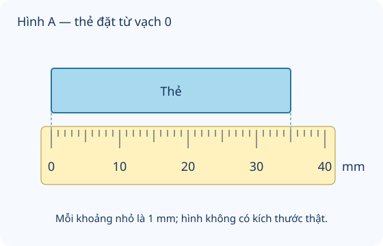

# Thực hành và trải nghiệm với các đơn vị mi-li-mét, gam, mi-li-lít, độ C

Nguồn tham khảo: Toán 3 KNTT, tập 1, trang 93-94.

Trạng thái: AI biên soạn và rà soát; chưa có xác nhận của giáo viên.

## Mục tiêu

- Chọn dụng cụ và đơn vị phù hợp cho độ dài, khối lượng, dung tích, nhiệt độ.
- Thực hành đo và đọc số, giải thích sai số do đặt dụng cụ chưa đúng.

## Khám phá

Mỗi dụng cụ giúp đo một đại lượng. Trước khi làm phép tính, cần biết số đo thuộc đại lượng nào, dùng đơn vị gì và đọc được bằng cách nào. Kết quả đo thật có thể khác giữa các vật; không lấy kích thước hình trên màn hình làm kích thước vật thật.

- Thước chia mm đo độ dài; cân đo khối lượng g hoặc kg; ca chia ml đo dung tích; nhiệt kế đo nhiệt độ °C.
- Đặt một đầu vật ở vạch 0 khi đo độ dài. Nếu lệch 0, lấy số cuối trừ số đầu.
- Cân cần ở trạng thái cân bằng hoặc ổn định. Tính đủ khối lượng quả cân; nếu hỏi ruột vật, trừ vỏ.
- Đọc ca ở mặt phẳng ngang, mắt ngang mực nước; phân biệt lượng hiện có với dung tích tối đa.
- Đổi cùng đơn vị trước khi so sánh hoặc tính; không đổi g thành ml chỉ bằng giữ nguyên số.

## Hướng dẫn

1. Xác định đại lượng cần đo và chọn dụng cụ.
2. Kiểm tra vạch chia, đơn vị, cách đặt dụng cụ.
3. Đo rồi ghi cả số và đơn vị.
4. Đo lại nếu cách đặt sai hoặc kết quả bất thường; giải thích cách tính khi cần.

## Lỗi thường gặp

- Lẫn mm, g, ml và °C.
- Để thước lệch 0 nhưng vẫn lấy số đầu cuối như thể bắt đầu tại 0.
- Coi lượng nước hiện có là dung tích tối đa.
- Chép số đo mà bỏ đơn vị.

## Ví dụ

Một vật bắt đầu ở vạch 8 mm và kết thúc ở 37 mm. Vật dài bao nhiêu?

1. 37 - 8 = 29.
2. Ghi 29 mm, không ghi 37 mm.

Cân thăng bằng: lọ và hạt ở trái, tổng quả cân 460 g ở phải; lọ rỗng 60 g. Hạt nặng bao nhiêu?

1. Cả lọ và hạt nặng 460 g.
2. 460 - 60 = 400. Riêng hạt nặng 400 g.

## Hình minh họa

## Thực hành với dụng cụ

### Bốn trạm đo tại nhà

Dụng cụ: Thước có mm, Cân hoặc gói có ghi khối lượng, Ca chia ml, Nhiệt kế đo không khí nếu có, Giấy bút.

1. Trạm 1: đo một chiếc tẩy bằng mm, đặt đầu tại 0; ghi kết quả.
2. Trạm 2: cân một đồ vật nhẹ hoặc đọc nhãn khối lượng của gói, ghi số và g.
3. Trạm 3: đọc lượng nước trong ca, ghi số và ml, không rót quá sức chứa.
4. Trạm 4: nhờ người lớn hỗ trợ đọc nhiệt kế không khí; nếu thiếu dụng cụ thì ghi chưa thực hiện, không đoán số.

Tự kiểm tra:

- Mỗi dòng có tên vật/địa điểm, số và đơn vị đúng.
- Nêu được dụng cụ và cách đọc; phân biệt số đo thật với dữ liệu mô phỏng trên web.

## Ngân hàng câu hỏi

### Câu 1 - nhan_biet

Cần đo chiều dài chiếc kẹp giấy. Chọn đơn vị thích hợp: mm, g, ml, °C.

A. mm; B. g; C. ml; D. °C

Đáp án: mm. Lời giải: Chiều dài là đại lượng đo bằng mm.

### Câu 2 - nhan_biet

Cần cân một túi hạt nhỏ. Chọn đơn vị: g, mm, ml, °C.

Đáp án: g. Lời giải: Gam dùng đo khối lượng.

### Câu 3 - nhan_biet

Cần đong lượng nước trong cốc. Chọn đơn vị: ml, mm, g, °C.

A. ml; B. mm; C. g; D. °C

Đáp án: ml. Lời giải: Mi-li-lít dùng đo dung tích.

### Câu 4 - nhan_biet

Cần ghi mức nóng lạnh trong phòng. Chọn đơn vị: °C, mm, g, ml.

Đáp án: °C. Lời giải: Độ C là đơn vị nhiệt độ.

### Câu 5 - nhan_biet

Một mét bằng mấy mm?

A. 1000; B. 100; C. 10; D. 1

Đáp án: 1000. Lời giải: 1 m bằng 1000 mm.

### Câu 6 - nhan_biet

Một ki-lô-gam bằng mấy gam?

Đáp án: 1000. Lời giải: 1 kg bằng 1000 g.

### Câu 7 - nhan_biet

Một lít bằng mấy ml?

A. 1000; B. 100; C. 10; D. 1

Đáp án: 1000. Lời giải: 1 l bằng 1000 ml.

### Câu 8 - nhan_biet

Đo nhiệt độ dùng dụng cụ nào?

Đáp án: nhiệt kế. Lời giải: Nhiệt kế dùng đo nhiệt độ.

### Câu 9 - nhan_biet

Cân thăng bằng mới so được hai bên có khối lượng bằng nhau không? Trả lời có hoặc không.

A. có; B. không; C. luôn bằng nhau; D. chỉ nhìn màu

Đáp án: có. Lời giải: Khi cân thăng bằng, tổng khối lượng hai bên bằng nhau.

### Câu 10 - nhan_biet

Khi đọc thước, nên đặt một đầu vật ở vạch mấy?

Đáp án: 0. Lời giải: Đặt ở vạch 0 giúp đọc trực tiếp độ dài đầu còn lại.

### Câu 11 - thong_hieu

Hình A: chiếc thẻ từ 0 đến 35 mm. Thẻ dài mấy mm?

A. 35; B. 30; C. 40; D. 3

Đáp án: 35. Lời giải: Đầu trái ở 0, đầu phải ở 35; 35 - 0 = 35 mm.

### Câu 12 - thong_hieu

Hình A: mỗi khoảng nhỏ dài 1 mm. Từ vạch 30 đến cuối thẻ có mấy khoảng?

Đáp án: 5. Lời giải: 35 - 30 = 5 khoảng 1 mm.

### Câu 13 - thong_hieu

Nhãn hộp ghi 250 g, bạn chép 250 ml. Bạn đã đổi sai đại lượng nào? Chọn khối lượng hoặc độ dài.

A. khối lượng; B. độ dài; C. nhiệt độ; D. thời gian

Đáp án: khối lượng. Lời giải: 250 g chỉ khối lượng, không thể tự đổi thành dung tích ml.

### Câu 14 - thong_hieu

Một ca có vạch 100, 200, 300 ml đều nhau. Mực nước giữa 200 và 300. Có mấy ml?

Đáp án: 250. Lời giải: Giữa 200 và 300 là 250 ml.

### Câu 15 - thong_hieu

Có các quả cân 500 g, 200 g, 200 g, 100 g. Tổng bằng mấy gam?

A. 1000; B. 900; C. 800; D. 1100

Đáp án: 1000. Lời giải: 500 + 200 + 200 + 100 = 1000 g, đúng 1 kg.

### Câu 16 - thong_hieu

Một vật bắt đầu ở vạch 9 mm và kết thúc ở 41 mm. Dài mấy mm?

Đáp án: 32. Lời giải: 41 - 9 = 32 mm.

### Câu 17 - thong_hieu

Nhiệt kế chỉ 26 °C, ngày sau tăng 2 độ. Ghi mấy °C?

A. 28; B. 24; C. 52; D. 30

Đáp án: 28. Lời giải: 26 + 2 = 28 °C.

### Câu 18 - thong_hieu

Túi 700 g, hộp 1 kg. Hộp nặng hơn mấy gam?

Đáp án: 300. Lời giải: 1 kg bằng 1000 g; 1000 - 700 = 300 g.

### Câu 19 - thong_hieu

Đo một vật ba lần được 32, 32, 40 mm; lần cuối đặt sai vạch 0. Có nên kiểm tra lại lần cuối không? Trả lời có hoặc không.

A. có; B. không; C. chọn số lớn nhất; D. cộng ba số

Đáp án: có. Lời giải: Kết quả lệch và cách đặt sai nên cần đo lại đúng vạch.

### Câu 20 - thong_hieu

Ca tối đa 500 ml đang chứa 300 ml. Dung tích tối đa có thay đổi thành 300 ml không? Trả lời có hoặc không.

Đáp án: không. Lời giải: 300 ml là lượng đang có; sức chứa tối đa vẫn là 500 ml.

### Câu 21 - van_dung

Có hai ca chứa 120 ml và 280 ml. Gộp lại mấy ml?

A. 400; B. 160; C. 300; D. 500

Đáp án: 400. Lời giải: 120 + 280 = 400 ml.

### Câu 22 - van_dung

Có ba ca 150 ml, 250 ml, 350 ml. Chọn hai ca để có 500 ml. Ca 150 ml cần ghép với ca mấy ml?

Đáp án: 350. Lời giải: 150 + 350 = 500 ml.

### Câu 23 - van_dung

Cần 1 kg hạt; đã đặt quả cân 500 g và 200 g. Cần thêm mấy gam quả cân?

A. 300; B. 700; C. 200; D. 500

Đáp án: 300. Lời giải: 500 + 200 = 700; 1000 - 700 = 300 g.

### Câu 24 - van_dung

Tấm bìa 8 cm, cần cắt còn 65 mm. Cắt bớt mấy mm?

Đáp án: 15. Lời giải: 8 cm bằng 80 mm; 80 - 65 = 15 mm.

### Câu 25 - van_dung

Hai ngày đo cùng giờ được 25 °C và 29 °C. Chênh nhau mấy độ C?

A. 4; B. 54; C. 3; D. 5

Đáp án: 4. Lời giải: 29 - 25 = 4 độ C.

### Câu 26 - van_dung

Bình 1 l, rót đầy hai ca 300 ml mỗi ca. Bình còn mấy ml?

Đáp án: 400. Lời giải: 300 × 2 = 600; 1000 - 600 = 400 ml.

### Câu 27 - van_dung

Lọ rỗng 90 g, cả lọ và hạt 390 g. Hạt nặng mấy gam?

A. 300; B. 480; C. 390; D. 90

Đáp án: 300. Lời giải: 390 - 90 = 300 g.

### Câu 28 - van_dung

Bốn dây bằng nhau có tổng 96 mm. Mỗi dây dài mấy mm?

Đáp án: 24. Lời giải: 96 : 4 = 24 mm.

### Câu 29 - van_dung

Có 450 ml cần rót vào các cốc tối đa 200 ml. Ít nhất mấy cốc?

A. 3; B. 2; C. 4; D. 1

Đáp án: 3. Lời giải: Hai cốc chứa 400 ml, 50 ml còn lại cần cốc thứ 3.

### Câu 30 - van_dung

Một thẻ dài 3 cm 4 mm. Thẻ kia dài 29 mm. Thẻ đầu dài hơn mấy mm?

Đáp án: 5. Lời giải: 3 cm 4 mm bằng 34 mm; 34 - 29 = 5 mm.

### Câu 31 - van_dung

Cân thăng bằng, túi và 50 g bằng 400 g. Túi nặng mấy gam?

A. 350; B. 450; C. 400; D. 50

Đáp án: 350. Lời giải: 400 - 50 = 350 g.

### Câu 32 - van_dung

Mỗi lượt đong 125 ml. Bốn lượt được mấy ml?

Đáp án: 500. Lời giải: 125 × 4 = 500 ml.

### Câu 33 - van_dung

Nhiệt độ 20 °C tăng 5 độ rồi giảm 3 độ. Cuối cùng mấy °C?

A. 22; B. 28; C. 18; D. 12

Đáp án: 22. Lời giải: 20 + 5 = 25; 25 - 3 = 22 °C.

### Câu 34 - van_dung

Có 600 g đậu chia đều 4 túi. Hai túi nặng tổng mấy gam?

Đáp án: 300. Lời giải: 600 : 4 = 150; 150 × 2 = 300 g.

### Câu 35 - van_dung

Thanh gỗ dài 1 m, cắt 280 mm và 320 mm. Còn mấy mm?

A. 400; B. 600; C. 680; D. 720

Đáp án: 400. Lời giải: 280 + 320 = 600; 1000 - 600 = 400 mm.

### Câu 36 - van_dung

Có 720 ml, lượng rót ra bằng ban đầu giảm 3 lần. Còn mấy ml?

Đáp án: 480. Lời giải: 720 : 3 = 240; 720 - 240 = 480 ml.

### Câu 37 - van_dung

Một vật cân cả hộp 650 g, hộp 150 g. Chia vật bên trong đều 5 phần, mỗi phần mấy gam?

A. 100; B. 130; C. 500; D. 160

Đáp án: 100. Lời giải: 650 - 150 = 500; 500 : 5 = 100 g.

### Câu 38 - van_dung

Cần hai dây dài 45 mm và 55 mm. Tổng bằng mấy cm?

Đáp án: 10. Lời giải: 45 + 55 = 100 mm; 100 : 10 = 10 cm.

### Câu 39 - van_dung

Ba ca chứa 200, 300, 400 ml. Đổ hết vào bình tối đa 1 l thì còn thiếu mấy ml mới đầy?

A. 100; B. 900; C. 200; D. 300

Đáp án: 100. Lời giải: 200 + 300 + 400 = 900; 1000 - 900 = 100 ml.

### Câu 40 - van_dung

Một tuần ghi các mức cùng giờ 27, 25, 28 °C trong ba ngày. Mức cao nhất hơn thấp nhất mấy độ C?

Đáp án: 3. Lời giải: 28 - 25 = 3 độ C.

## Trò chơi

Ghép kết quả trạm đo: Ghép tình huống thực hành với số đo, đơn vị và phép tính thích hợp.

- Mỗi lượt chọn 5 câu có 5 đáp án khác nhau.
- Chọn câu hỏi bên trái rồi đáp án bên phải. Sai thì thử lại.
- Mỗi cặp đúng 10 điểm; tối đa 50 điểm.

## Đánh giá

Đúng lần đầu: 1 điểm; đúng sau một gợi ý: 0,5 điểm. Từ 90%: 3 sao; từ 60%: 2 sao; còn lại: 1 sao.

Xem lời giải các câu sai, đọc lại quy tắc, rồi làm một lượt mới.
